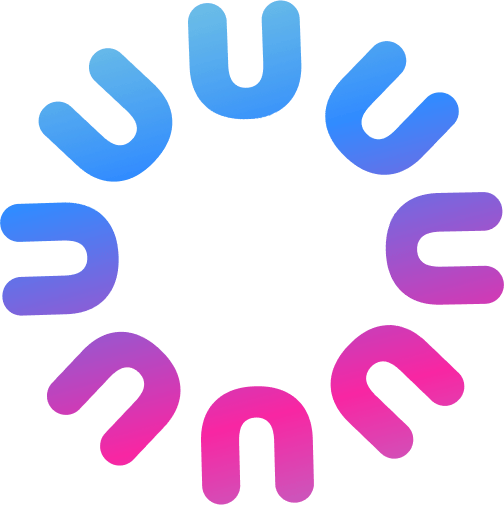

  

<h1 align="center">Unitalk Desktop </h1>

  <b>El Colaborador IA que crece con su empresa. Impulsado por Hermes.</b>

  
  
  
  

  
  
  
  
  

---

## Descripción general

**Unitalk Desktop** es la distribución profesional oficial de [Hermes Agent](https://github.com/NousResearch/hermes-agent) desarrollado por [Nous Research](https://nousresearch.com).

Mientras que Hermes estándar está orientado a desarrolladores mediante comandos de terminal, **Unitalk Desktop** empaqueta todo este poder en una aplicación instalable en 1 clic (`.exe` y `.dmg`), diseñada para empresas, directivos y equipos profesionales.

### Propuesta de valor

| Necesidad empresarial | Hermes Agent Vanilla | Unitalk Desktop |
| :--- | :--- | :--- |
| **Instalación** | Requiere comandos de terminal `curl \| bash` | **Instaladores en 1 clic para Windows (`.exe`) y macOS (`.dmg`)** |
| **Identidad** | Indicador de terminal anónimo | **Colaborador con nombre propio elegido por la empresa** |
| **Multimodal** | Subagentes fragmentados | **Módulos nativos integrados: Chat, Imágenes, Vídeos, Reuniones** |
| **Autenticación** | Usuario local aislado | **Inicio de sesión profesional fluido (Google Workspace, M365, Email)** |
| **Enrutamiento IA y Facturación** | Múltiples claves API manuales | **Unitalk AI Gateway (LiteLLM) con 10.000 créditos de prueba (€5)** |
| **Habilidades de Negocio** | Redacción manual de prompts | **Tienda de habilidades gratuitas ([`unitalk.ai/home/marketplace/`](https://unitalk.ai/home/marketplace/profils-metier))** |
| **Propiedad de los datos** | Proceso efímero en el equipo | **Activo corporativo duradero (memoria Honcho, bases Qdrant)** |

---

## Descarga e Instalación

👉 **[Descargar Unitalk Desktop para Windows y macOS](https://unitalk.ai/download)**

- **Windows**: Descargue y ejecute `Unitalk Setup.exe`.
- **macOS**: Descargue `Unitalk.dmg`, arrastre a Aplicaciones y ejecute.

---

## Licencia

Distribuido bajo licencia **MIT**. Consulte [LICENSE](LICENSE) para más detalles.
