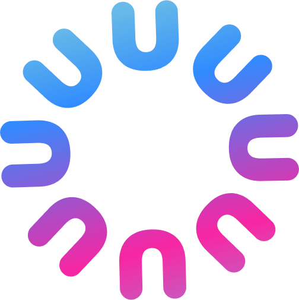

<p align="center">
  <a href="https://unitalk.ai">
    
  </a>
</p>

<h1 align="center">Unitalk Desktop/h1>

<p align="center">
  <b>The AI Collaborator that grows with your enterprise. Powered by Hermes.</b>
</p>

<p align="center">
  <a href="https://unitalk.ai"></a>
  <a href="https://github.com/unitalkai/unitalk-desktop/blob/main/LICENSE"></a>
  <a href="https://github.com/NousResearch/hermes-agent"></a>
  <a href="https://unitalk.ai/home/marketplace/profils-metier"></a>
</p>

---

## Overview

**Unitalk Desktop** is the official enterprise distribution of [Hermes Agent](https://github.com/NousResearch/hermes-agent) developed by [Nous Research](https://nousresearch.com).

**Unitalk Desktop** packages the engine into a turn-key, 1-click installable application tailored for companies, executives, and business teams.

### Core Value Proposition

| Enterprise Need | Vanilla Hermes Agent | Unitalk Desktop |
| :--- | :--- | :--- |
| **Onboarding** | Requires terminal `curl \| bash` | **1-click signed installers (`.exe` & `.dmg`)** |
| **Identity** | Anonymized CLI bot prompt | **Single embodied Collaborator with customer-chosen name** |
| **Multimodal** | Fragmented sub-agents | **Built-in modules: Chat, Images, Videos, Meetings** |
| **Authentication** | Local terminal single-user | **Native Clerk SSO (Google Workspace, M365, Corporate email)** |
| **AI Routing & Billing** | Multiple manual API keys or Nous Portal | **Unitalk AI Gateway (LiteLLM) with 10,000 free trial credits (€5)** |
| **Business Skills** | Manual prompt scripting | **Free Business Expertises Store (`unitalk.ai/home/marketplace/`)** |
| **Data Ownership** | Local ephemeral workstation process | **Corporate asset (Honcho persistent memory, Qdrant KB)** |

---

## Key Capabilities (Phase 1)

1. **Embodied Identity (Single Persona)**:
   - Your AI Collaborator has a single first name chosen by your organization (*Emma*, *Thomas*, etc.).
   - No confusing sub-personas: specialized tasks are handled through native capability tabs (**Images**, **Videos**, **Meetings**).

2. **Pre-Provisioned AI Gateway**:
   - Access top frontier models (OpenAI, Anthropic, Google, open-source) through a unified, optimized gateway powered by LiteLLM.
   - Every install includes **10,000 free trial credits (€5)** to test immediately without entering credit card details.

3. **Enterprise Authentication**:
   - Built-in Clerk SSO allows users to log in with their work accounts and link their Collaborator to their company profile.

4. **Business Expertises Store**:
   - Upgrade your Collaborator's capabilities in 1 click from the [Marketplace](https://unitalk.ai/home/marketplace/profils-metier):
     - **Sales & BD**: SDR, Account Executive, Sales Director, Key Account Manager.
     - **Administration**: Executive Assistant, Administrative Manager.
     - **Leadership & Strategy**: CEO Chief of Staff, Market & Competitive Intelligence.

---

## Download & Installation

### For End-Users & Customers

Direct 1-click downloads are available on the official portal:

👉 **[Download Unitalk Desktop for Windows & macOS](https://unitalk.ai/download)**

- **Windows**: Download and run `Unitalk-Desktop-Setup.exe`.
- **macOS**: Download `Unitalk-Desktop.dmg`, drag to Applications, and launch.

---

### For Developers & Contributors

To run and build the desktop application locally from source:

```bash
# 1. Clone the repository
git clone https://github.com/unitalkai/unitalk-desktop.git
cd unitalk-desktop

# 2. Switch to the distribution branch
git checkout distribution/unitalk

# 3. Install workspace dependencies
pnpm install

# 4. Run the desktop application in development mode
pnpm --filter @hermes/desktop dev
```

---

## Upstream Tracking & License

Unitalk Desktop is a downstream distribution of [NousResearch/hermes-agent](https://github.com/NousResearch/hermes-agent).

- **Clean Distribution Model**: We do not hard-fork or patch the core Python agent loop. Upstream updates from Nous Research are continuously merged via `upstream/main`.
- **License**: Released under the **MIT License**. See the [LICENSE](LICENSE) file for complete upstream copyright notices.

---

*Built with ❤️ by [Unitalk](https://unitalk.ai) · Powered by [Hermes Agent](https://github.com/NousResearch/hermes-agent) by Nous Research.*
