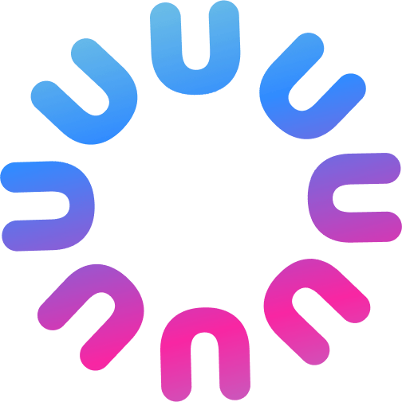

  

<h1 align="center">Unitalk Desktop ☤</h1>

  <b>伴随企业共同成长的 AI 协作者 · 由 Hermes 强力驱动</b>

  
  
  
  

  
  
  
  
  

---

## 概述

**Unitalk Desktop** 是基于 [Nous Research](https://nousresearch.com) 开发的开源 [Hermes Agent](https://github.com/NousResearch/hermes-agent) 打造的官方企业桌面发行版。

原版 Hermes 主要是面向开发者、通过终端命令行配置的智能体；而 **Unitalk Desktop** 将其封装为一个面向企业管理人员与业务团队、支持一键安装运行的桌面应用程序（`.exe` 与 `.dmg`）。

### 核心价值对比

| 业务需求 | 原版 Hermes Agent | Unitalk Desktop |
| :--- | :--- | :--- |
| **上手门槛** | 需要终端运行 `curl \| bash` 命令行 | **Windows (`.exe`) 与 macOS (`.dmg`) 官方一键安装包** |
| **角色身份** | 终端中的匿名提示词机器人 | **具备独立具象化身份的 AI 协作者（企业自定义专属姓名）** |
| **多模态能力** | 割裂的子代理配置 | **原生集成能力模块：对话、图像设计、视频创作、会议纪要** |
| **企业认证** | 仅限单机本地无状态运行 | **企业级统一认证 SSO（Google Workspace、Microsoft 365、企业邮箱）** |
| **AI 路由与计费** | 需手动申请配置多个海外服务商 API Key | **Unitalk AI Gateway（基于 LiteLLM），首发赠送 10,000 免费试用点数 (€5)** |
| **业务技能** | 手动编写复杂的提示词脚本 | **免费业务技能市场，一键赋能（[`unitalk.ai/home/marketplace/`](https://unitalk.ai/home/marketplace/profils-metier)）** |
| **数据资产** | 随终端关闭而丢失的易失进程 | **企业数字化永久资产（Honcho 长期记忆、Qdrant 知识库）** |

---

## 下载与安装

👉 **[前往官网下载 Unitalk Desktop（Windows / macOS）](https://unitalk.ai/download)**

- **Windows**：下载并运行 `Unitalk Setup.exe`。
- **macOS**：下载 `Unitalk.dmg`，拖入 Applications 文件夹即可启动。

---

## 开源协议

遵循 **MIT 开源协议**。详情请参阅 [LICENSE](LICENSE) 文件。
