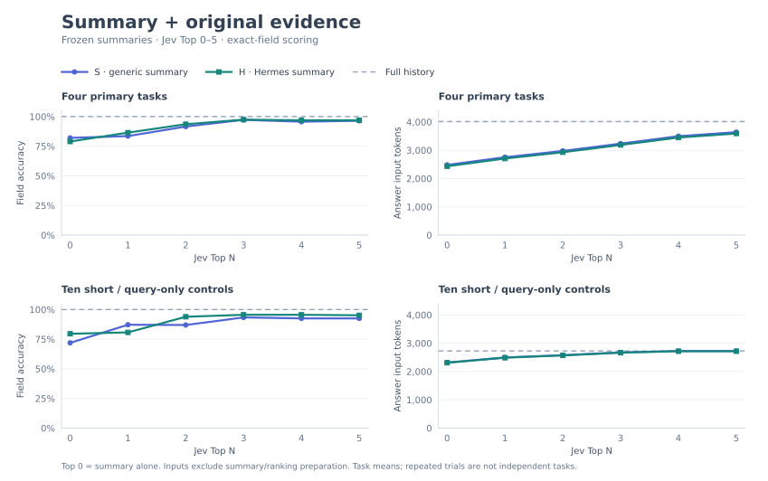

# Summary and original evidence: results

**Appending Jev-selected originals improved both frozen summaries on the four primary tasks.**
S rose from **82.0% to 97.2%**, and H from **79.0% to 97.4%**, at Top 3.
Mean answering inputs were **19.4% / 20.6% shorter** than Full for S/H.

[Experimental setting and reproduction](../STUDY.md). All **546 contexts / 1,092 answers**
completed and passed the recorded input ceilings. Each task has equal weight.
Input tokens are actual answer-call usage, excluding summary/ranking preparation.

## Four primary tasks

| Jev Top N | S accuracy | H accuracy | S input tokens | H input tokens |
| --- | ---: | ---: | ---: | ---: |
| Full history | 100.0% | 100.0% | 4,014 | 4,014 |
| 0 | 82.0% | 79.0% | 2,481 | 2,435 |
| 1 | 83.5% | 86.5% | 2,754 | 2,708 |
| 2 | 91.6% | 93.5% | 2,976 | 2,930 |
| 3 | 97.2% | 97.4% | 3,234 | 3,188 |
| 4 | 95.7% | 96.9% | 3,496 | 3,450 |
| 5 | 96.5% | 96.9% | 3,639 | 3,593 |

Top 0 is summary alone. Top 4–5 did not improve on Top 3 in this cohort.
These point estimates support evidence supplementing the summaries; they do not
attribute all gains specifically to Jev ranking or establish an optimal N.

Ten short-source / query-only controls

| Jev Top N | S accuracy | H accuracy | S input tokens | H input tokens |
| --- | ---: | ---: | ---: | ---: |
| Full history | 100.0% | 100.0% | 2,727 | 2,727 |
| 0 | 71.9% | 79.6% | 2,318 | 2,309 |
| 1 | 87.2% | 80.7% | 2,496 | 2,488 |
| 2 | 86.9% | 93.9% | 2,577 | 2,568 |
| 3 | 93.3% | 95.6% | 2,674 | 2,665 |
| 4 | 92.5% | 95.6% | 2,725 | 2,716 |
| 5 | 92.5% | 95.1% | 2,725 | 2,716 |

All-fields-correct rates

An answer counts only when every requested field is correct.

| Jev Top N | Primary S | Primary H | Controls S | Controls H |
| --- | ---: | ---: | ---: | ---: |
| Full history | 100.0% | 100.0% | 100.0% | 100.0% |
| 0 | 8.3% | 25.0% | 41.7% | 45.0% |
| 1 | 12.5% | 41.7% | 70.0% | 60.0% |
| 2 | 50.0% | 58.3% | 80.0% | 83.3% |
| 3 | 83.3% | 79.2% | 90.0% | 90.0% |
| 4 | 70.8% | 75.0% | 90.0% | 90.0% |
| 5 | 75.0% | 75.0% | 90.0% | 88.3% |

The earlier frozen study reported S 82.0% → 99.5% and H 79.4% → 97.9%.
This fresh run reproduced the direction, not identical predictions. Temperature
zero does not guarantee immutable service weights or deterministic responses.

Run provenance and audit

- Hermes source at run start: `5ea04f26f9a9cb74613abf4efb9df628b004b2b8`; an implementation snapshot and hashes are retained with the local artifacts.
- Text model: `qwen3.8-max`, through Hermes auxiliary compression routing; thinking disabled, temperature zero.
- Jev: requested `jev-latest`, all 54 responses resolved to `jev-1.13.0`.
- 42 S summaries accepted after 45 length-check attempts; 42 H summaries accepted after 42 attempts. No answer-based retries.
- All 546 frozen contexts were checked for exact summary reuse, strict nested evidence prefixes and identical S/H selections.
- Every recorded answer was regraded offline; all grades and aggregates matched. No configured API keys were found in artifacts.
- Shared preparation plus answers: 1,179 Qwen calls, 3,197,729 input / 60,735 output tokens. The separate routing probe is excluded.
- Jev preparation: 54 calls, 77,799 input / 5,634 output tokens. No dollar-cost estimate is inferred from token counts.
- All 42 H-alone conditions were shorter than paired Full. Mean reductions do not imply that every fusion condition shortened its paired input.

Validation: **11 focused tests** passed through `scripts/run_tests.sh`; all **12 `scripts/check` groups** passed. The full repository test suite was not run. Raw histories, requests and responses remain outside Git.

Experiment adapted from [ReMe’s context compaction study](https://github.com/agentscope-ai/ReMe/blob/main/docs/en/context_compaction.md), reproduced independently in Hermes Agent.
