# petasos-finance-vault

A Hermes Agent skill for running a household-finance vault in Obsidian on a
ledger architecture:

- **Append-only JSONL ledger** as the single source of truth — every manual
  edit goes through a validated CLI (`python3 -m petasos.ledger add|relabel`);
  hand-editing the JSONL is disallowed
- **All intelligence is DATA you own**: `banks.yaml` (bank email formats) and
  `rules.md` (classification: auto-post / aggregate / needs-confirm /
  plumbing tiers, plus the §5 kind-routing table) live in your vault and
  shadow the bundled examples — the engine is generic and never user-edited
- **Bank alert emails** as the primary evidence source (AgentMail inbox,
  or any REST-compatible endpoint)
- **Arithmetic verification gates** (ID uniqueness, balances arithmetic,
  transaction chain, frozen months) that must pass after EVERY write —
  `--dry` previews everything and writes nothing
- **Frozen month closes**: preconditions enforced (gates green, zero
  needs-confirm), expense totals frozen immutably, full-ledger snapshot
  archived as a restore point
- **Concurrent-run safety**: live runs serialize on a lockfile; an
  overlapping run exits loudly instead of double-writing

Python 3.10+ stdlib + PyYAML (`pip install pyyaml`) — the only dependency,
and its absence fails loud by design.

## How it works

```mermaid
flowchart LR
    A["Bank alert emails"] -->|"REST fetch, dedupe by seen/subject/old_ref"| B["pipeline.py daily sync"]
    B -->|"banks.yaml adapters parse"| C{"Chain-verify:<br/>bal(n) = bal(n-1) -/+ amount<br/>(batched ± pair = one alert)"}
    C -->|"mismatch → append NOTHING,<br/>exit 1"| X["Parse bug or<br/>unalerted txn"]
    C -->|"ok"| D["Classify via rules.md<br/>§6 confirmed → never re-asked,<br/>§3a merchants, §1 patterns,<br/>§5 kind-routing tiers"]
    D -->|"auto tiers"| E["Append JSONL ledger<br/>(lockfile held; re-read verified)"]
    D -->|"unknown ≥ threshold<br/>/ mystery credit"| I["Digest asks the user ONCE"]
    I -->|"python3 -m petasos.ledger relabel<br/>status=posted, src=user-confirm"| E
    M["chat-reported item"] -->|"python3 -m petasos.ledger add"| E
    E --> F["balances.json synced<br/>(alerts authoritative; holds recorded, not rowed)"]
    F --> G["gen_views.py gates"]
    G -->|"ALL GATES PASS"| H["Dashboards + Salary History<br/>(generated — never hand-edited)"]
    G -->|"gate fails → exit 1"| Y["Pipeline aborts —<br/>fix the ledger first"]
    K["monthly_close.py YYYY-MM<br/>(gates green + zero needs-confirm)"] --> L["freeze closed_months.json<br/>+ archive snapshot to 4-Archives"]
```



## Use cases

| Use case | How it runs |
|---|---|
| Daily hands-off sync | Blueprint cron (07:00) or `scripts/pipeline.py` — fetch, parse, chain-verify, classify, append, digest, gates |
| Safe preview | `scripts/pipeline.py --dry` — prints the full plan and digest, writes NOTHING, marks nothing seen |
| "Spent 50k cash for coffee" in chat | `python3 -m petasos.ledger add ...` logs one posted row on the spot (never left for the cash true-up) |
| A row is mislabeled / a needs-confirm is answered | `python3 -m petasos.ledger relabel --set ...` — in-place, evidence fields untouchable, then gates re-run |
| Month close | `scripts/monthly_close.py 2026-09` — freezes the expense total, archives an immutable snapshot |
| "What's my balance / net worth / spend mix?" | Agent answers from `balances.json` + regenerated views — never from memory |
| New bank or mailbox | One entry in your vault's `banks.yaml` (verify with `--probe`, pin with a fixture + `--test`) — no code edits |

## Install

```bash
hermes skills install "nhutdm/petasos-finance-vault/"
pip install pyyaml
```

(The trailing slash matters: it tells Hermes the skill lives at the repo root
rather than in a subdirectory. Missing PyYAML is a loud error with the same
install hint, exit 2 — by design.)

## Quickstart

```bash
# 1. Scaffold the vault (idempotent, never overwrites; create the vault dir first)
python3 scripts/init_vault.py /path/to/your/vault

# 2. Dry-run the daily sync (writes nothing, marks nothing seen)
PETASOS_VAULT=/path/to/your/vault PETASOS_INBOX=you@example.com \
AGENTMAIL_API_KEY=xx python3 scripts/pipeline.py --dry

# 3. Regenerate views + run all gates (exit 0 iff ALL GATES PASS)
PETASOS_VAULT=/path/to/your/vault python3 scripts/gen_views.py
```

Then: edit the scaffolded `balances.json` (real accounts — one synthetic
placeholder per kind is shown), `rules.md` (your merchant patterns and §5
kind routing), and `banks.yaml` (your banks' email formats — the vault copy
shadows the skill's bundled examples, so skill updates never touch your
data), and accept the daily-sync blueprint via `/suggestions`.

### Email prerequisites

The pipeline syncs transactions from **bank alert emails** fetched over a
REST API (AgentMail by default — set `PETASOS_API_BASE` for another
compatible endpoint):

- Your bank must send per-transaction alert emails (parsers ship as worked
  examples for three Vietnamese banks / six formats; the engine itself is
  bank-agnostic).
- Point those alerts at your REST-reachable inbox and set `PETASOS_INBOX` +
  `AGENTMAIL_API_KEY`.
- Other banks: add an entry to your vault's `banks.yaml` — copy a worked
  example, then verify with `python3 scripts/bank_adapters.py --probe
  <email.txt>` (per-field MATCH/MISS report; a MISS line is the dead regex)
  and keep `--test` green by saving that email under `fixtures/` beside it.
  No code edits.

## Exit codes (the contract)

| Command | 0 | 1 | 2 | 3 |
|---|---|---|---|---|
| `scripts/pipeline.py` | ok, or fetch skipped | chain break / gates failed | config error | another run holds the lock |
| `scripts/gen_views.py` | ALL GATES PASS | gate failure | config/input fatal | — |
| `scripts/monthly_close.py [YYYY-MM]` | frozen or verified | refused (red gates, open needs-confirm, freeze drift) | usage/config fatal | — |
| `python3 -m petasos.ledger add\|relabel` | appended / relabeled | — | validation error (file untouched) | — |
| `scripts/bank_adapters.py --probe` | some format matched | no format matched | config error | — |

See SKILL.md → "Daily Operations" for the full canonical command list and
procedures (manual edits, confirmations, month close, adding a bank).

## Adapting to your setup

Designed to be country- and bank-agnostic, and every knob is env or data —
never a source edit:

- **Currency** — `PETASOS_CURRENCY` (default `VND`); amounts are plain
  integers; threshold is a plain number in your currency.
- **Your banks** — `banks.yaml` in your vault, shadowing the bundled
  examples (`$PETASOS_BANKS` overrides everything; a missing explicit path
  is a LOUD error).
- **Your merchants** — `rules.md` tables (§1 patterns, §3a merchants, §5
  kind routing), no code.
- **Your mailbox** — any REST-reachable alert inbox; `PETASOS_API_BASE` +
  `PETASOS_INBOX`.
- **Your layout** — `PETASOS_LEDGER_DIR` if you don't use the PARA default.

See SKILL.md → "Adapting to Your Setup" for the full knob table.

## Privacy

This repository is a public generic engine: it must never contain real
account numbers, names, IPs, card fragments, or private deployment details.
Bundled banks/rules are worked examples only; your real data lives in your
vault, which is yours and stays outside the repo.

## License

MIT — see [LICENSE](LICENSE).
