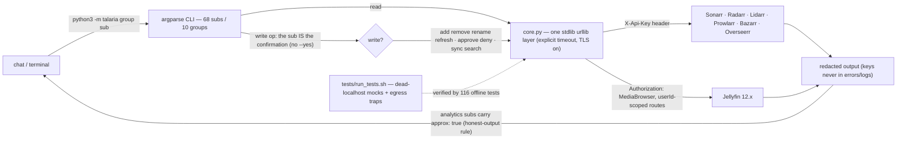

# talaria-media-suite

A Hermes Agent skill for controlling a self-hosted media stack — **Sonarr,
Radarr, Lidarr, Prowlarr, Bazarr, Overseerr, Jellyfin** at one LAN host —
from the terminal:

- **Stdlib-only Python 3.8+** — no pip, no venv, no third-party imports;
  every network call goes through ONE urllib layer with an explicit timeout
  and TLS always on
- **Secrets enter only via environment variables** — never argv, never logs,
  never error messages; a redaction layer strips the contacted service's key
  from every error path (pinned by tests)
- **Jellyfin speaks its 12.x reality** — `Authorization: MediaBrowser` auth,
  userId-scoped `/Items` routes, PascalCase `ItemCounts`; every
  live-behavior bug fixed to date became a fixture pinned to the observed
  API shape as a permanent regression trap
- **Write ops are explicit-invocation only** — `add remove rename refresh ·
  search · add-app sync · approve deny · jellyfin refresh`; the sub itself is
  the confirmation, there is no `--yes` flag
- **Honest-output rule** — Jellyfin core has no session-grain history, so the
  analytics subs are labeled approximations in every output mode
  (`"approx": true` in `--json`)
- **Offline test harness** — dead-localhost mocks with egress traps (queries
  with `api_key=`, legacy `X-Emby-Token`, `/emby/` prefixes are rejected on
  arrival): 116 tests, no live services needed
- **LAN-only egress** — the skill makes no internet calls at all; no config
  files, no token files, no OAuth flows

## What Can It Do?

| Category | Capabilities |
|----------|-------------|
| **Setup & Diagnostics** | Host auto-discovery, guided key recovery (`setup`), per-service health badges with the services' own warnings (`status`), root-cause triage (`diagnose`) |
| **Library Analytics** | Stats, quality profiles, missing content, unmonitored, disk usage, genre / year / studio distributions, recently added |
| **Viewing & Jellyfin** | Live sessions, continue watching, next up, latest additions, activity log, user listing; watch history / most-watched / play-totals as clearly-labeled approximations (Jellyfin core has no session-grain history) |
| **Content Management** | Lookup / add / remove / rename / refresh for series and movies (writes are explicit-invocation), calendars, wanted lists, history |
| **Request Handling** | Overseerr request listing, approve / deny workflows, per-request info, stats |
| **Subtitles** | Bazarr wanted / history / languages, on-demand search |
| **Indexer Management** | Prowlarr indexer listing and testing, stats, cross-app sync targets, manual search, logs |
| **Queue Monitoring** | Cross-service download queue snapshot (Sonarr · Radarr · Lidarr) |
| **Dashboards** | Self-contained HTML dashboard generation (absolute path delivered) |

---
## How it works



```
talaria/            __main__.py (CLI) · core.py (HTTP + env + redaction)
                    sonarr radarr lidarr prowlarr bazarr overseerr jellyfin
                    library (cross-service analytics) · ops · dashboard
tests/              mock_server (egress traps) · harness · fixtures (live-shape)
```

## Use cases

| Use case | How it runs |
|---|---|
| Stack health / troubleshooting | `python3 -m talaria status` then `diagnose` — per-service badge table with the services' own health warnings |
| First run on a new host | `python3 -m talaria setup <host>` — recovers the *arr keys via the services' public bootstrap endpoint and prints an export block (capture to a 0600 file) |
| Library analytics | `library stats\|quality\|missing\|disk …`, `jellyfin counts\|latest …` |
| Approve or deny a request | `overseerr list` → `overseerr approve\|deny <id>` (explicit write) |
| Add / rename / refresh content | `sonarr\|radarr add\|rename\|refresh` (explicit writes; the API confirmation is echoed) |
| Dashboard artifact | `python3 -m talaria dashboard out.html` — writes the file, prints the absolute path |
| Verify an install | `tests/run_tests.sh` — 116 offline tests; ALL GREEN = the full tier set passed inside the dead-proxy harness |

## Install

```bash
hermes skills install "nhutdm/talaria-media-suite/"
```

(The trailing slash matters: it tells Hermes the skill lives at the repo root
rather than in a subdirectory. While the repo is private, copy the tree into
`<HERMES_HOME>/skills/talaria-media-suite/` instead — unauthenticated
installs cannot read private repos.)

## Quickstart

```bash
# 1. Point at your stack; recovers the arr keys, prints an export block
python3 -m talaria setup 192.168.1.100

# 2. Capture the block to a 0600 env file, add JELLYFIN_KEY
#    (Jellyfin Dashboard -> API Keys), then:
set -a && source /path/to/env && set +a

# 3. Health pass
python3 -m talaria status

# 4. Read something real
python3 -m talaria jellyfin sessions
python3 -m talaria library stats
```

### Start using it

Then just talk to your agent naturally:

- *"Is my media stack healthy?"*
- *"Show me what's downloading right now"*
- *"What movies were added this week?"*
- *"What's missing from my TV library?"*
- *"How much disk space does my library use?"*
- *"Who's watching something right now?"*
- *"What should we watch next?"*
- *"Which episodes are missing subtitles?"*
- *"Approve the pending Overseerr requests"* (explicit write — the agent runs `overseerr approve`)
- *"Generate a dashboard of my media library"*

## Supported Services

| Service | Default port | Module |
|---------|--------------|--------|
| Sonarr | 8989 | `talaria/sonarr.py` |
| Radarr | 7878 | `talaria/radarr.py` |
| Lidarr | 8686 | `talaria/lidarr.py` |
| Prowlarr | 9696 | `talaria/prowlarr.py` |
| Bazarr | 6767 | `talaria/bazarr.py` |
| Overseerr | 5055 | `talaria/overseerr.py` |
| Jellyfin | 8096 | `talaria/jellyfin.py` |

Cross-service modules (`library.py`, `ops.py`, `dashboard.py`) ride on top of
these; every port is overridable via `<SERVICE>_PORT`.
### Service prerequisites

- The seven services at one host, each key exported: `TALARIA_HOST` +
  `SONARR_KEY RADARR_KEY LIDARR_KEY PROWLARR_KEY BAZARR_KEY OVERSEERR_KEY
  JELLYFIN_KEY`. Every var degrades gracefully per service — a missing key
  exits 1 naming the var, zero requests sent.
- Optional per-service port overrides `<SERVICE>_PORT`
  (defaults 8989 · 7878 · 8686 · 9696 · 6767 · 5055 · 8096).
- `setup` prints recovered keys in its export block by design (capture to a
  0600 file); no other sub prints key material.

## Exit codes (the contract)

| Command shape | 0 | 1 | 2 |
|---|---|---|---|
| any `python3 -m talaria …` | ok | any talaria error — one stderr line, `talaria:` prefix, keys redacted | usage |

## Adapting to your setup

Every knob is env or flag — never a source edit:

- **Host** — `TALARIA_HOST` (or one-shot `--host H`).
- **Ports** — `<SERVICE>_PORT` overrides with stock defaults.
- **Timeouts** — `--timeout N` per run (default 10 s).
- **Machine output** — `--json` (approximation subs carry `"approx": true`).
- **Docs per sub** — `python3 -m talaria <group> <sub> --help` (never
  env-gated).

See SKILL.md → "Prerequisites" / "Quick Reference" for the full surface.

## Privacy

This repository must never contain real hosts, API keys, or household
identities: test fixtures are synthetic payloads pinned to live-API SHAPES
(field names, casing, route structure), not captures of real libraries, and
the structural test tier enforces the forbidden-pattern list on every file.

## License

MIT — see [LICENSE](LICENSE).
