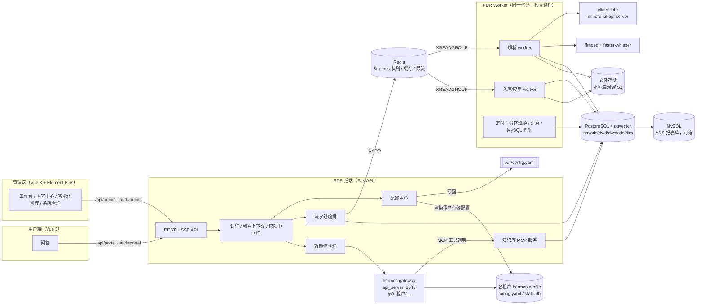
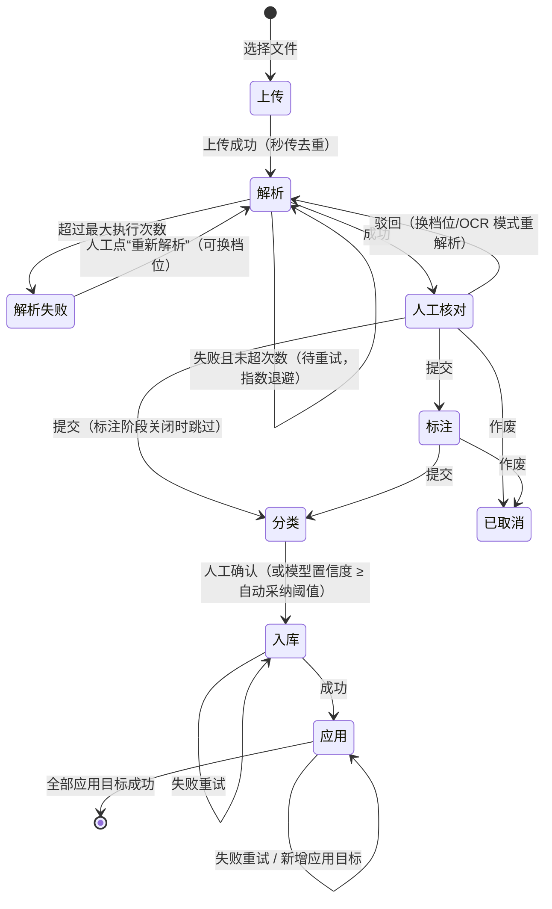
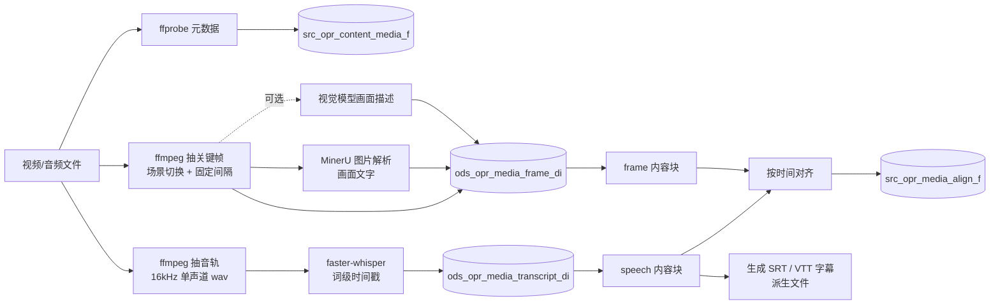

# PDR 架构设计（草案 v0.1，待确认）

> 本文是需求第 7 节要求的「先设计、后编码」交付：架构设计 + 数据库 DDL + `config.yaml` 草案。
> 配套产物：
> - 数据库 DDL：`pdr/deploy/sql/postgres/pdr_ddl.sql`、`pdr/deploy/sql/mysql/pdr_ddl.sql`（50 张表，由 `pdr/server/pdr_server/db/tables.py` 生成）
> - 配置模板：`pdr/config.yaml`（PDR 系统段手写 + hermes 段 967 项自动生成，全部带中文元数据）
>
> **请先看第 0 节的假设清单**，其中每一条都会影响后续编码；确认或修改后我再进入编码阶段。

---

## 0. 需确认的假设与建议方案

| # | 不明确处 | 建议方案（当前草案采用） | 备选 |
|---|---|---|---|
| A1 | **PDR 与 hermes-agent 的关系** | PDR 放在本仓库 `pdr/` 目录，把 hermes-agent 当作**智能体引擎**使用：每个租户对应一个 hermes profile（`t_<租户编码>`），由一个 `hermes gateway`（api_server 平台）进程统一服务，PDR 后端通过 `http://127.0.0.1:8642/p/<profile>/api/sessions/...` 代理对话（与 hermes-desktop 连本地 8642 端口的方式一致）。不修改 hermes 核心代码。 | 每租户独立 gateway 进程（隔离更强，资源开销大） |
| A2 | **「区域」的粒度** | 树形区域：国家 → 省/州 → 城市 → 区县 → 景区/门店（`dim.dim_cus_region_f`，`region_level` 1~5），租户可增加虚拟分组。区域权限按**区域路径前缀**授权，可选“含下级”。 | 只做一级（城市）；或按组织架构（部门）代替地理区域 |
| A3 | **平台自身的表归哪个主题域** | 规范只给了 9 个旅游业务域。租户/用户/角色/权限归 **customer（`cus_`）**（需求原文就举了 `cus_tenant`、`cus_role` 的例子）；配置中心、内容流水线、知识库、智能体用量归 **operation（`opr_`）**；租户计费汇总归 **finance（`fin_`）**。不新增主题域前缀。 | 新增 `sys_` 平台域（需您批准修改规范） |
| A4 | **分区字段 `travel_date` 用于非出行数据** | 规范要求分区字段统一为 `travel_date`（YYYYMMDD）。对非出行数据，`travel_date` 的含义是“该行的业务日期”：日志=发生日期，解析结果=解析日期，入库明细=入库日期，抽取回填=单据日期（如开票日期），月表=当月 1 日。每张表的注释里写明了取哪个日期。 | 另加 `stat_date` 分区（与规范冲突，不推荐） |
| A5 | **PostgreSQL 与 MySQL 分工** | **PostgreSQL 是唯一主库**：src/ods/dwd/dws/ads/dim 全部分层、行级安全（RLS）、pgvector 向量检索都在 PG。**MySQL 有两个作用**：① 兼容：同一份表定义同时生成 MySQL DDL，可整套部署在 MySQL 8 上（会失去 RLS，只剩应用层过滤，也没有向量检索）；② 辅助：可选的 **ADS 报表库**，定时把 ads（可选 dws/dim）同步过去给 BI 工具读。 | MySQL 作业务库、PG 作数仓（两边事务一致性复杂，不推荐） |
| A6 | **MinerU 版本与接入方式** | 适配 **MinerU 4.x**（`mineru>=4.0,<5`）：PDR 拉起 `mineru-kit api-server`，异步调用 `POST /v1/tasks` → 上传文件 → 轮询 `GET /v1/tasks/{task_id}` → 下载 `middle_json` / markdown / structured_content，归一化成 PDR 内容块。默认 `basic` 档位（CPU 可跑），`model_source=modelscope`（国内下载）。备用 `cli` 模式。**注意：4.x 的 middle_json 字段需要用真实样例确认后才能定版映射**，编码第一步会先跑通样例并补映射测试。 | 锁定 MinerU 2.x（旧 `/file_parse` 接口） |
| A7 | **七种模态都“经 MinerU 解析”** | MinerU 4.x 能原生解析图片 / PDF / Word / Excel（还有 PPT 等）。**Markdown 是 MinerU 官方明确不解析、建议直接读取的格式**，PDR 用 markdown-it 直读，转成与 MinerU 一致的内容块结构。**视频/音频**：ffmpeg 抽元数据 / 音轨 / 关键帧 → 语音识别（默认本机 faster-whisper）→ 关键帧交给 MinerU 做图片 OCR → 按时间对齐。即：MinerU 负责所有“文档与画面”的版面解析，音频文字由 ASR 负责。 | 把 Markdown 先转 PDF 再进 MinerU（浪费且会丢结构） |
| A8 | **「应用」阶段的含义** | 入库后的内容有四种去向：① **知识库检索**（切片 + 向量，以 MCP 服务挂到该租户智能体，智能体可以检索）；② **业务表回填**（按分类配置的目标表抽取结构化字段，如发票 → `ods.ods_fin_invoice_extract_di`）；③ **导出**（JSON/Markdown/Excel）；④ **作为对话附件**。 | 仅做知识库 |
| A9 | **页面修改配置与 `config.yaml` 的关系** | 三层：hermes 内置默认 ← `config.yaml`（平台级，**唯一事实来源**）← 租户覆盖（数据库，只对允许租户配置的项）。平台管理员在页面改平台级配置 → **写回 `config.yaml`**（保留注释）+ 数据库记变更日志；租户管理员改的只进数据库。详见第 6 节。 | 全部进数据库、`config.yaml` 只做初始化（与“唯一入口”冲突） |
| A10 | **业务实体范围** | 本期 PDR 的业务实体是“平台 + 内容”。旅游业务域（产品/供应商/财务）只建**回填抽取表**（发票、供应商合同、产品资料）作为示例目标，通过“DDL 设计器”（按规范校验的建表页面）让租户扩展更多业务表。 | 一次性建出完整的订单/库存/航班等业务模型（需另给业务需求） |
| A11 | **前端 UI 库** | Vue 3 + Vite + TypeScript + Pinia + Vue Router + **Element Plus**（中文生态最成熟）。 | Naive UI / Ant Design Vue |
| A13 | **管理端与用户端** | 两个独立前端工程（`pdr/web/admin`、`pdr/web/portal`）、独立端口/域名、独立登录。令牌带受众 `aud=admin`/`aud=portal`，后端 `/api/admin/*` 与 `/api/portal/*` 分别校验，交叉使用一律 401；页面之间没有任何互相跳转的链接或提示。管理端菜单、工作台、按钮全部按登录者的角色权限生成；用户端只有问答界面。账号也分开：`user_type=4` 只能登录用户端，0~2 只能登录管理端。 | 同一工程按角色切换（与“不能互相进入”冲突） |
| A12 | **一键启动的依赖供给** | `start_run.py` 优先用 **Docker Compose** 启动 PostgreSQL(pgvector)/MySQL/Redis；没有 Docker 时退回本机已安装的服务（自动 initdb 到 `.pdr/` 目录）。MinerU 与 hermes 装在 PDR 的 Python 虚拟环境里由脚本拉起。 | 只支持 Docker |

---

## 1. 产品定位

PDR 是一个**多租户 Web SaaS**，把 hermes-agent 的智能体能力和多模态内容处理整合到一起：

系统分成**两个互不相通的端**：

- **管理端**（admin）：给有管理职责的登录者使用，菜单、工作台、待办和按钮**全部按其角色权限生成**，没有权限的功能不出现。包含：
  1. **内容中心**：七种模态的「上传 → 解析 → 核对 → 标注 → 分类 → 入库 → 应用」流水线，产出租户知识库与结构化业务数据。
  2. **智能体管理**：参照 hermes-desktop（Hermes One）的功能组织——智能体配置（967 项中文化表单）、技能、工具集、模型、记忆、人格（SOUL）、定时任务、消息网关，以及用户端问答会话的审计。
  3. **系统管理**：租户、用户、角色、权限点、数据范围（区域）、列级权限、推荐问题、审计日志、用量统计。
- **用户端**（portal）：只有一个**问答界面**。回答基于管理端审核入库的资料，并标注出处（可预览原文片段、视频片段）。

两端的视觉参照用户提供的两张参考图：管理端为“工作台”式卡片布局（核心数据、待办、常用功能），用户端为居中问候 + 大输入框 + 推荐问题的问答首页。

## 2. 总体架构



**进程清单**（全部由 `start_run.py` 拉起）：

| 进程 | 默认端口 | 说明 |
|---|---|---|
| `pdr-api` | 8600 | FastAPI：REST、SSE、知识库 MCP 端点 `/mcp` |
| `pdr-worker` | — | 消费 Redis Streams：解析、核对后处理、入库、应用、重试 |
| `pdr-scheduler` | — | 分区预建、DWS/ADS 汇总、拉链表、MySQL 同步、hermes 用量同步 |
| `pdr-admin-web` | 5173 | 管理端前端（生产为独立域名的静态站点） |
| `pdr-portal-web` | 5174 | 用户端前端（生产为独立域名的静态站点） |
| `mineru-kit api-server` | 8610 | MinerU 解析服务 |
| `hermes gateway` | 8642 | 智能体网关（api_server 平台），多 profile 共用一个监听 |
| PostgreSQL / MySQL / Redis | 5432 / 3306 / 6379 | Docker Compose 或本机服务 |

### 2.1 目录结构

仓库根目录只放启动文件；hermes-agent 引擎源码整体收进 `hermes-agent/`（内部结构不变），PDR 全部在 `pdr/`：

```
<仓库根>/
├── start_run.py                 # 唯一的启动入口
├── .github/                     # GitHub 要求必须在根目录（CI 已指向 hermes-agent/）
├── hermes-agent/                # 智能体引擎（原仓库根目录的全部内容，未做修改）
└── pdr/
    ├── config.yaml              # 系统核心配置唯一入口（中文元数据注释）
    ├── .env.example             # 只放密钥（运行时生成 pdr/.env，不提交）
    ├── .pdr/                    # 运行时目录：虚拟环境、数据（不提交）
    ├── docs/                    # 架构设计、接口文档、二次开发指引
    ├── deploy/
    │   ├── docker-compose.yml   # postgres(pgvector) / redis / mysql（可选）
    │   └── sql/{postgres,mysql}/ # 生成的 DDL（勿手改）
    ├── scripts/gen_config_yaml.py # 从 hermes DEFAULT_CONFIG 生成 config.yaml 的 hermes 段
    ├── server/
    │   ├── pdr_server/
    │   │   ├── main.py          # FastAPI 应用工厂（admin 与 portal 两组路由）
    │   │   ├── settings.py      # 读取 pdr/config.yaml（${ENV:...} 展开）
    │   │   ├── db/              # spec.py 表描述与方言渲染、tables.py 全量表、naming.py 规范检查、render.py
    │   │   ├── security/        # 认证（区分 aud）、租户上下文、RBAC、数据范围、列权限、审计
    │   │   ├── config_center/   # config.yaml 读写（保留注释）、元数据解析、租户覆盖、profile 渲染
    │   │   ├── pipeline/        # 状态机、任务队列、各阶段处理器；parsers/ 下 mineru / markdown / media
    │   │   ├── knowledge/       # 切片、向量、检索、MCP 服务
    │   │   ├── agent/           # hermes 网关代理、profile 生命周期、config_zh.json
    │   │   ├── warehouse/       # 分区维护、DWS/ADS 汇总、拉链、MySQL 同步
    │   │   └── routers/{admin,portal}/ # 两端路由物理分开
    │   └── tests/
    └── web/
        ├── admin/               # 管理端 Vue 3 工程
        └── portal/              # 用户端 Vue 3 工程（只有问答页与登录页）
```

## 3. 模块划分

| 模块 | 职责 | 主要表 |
|---|---|---|
| 认证与租户 | 登录（JWT + 刷新令牌）、API 令牌、租户开通/停用、配额 | `src_cus_tenant_f` `src_cus_user_f` `src_cus_api_token_f` |
| 权限 | 角色、权限点（菜单/按钮/接口）、数据范围、区域授权、列级权限 | `src_cus_role*` `src_cus_permission_f` `src_cus_user_region_f` `dim_cus_region_f` |
| 审计 | 所有写操作和越权拒绝写审计日志 | `src_cus_operate_log_di` |
| 配置中心 | 配置项字典、平台级写回 `config.yaml`、租户覆盖、变更记录、生效提示 | `src_opr_config_item_f` `src_opr_config_value_f` `src_opr_config_change_log_di` |
| 智能体管理（管理端） | 租户 profile 生命周期、技能、工具集、模型、记忆、人格、定时任务、网关平台、问答会话审计 | hermes 自己的 profile 目录；用量同步到 `ods_opr_agent_session_di` |
| 问答（用户端） | 对话代理（SSE）、出处预览、反馈、推荐问题、临时附件 | `src_opr_portal_suggest_question_f` `src_opr_portal_feedback_di` |
| 内容流水线 | 上传、状态机、阶段任务、重试、人工核对/标注/分类工作台 | `src_opr_content_*` `ods_opr_*` |
| 知识库 | 切片、向量、检索、MCP 工具 | `src_opr_knowledge_base_f` `dwd_opr_knowledge_chunk_di` |
| 数仓 | 入库明细、拉链、汇总、看板、报表同步 | `dwd_*` `dws_*` `ads_*` |
| DDL 设计器 | 租户在页面上按规范设计业务表，提交前自动做命名规范检查，生成双方言 DDL | 复用 `naming.py` |

## 4. 多租户与权限模型

### 4.1 隔离层次

```
请求 → ① 认证（JWT：user_code + tenant_code）
     → ② 接口权限（权限点 permission_type=3，按 HTTP 方法 + 路径模板匹配）
     → ③ 数据范围解析（角色 × 资源类型 → 可见区域集合，缓存在 Redis）
     → ④ 应用层过滤（所有查询走统一的 Repository，自动加 tenant_code / region_code 条件）
     → ⑤ 数据库 RLS（PG：每个事务 SET LOCAL pdr.tenant_code / pdr.region_codes，策略二次校验）
     → ⑥ 列级权限（结果序列化时按角色列权限隐藏 / 脱敏 / 只读）
```

④ 和 ⑤ 是**双保险**：即使某个查询漏了条件，PG 的 RLS 也不会返回别的租户或区域的数据。草案 DDL 已在本地 PostgreSQL 16 上实测：

| 上下文 | 结果 |
|---|---|
| 租户 t1，数据范围=全部 | 看到 t1 的上海、北京两条 |
| 租户 t1，可见区域=SH | 只看到上海一条 |
| 租户 t2 | 只看到 t2 自己的数据 |
| 未设置租户上下文 | 0 行（失败即拒绝） |
| 以 t1 身份写入 tenant_code=t2 的行 | 被策略拒绝 |

后端连库账号 `pdr_app` 必须是**非超级用户**（超级用户会绕过 RLS），`start_run.py` 会按此创建账号。

### 4.2 RBAC（功能权限）

- `src_cus_permission_f`：权限点树，平台共享（`tenant_code=platform`），三类：1-菜单（对应前端路由）、2-按钮、3-接口。
- `src_cus_role_f` / `src_cus_user_role_f` / `src_cus_role_permission_f`：标准 RBAC。
- 内置角色（`role_type=0`）：平台超级管理员、租户管理员、内容审核员、标注员、只读访客。
- 前端菜单与按钮从 `/api/me/permissions` 动态生成；后端接口用装饰器 `@require("content:review:submit")` 检查，未登记权限点的接口启动时报错（防止漏配）。

### 4.3 数据范围（行级权限 + 区域权限）

`src_cus_role_data_scope_f`：按 **角色 × 资源类型 × 操作（读/写）** 配置范围类型：

| scope_type | 含义 | 可见区域计算 |
|---|---|---|
| 1 | 本租户全部 | 不过滤区域（`pdr.region_all=1`） |
| 2 | 本区域及下级 | 用户归属区域（`src_cus_user_region_f`）的 `region_path` 前缀匹配展开 |
| 3 | 仅本区域 | 用户归属区域本身 |
| 4 | 自定义区域 | `src_cus_role_region_f` 列出的区域（可选含下级） |
| 5 | 仅本人创建 | 区域不限，再加 `create_user_code = 当前用户` |

- 用户有多个角色时，**取并集**。
- 资源类型：`content_asset`（内容资产）、`knowledge`（知识库）、`business_extract`（回填业务数据）、`report`（报表）、`*`。
- 计算结果是一组展开后的 `region_code`，缓存在 Redis（键含租户与用户，角色/区域变化时失效），同时用于应用层条件和 RLS 会话变量。
- `region_code=''` 表示“不属于任何区域”的租户级数据，有租户权限的人都能看到。

### 4.4 列级权限

`src_cus_role_column_perm_f`：角色 × 表（库名.表名）× 字段 → 0-不可见 / 1-脱敏可见 / 2-只读 / 3-可读写；脱敏规则：手机号、证件号、金额区间、姓名、全遮蔽。多角色时取最宽权限。在 API 序列化层执行（PG 的列权限不区分租户角色，不适合）；导出功能复用同一套规则。

### 4.5 智能体侧的租户隔离

- 每个租户一个 hermes profile（`<data_dir>/hermes/profiles/t_<租户编码>`），hermes 自己保证 profile 之间互不可见（会话、记忆、技能、密钥）。
- PDR 代理只会把请求转给当前登录租户的 `/p/t_<租户编码>/` 前缀，前端拿不到网关密钥。
- 知识库 MCP 服务按 profile 签发**租户专属令牌**，检索时用这个令牌还原租户上下文，再走同一套 RLS。

### 4.6 管理端与用户端隔离

| 层面 | 做法 |
|---|---|
| 前端 | 两个独立工程、两个端口（生产两个域名），各自的登录页；代码、路由、菜单里都没有指向另一端的链接或提示 |
| 账号 | `src_cus_user_f.user_type`：0~2 只能登录管理端，4 只能登录用户端；登录接口分开（`/api/admin/v1/auth/login`、`/api/portal/v1/auth/login`），类型不符直接拒绝 |
| 令牌 | JWT 带 `aud=admin` 或 `aud=portal`，两组路由各自只接受自己的受众；用用户端令牌调管理端接口返回 401，反之亦然 |
| 权限点 | `src_cus_permission_f.client_type` 区分 admin / portal，两端权限点互不相通；用户端只有问答相关权限 |
| 数据 | 用户端检索同样经过租户隔离与数据范围（区域）过滤，只能检索到其可见范围内已入库的资料，看不到原件和任何管理数据 |
| 审计 | `src_cus_operate_log_di.client_type` 记录请求来自哪一端；用户端的“没帮助”反馈进入管理端“问答会话审计” |

## 5. 多模态内容流水线

### 5.1 状态机

资产主表 `src_opr_content_asset_f` 记录**当前阶段 `stage_code` + 阶段状态 `stage_status`**；每次执行在 `src_opr_content_stage_task_f` 留一行（含重试次数、下次重试时间、worker、操作人、错误）；每次状态变化在 `src_opr_content_stage_log_di` 留一行（从哪到哪、谁、为什么）。



| 阶段 | stage_code | 执行方式 | 产出 |
|---|---|---|---|
| 上传 | 10 | 自动 | 原件存储、SHA-256、模态识别、批次 |
| 解析 | 20 | 自动（队列） | ODS 原始结果 + `src_opr_content_block_f` 内容块 + 派生文件 |
| 人工核对 | 30 | 人工 | 每块确认/修改/删除（`review_status`），原文保留在 `origin_text` |
| 标注 | 40 | 人工（可模型预标注） | `src_opr_content_label_f`：文本实体、图像框、时间片、整篇标签、表格单元格 |
| 分类 | 50 | 模型建议 + 人工确认 | `src_opr_content_category_rel_f` |
| 入库 | 60 | 自动（队列） | `dwd_opr_content_block_di`、知识切片、业务回填 ODS 行、拉链更新 |
| 应用 | 70 | 自动（队列） | `src_opr_content_application_f`：知识库 / 回填 / 导出 / 附件 |

阶段状态：`0-待处理 1-处理中 2-成功 3-失败 4-待重试 5-已驳回 6-已跳过 9-已取消`。

**状态迁移只能通过一个函数**（`pipeline.transition(asset, to_stage, to_status, operator, reason)`）：用 `SELECT ... FOR UPDATE` 加行锁、按迁移表校验合法性、在同一事务里写资产表 + 日志表 + 下一阶段任务。非法迁移直接报错，不会出现“状态改了但没留日志”。

### 5.2 任务队列与重试（Redis）

- 每个自动阶段一个 Redis Stream：`pdr:stream:parse`、`pdr:stream:store`、`pdr:stream:apply`，worker 以消费组方式消费（`XREADGROUP`），处理完 `XACK`。
- **数据库是事实来源，Redis 只负责投递**：任务行先在数据库里提交，再 `XADD`；worker 启动和定时巡检时会把“数据库里待处理、但 Redis 里没有”的任务补投，Redis 丢消息不会丢任务。
- worker 崩溃：消费组里超时未确认的消息由巡检用 `XAUTOCLAIM` 接管。
- 失败重试：`attempt_qty < max_attempt_qty` 时状态置 4-待重试，`next_retry_time = now + min(初始值 × 2^(n-1), 上限)`，放进延迟集合 `pdr:delay`（ZSET，分值=时间戳），到期再投回队列。超过次数置 3-失败，页面显示“重新执行”。
- 同一租户的并发上限可配置，防止一个租户批量上传占满 worker。

### 5.3 各模态解析通道

所有解析器输出同一种**内容块（Block）**结构，后面的核对、标注、入库不区分模态：

| 模态 | 通道 | 说明 |
|---|---|---|
| 图片 | MinerU | OCR + 版面；整图也存为一个 image 块 |
| PDF | MinerU | 文字层 PDF / 扫描件（`ocr_mode=auto`）；标题、正文、表格（HTML + 二维数组）、图片、公式、页眉页脚 |
| Word | MinerU（4.x 原生支持 doc/docx） | 同上 |
| Excel | MinerU（4.x 原生支持 xls/xlsx） | 每个工作表一个 `sheet` 块，表格写入 `table_json`；如映射不足再用 openpyxl 补充单元格 |
| Markdown | 直读（markdown-it） | MinerU 官方对 md 的建议就是直接读取；按标题/段落/表格/代码切块，图片链接下载为派生文件 |
| 视频 | ffmpeg + ASR + MinerU | 见 5.4 |
| 音频 | ffmpeg + ASR | 见 5.4 |

MinerU 适配层（`parsers/mineru.py`）：

1. `POST {base_url}/v1/tasks`，带上文件名、`sha256sum`、`tier`、`ocr_mode`、`output_formats`。
2. 按返回的 `upload.url` 用 PUT 上传文件。
3. 每 `poll_interval_seconds` 轮询 `GET /v1/tasks/{task_id}`：waiting-file / pending / running / completed / partial / failed / canceled。
4. 完成后下载 `result_url` 产物（markdown.md、middle_json.json、structured_content.json、images/），原样保存为派生文件 `mineru_raw`，并在 `ods_opr_mineru_parse_result_di` 记一行。
5. 把 middle_json 的 `pages[].blocks` 映射为 PDR 内容块：页码 `page_idx + 1`，坐标归一化到 0~1000，图片存为 `crop_image` 派生文件。
6. `partial`（部分页失败）记为 2-部分成功，进入人工核对时高亮失败页。

### 5.4 视频 / 音频方案



- **抽帧**：`select='gt(scene,阈值)'` 场景切换帧 + 每 N 秒一帧，合并后去掉 1 秒内重复的帧，超过上限时按时间均匀保留。帧图片存为派生文件 `frame`，记录 `time_ms_qty`。
- **转写**：默认本机 faster-whisper（CPU 可跑，`small` 模型），可换 OpenAI 兼容接口或复用 hermes 的语音识别配置。结果按片段落 ODS，带词级时间戳（`word_json`）。
- **对齐**：帧时间点落在某个语音片段的 `[start, end)` 内 → 1-时间重叠；落在片段间隙 → 2-最近邻；人工在核对页拖动调整 → 3-人工调整。
- **字幕**：核对后的语音片段文本生成 SRT/VTT（派生文件），核对页可以边播放边改字。
- **入库**：语音片段按时间窗口（约 60 秒或 token 上限）合并成切片，切片带 `start_ms_qty`，智能体检索命中后可以回答“在第几分几秒”。
- 音频走同一条管线，只是没有抽帧。

### 5.5 核对 / 标注 / 分类工作台

- **核对**：左边原件（PDF 页面图 / 图片 / 播放器），右边内容块列表；点块高亮原件里的 bbox 或跳到对应时间点。逐块“确认 / 修改 / 删除”，可整篇驳回重解析。
- **标注**：标签体系来自 `dim_opr_label_schema_f`（租户自定义），支持文本划词、图像拉框、时间轴片段、整篇标签、表格单元格；模型预标注的结果标为 1-模型预标注，人工确认后变 2。
- **分类**：分类树来自 `dim_opr_content_category_f`；模型给出候选分类和置信度，人工确认或否决。分类上可以配**回填目标表**和抽取提示词，入库时按它抽取结构化字段。

## 6. 配置管理机制

### 6.1 三层配置与优先级

```
hermes 内置默认（hermes_cli/config_defaults.py DEFAULT_CONFIG）
   ← pdr/config.yaml 的 hermes 段（平台级，唯一事实来源）
      ← src.src_opr_config_value_f（租户覆盖，仅 scope_type=1 的项）
         = 租户有效配置 → 渲染到 <data_dir>/hermes/profiles/t_<租户>/config.yaml（hermes 读取的就是这份）
```

PDR 自身的配置（app/database/redis/mineru/media/pipeline/knowledge/...）只有平台级，没有租户覆盖。

### 6.2 页面元数据就写在 `config.yaml` 里

`config.yaml` 每个配置项上方有一行：

```yaml
#: 中文名｜说明｜范围:<取值范围>｜生效:<热加载|下一会话|重启>
max_attempt_qty: 3
```

- 配置页面**直接解析这些注释**生成分组、表单控件（布尔→开关，枚举→下拉，整数/小数→数字框，列表/键值对→动态表格，`${ENV:...}`→密钥输入框）、校验与生效提示。所以**页面字段和 `config.yaml` 天然一一对应**，不会两边各维护一份。
- 启动时把这些元数据同步进 `src_opr_config_item_f`，供审计、搜索和租户覆盖使用。
- hermes 段由 `pdr/scripts/gen_config_yaml.py` 从 hermes 的 `DEFAULT_CONFIG` 生成：**967 项，全部有中文名和说明**（中文译文在 `pdr/server/pdr_server/agent/config_zh.json`）。hermes 升级后重新生成，已改过的值会保留，新增项若缺中文说明脚本会列出来。
- 枚举范围是从中文说明里的“值-含义”写法自动提取的（如 `auto|focus|on|off`），数值类目前只标“整数/小数”。编码阶段会补一个范围覆盖表，给关键数值项写上最小/最大值。

### 6.3 保存与生效

1. 页面提交 → 后端按元数据校验类型与范围。
2. **平台级**：用 ruamel.yaml 往返编辑（保留注释和顺序）写回 `config.yaml`，先写临时文件再原子替换，并用文件锁防并发；写入后算 SHA-256 记入 `src_opr_config_change_log_di`。页面上随时显示“文件 SHA-256 与数据库记录一致”。
3. **租户级**：写 `src_opr_config_value_f`（带版本号做乐观锁）+ 变更日志。
4. 生效：
   - **热加载**：后端监听 `config.yaml` 变化（文件监听 + Redis 广播），各进程重新加载。
   - **下一会话**：重新渲染受影响租户的 hermes profile 配置；**进行中的会话不受影响**（hermes 的设计原则：会话中途不重建系统提示，否则提示缓存失效、费用翻倍），页面提示“新会话生效”。
   - **重启**：页面提示需要重启的进程，并提供“重启该服务”按钮（仅平台管理员）。
5. 有人直接手改 `config.yaml`：文件监听会发现变化，把差异补记为一条“文件直改”的变更日志，页面与文件保持一致。

### 6.4 密钥

`config.yaml` 里只写 `${ENV:变量名}`，值放在 `pdr/.env`（启动时加载）。页面上的密钥字段只显示“已设置/未设置”，修改时写 `.env`，不写日志明文。租户自己的模型密钥写进该租户 profile 的 `.env`（hermes 的约定：`.env` 只放密钥）。

## 7. 数据库设计

### 7.1 分层与库

PostgreSQL 一个数据库 `pdr`，按分层建 6 个 schema；MySQL 对应 6 个 database。SQL 一律写 `库名.表名`，两种数据库写法一致。

| 库 | 分层 | 本期内容 |
|---|---|---|
| `src` | 业务源层 | 租户与权限、配置中心、内容流水线工作数据（可改） |
| `ods` | 原始数据层 | MinerU 原始结果、ASR 原始片段、抽帧记录、智能体用量、业务回填抽取（只追加） |
| `dwd` | 明细层 | 入库内容块、知识切片（含向量）、资产拉链、用户拉链 |
| `dws` | 汇总层 | 内容处理日汇总、阶段小时吞吐、租户月度用量 |
| `ads` | 应用层 | 内容中心看板（天全量）、内容质量月报 |
| `dim` | 维度表 | 区域、模态、阶段、分类体系、标注体系 |

### 7.2 表清单（50 张）

| 库.表 | 说明 |
|---|---|
| **dim** | |
| `dim.dim_cus_region_f` | 区域维度（树形，区域权限授权单元） |
| `dim.dim_opr_content_modality_f` | 内容模态字典 |
| `dim.dim_opr_content_stage_f` | 流水线阶段字典 |
| `dim.dim_opr_content_category_f` | 内容分类体系（含回填目标表） |
| `dim.dim_opr_label_schema_f` | 标注体系 |
| **src · 租户与权限** | |
| `src.src_cus_tenant_f` | 租户 |
| `src.src_cus_user_f` | 用户 |
| `src.src_cus_role_f` | 角色 |
| `src.src_cus_permission_f` | 权限点（菜单/按钮/接口） |
| `src.src_cus_user_role_f` | 用户-角色 |
| `src.src_cus_role_permission_f` | 角色-权限点 |
| `src.src_cus_user_region_f` | 用户归属区域 |
| `src.src_cus_role_data_scope_f` | 角色数据范围（行级） |
| `src.src_cus_role_region_f` | 角色自定义区域 |
| `src.src_cus_role_column_perm_f` | 角色列级权限 |
| `src.src_cus_api_token_f` | API 令牌 |
| `src.src_cus_operate_log_di` | 操作审计日志（天分区） |
| **src · 配置中心** | |
| `src.src_opr_config_item_f` | 配置项字典（中文元数据） |
| `src.src_opr_config_value_f` | 租户配置覆盖 |
| `src.src_opr_config_change_log_di` | 配置变更记录（天分区） |
| **src · 内容流水线** | |
| `src.src_opr_content_batch_f` | 上传批次 |
| `src.src_opr_content_asset_f` | 内容资产主表（当前阶段/状态） |
| `src.src_opr_content_object_f` | 派生文件 |
| `src.src_opr_content_media_f` | 音视频元数据 |
| `src.src_opr_content_stage_task_f` | 阶段任务（含重试） |
| `src.src_opr_content_stage_log_di` | 状态流转日志（天分区） |
| `src.src_opr_content_block_f` | 内容块工作表（核对/标注对象） |
| `src.src_opr_media_align_f` | 音视频帧-语音对齐 |
| `src.src_opr_content_label_f` | 标注记录 |
| `src.src_opr_content_category_rel_f` | 资产分类关系 |
| `src.src_opr_knowledge_base_f` | 知识库 |
| `src.src_opr_content_application_f` | 内容应用记录 |
| **src · 用户端** | |
| `src.src_opr_portal_suggest_question_f` | 用户端推荐问题（管理端维护） |
| `src.src_opr_portal_feedback_di` | 用户端问答反馈（天分区） |
| **ods** | |
| `ods.ods_opr_mineru_parse_result_di` | MinerU 原始解析结果 |
| `ods.ods_opr_media_transcript_di` | ASR 原始片段 |
| `ods.ods_opr_media_frame_di` | 抽帧原始记录 |
| `ods.ods_opr_agent_session_di` | 智能体会话用量 |
| `ods.ods_fin_invoice_extract_di` | 发票抽取（回填示例） |
| `ods.ods_sup_contract_extract_di` | 供应商合同抽取（回填示例） |
| `ods.ods_prd_product_extract_di` | 产品资料抽取（回填示例） |
| **dwd** | |
| `dwd.dwd_opr_content_block_di` | 入库内容块明细 |
| `dwd.dwd_opr_knowledge_chunk_di` | 知识切片（pgvector） |
| `dwd.dwd_opr_content_asset_zip` | 内容资产拉链 |
| `dwd.dwd_cus_user_zip` | 用户拉链 |
| **dws** | |
| `dws.dws_opr_content_process_di` | 内容处理日汇总（租户×区域×模态） |
| `dws.dws_opr_content_stage_hrs` | 阶段小时吞吐 |
| `dws.dws_fin_tenant_usage_mo` | 租户月度用量（计费） |
| **ads** | |
| `ads.ads_opr_content_dashboard_df` | 内容中心看板（天全量） |
| `ads.ads_opr_content_quality_mo` | 内容质量月报 |

### 7.3 公共字段与约定

每张表统一带：`id`（自增主键）、`tenant_code`（租户）、多数业务表带 `region_code`（区域）、分区表带 `travel_date char(8)`，以及审计字段 `record_status`（0-正常 1-已删除）、`create_user_code`、`create_time`、`update_user_code`、`update_time`。

- 不建外键（MySQL 分区表不支持外键，跨层关联靠业务编号 `*_no` / `*_code`），一致性由状态迁移事务保证。
- 业务编号（`asset_no`、`task_no`、`block_no`……）用“前缀 + 时间 + 随机”生成，全局唯一，便于跨层追溯。
- 所有 `_type` / `_status` 字段的注释都写了每个取值的含义。

### 7.4 分区策略

- 后缀不是 `_f` / `_zip` 的表一律按 `travel_date` 做 RANGE 分区；主键和唯一键自动带上 `travel_date`（PG 与 MySQL 都要求这样）。
- PG：建表时带一个 DEFAULT 分区兜底；`pdr-scheduler` 每天预建未来 7 天的日分区（`_di`）/ 未来 2 个月的月分区（`_mo`），并按保留期删除过期分区（例如审计日志保留 180 天）。
- MySQL：建表时只有 `p_max` 分区，调度器用 `REORGANIZE PARTITION` 拆出新分区。
- 拉链表：`start_date` / `end_date`（当前有效记录为 `9999-12-31`），每日由调度器比对 src 表生成。

### 7.5 命名规范自动检查

`pdr/server/pdr_server/db/naming.py` 把第 4 节规范写成了可执行检查，生成 DDL 前必跑，DDL 设计器提交也走同一套：

- 表名：小写下划线；`分层_主题域_实体_粒度`；库名必须和分层一致；必须以规定的粒度后缀结尾；疑似拼音会被拦截。
- 字段：小写下划线；必须有注释；`_type` / `_status` 注释必须写清每个取值；`_date` 必须是 date、`_time` 必须是 timestamp、`_amt` 必须是 decimal、`_qty` 必须是整数（或 decimal）、`_rate` 必须是 decimal；分区字段必须叫 `travel_date`、类型 `char(8)`。
- 分区表必须有 `travel_date`，非分区表不能有。

全部 50 张表已通过检查，并在 **PostgreSQL 16（含 pgvector）** 上实际建表、连续执行两遍验证幂等。最初的 48 张表还曾分别在 **PostgreSQL 16（含 pgvector）** 和 **MariaDB 10.11**（MySQL 方言；仅为测试把排序规则换成了 `utf8mb4_unicode_ci`）上实际建表成功，MySQL 侧查询确认 0 个表、0 个字段缺注释。

## 8. 前后端接口约定

- 两组前缀：管理端 `/api/admin/v1`，用户端 `/api/portal/v1`，令牌受众分别为 `admin` / `portal`，不可混用。JSON，UTF-8；认证头 `Authorization: Bearer <jwt>`；平台管理员在管理端可以带 `X-PDR-Tenant` 切换租户视角（会写审计日志）。
- 统一响应：`{"code": 0, "message": "成功", "data": ..., "trace_id": "..."}`；`code` 非 0 为错误，`message` 是给用户看的中文提示。
- 分页：`?page=1&page_size=20`，返回 `{"items": [...], "total": N}`。
- 错误码分段：`10xxx` 认证、`11xxx` 权限（含越权拒绝）、`20xxx` 参数校验、`30xxx` 流水线（非法状态迁移、重复文件）、`40xxx` 配置（校验失败、版本冲突）、`50xxx` 外部依赖（MinerU、ASR、hermes 不可用）。
- 流式：对话和任务进度用 **SSE**（`text/event-stream`），对话事件直接透传 hermes `/api/sessions/{id}/chat/stream` 的事件。
- 上传：小文件直接 multipart；大文件（音视频）分片上传 `POST /content/uploads` → `PUT /content/uploads/{id}/parts/{n}` → `POST /content/uploads/{id}/complete`，秒传先比对 SHA-256。

主要接口（节选，下表除“用户端”一行外均在 `/api/admin/v1` 下）：

| 领域 | 接口 |
|---|---|
| 用户端（`/api/portal/v1`） | `POST /auth/login` · `GET /me` · `GET /suggested-questions` · `GET/POST /sessions` · `POST /sessions/{id}/ask/stream`（SSE）· `GET /citations/{chunk_no}`（出处片段）· `POST /messages/{id}/feedback` · `POST /attachments`（仅本次对话） |
| 认证 | `POST /auth/login` `POST /auth/refresh` `GET /me` `GET /me/permissions`（返回菜单、按钮、工作台模块） |
| 租户/权限 | `GET/POST/PATCH /tenants` · `/users` · `/roles` · `PUT /roles/{code}/permissions` · `PUT /roles/{code}/data-scopes` · `PUT /roles/{code}/column-perms` · `GET/POST /regions`（树） |
| 配置 | `GET /config/groups?domain=pdr\|hermes` · `GET /config/items?group=` · `PUT /config/items`（批量，平台级）· `PUT /tenants/{code}/config`（租户覆盖）· `GET /config/changes` · `GET /config/consistency`（页面与文件一致性） |
| 内容 | `POST /content/batches` · `POST /content/assets` · `GET /content/assets?stage=&status=&modality=&region=` · `GET /content/assets/{no}` · `POST /content/assets/{no}/transition`（提交/驳回/跳过/作废/重试）· `GET/PATCH /content/assets/{no}/blocks` · `GET/POST/DELETE /content/assets/{no}/labels` · `PUT /content/assets/{no}/category` · `POST /content/assets/{no}/applications` · `GET /content/assets/{no}/timeline`（流转日志） |
| 知识库 | `GET/POST /knowledge/bases` · `POST /knowledge/search` · MCP：`/mcp`（工具 `pdr_kb_search`） |
| 智能体管理 | `GET /agent/sessions`（问答会话审计）· `GET /agent/feedback` · `GET/POST /portal/suggested-questions` · `GET /agent/skills` · `GET /agent/toolsets` · `GET/PUT /agent/memory` · `GET/PUT /agent/soul` · `GET/POST /agent/cron` · `GET /agent/models` |
| 看板 | `GET /dashboard/content` · `GET /reports/content-quality?month=` |
| DDL 设计器 | `POST /ddl/check`（规范检查）· `POST /ddl/render?dialect=postgres\|mysql` |

完整的接口文档由 FastAPI 自动生成（`/docs`，仅开发环境开放），编码阶段再补一份 `docs/02-接口约定.md`。

## 9. 前端页面（Vue 3）

可交互原型（7 个画板，管理端可在 Tweaks 里切换登录角色查看权限效果）：https://claude.ai/artifact/8fp41xuTh4RvJxAq7UT8Ue

### 9.1 管理端（`pdr/web/admin`）

风格参照“管理者工作台”：浅色侧栏、浅蓝渐变页头、卡片式模块。**菜单、工作台模块、待办页签、常用功能和按钮都由 `/me/permissions` 返回的权限生成**，没有权限的功能不渲染；直接访问无权限路由显示 403。

| 分组 | 页面 | 对应 hermes-desktop |
|---|---|---|
| 概览 | 工作台：内容核心数据（KPI、近 7 日入库、各阶段积压）、我的待办（待我核对 / 待我标注 / 失败任务）、最近配置变更或公告、常用功能 | — |
| 内容中心 | 看板 · 任务列表 · 核对工作台 · 音视频核对 · 标注工作台 · 分类确认 · 入库与应用 · 知识库（检索测试） | — |
| 智能体管理 | 智能体配置（hermes 967 项，76 个分组，支持搜索；平台级 / 租户覆盖两种视图） | Settings |
| | 技能 · 工具集 | Skills / Tools |
| | 模型（各提供商的模型配置、备用模型） | Models / Providers |
| | 记忆 · 人格（SOUL.md） | Memory / Soul |
| | 定时任务 · 消息网关 | Schedules / Gateway |
| | 问答会话审计（用户端会话、“没帮助”反馈处理） | Sessions |
| 系统管理 | 系统配置（PDR 段）· 角色与权限（功能权限 / 数据范围 / 列权限）· 用户 · 区域 · 租户 · 推荐问题 · 字典 · DDL 设计器 · 审计日志 · 配置变更记录 | Settings › Logs |

### 9.2 用户端（`pdr/web/portal`）

只有**登录页 + 问答页**，风格参照参考图的 AI 助手首页：浅蓝紫渐变背景、居中问候语、大输入框、推荐问题浮层。交互：

1. **首页**：问候语 + 输入框（字数计数）+ 推荐问题卡片（问题文本 + 资料类别，由管理端维护，点击即提问）。
2. **对话**：流式输出；回答前显示“已检索 N 份资料”；正文中的 `[1]` 角标对应下方出处卡片。
3. **出处预览**：点出处卡片，右侧滑出原文片段（视频/音频可直接播放对应时间段），只展示与问题相关的片段，不开放原件下载。
4. **反馈**：复制、重新回答、有帮助 / 没帮助；“没帮助”进入管理端的问答会话审计。
5. **追问建议**、**历史会话**（右上角图标打开抽屉，可搜索）、**新对话**、**临时附件**（只对本次对话有效，不进入内容流水线）。
6. 页面中没有任何指向管理端的入口。

## 10. `start_run.py` 一键启动流程

```
python start_run.py              # 开发模式：全部拉起
python start_run.py --check      # 只做环境检查
python start_run.py --no-docker  # 不用 Docker，使用本机 PG/MySQL/Redis
python start_run.py stop         # 停止全部
```

当前已实现并实测的步骤（1~6）与待编码阶段接入的步骤（7）：

1. **环境检查**：Python ≥ 3.11、Node ≥ 20、pnpm、uv、Docker（区分“已安装”和“服务在运行”）、ffmpeg；缺什么给出中文提示。Docker 服务未运行时自动改为 `--no-docker`。
2. **密钥**：从 `pdr/.env.example` 生成 `pdr/.env`，自动填随机的数据库、Redis、JWT、网关、初始管理员密码；已有的值保留。
3. **Python 环境**：在 `pdr/.pdr/venv` 用 uv（没有则用 venv + pip）安装依赖，下载源按 `config.yaml` 的 `install` 段测速选择（含清华、阿里云、腾讯云等国内镜像）。
4. **生成 DDL**：先跑命名规范检查，不通过就停止。
5. **基础服务**：`docker compose up -d --wait` 拉起 PostgreSQL(pgvector)、Redis，`database.mysql.enabled` 为真时加上 MySQL。
6. **建库建表**：在容器里执行 DDL，创建非超级用户 `pdr_app` 并授权（幂等）。
7. **应用进程**：MinerU、hermes 网关、PDR 后端与 worker、管理端、用户端——编码阶段 M1~M5 交付后从这里拉起；目前会列出“尚未实现”。

每一步都可以重复执行（已完成就跳过），中途失败修好后重跑就从失败那步继续。

## 11. 测试与验收对照

| 验收项 | 怎么验证 |
|---|---|
| 名称、标题、配置项全部中文 | 测试：config.yaml 每个配置项都有 `#:` 元数据且中文名非空；前端路由 meta.title 全部是中文 |
| 页面改配置生效且与 config.yaml 一致 | 端到端测试：页面 API 改值 → 重新解析文件得到同一个值 → SHA-256 与变更日志一致；租户覆盖渲染进 profile 配置 |
| 七种模态都能走完全流程 | 每种模态一个样例文件的端到端测试（MinerU 可用时跑真服务，CI 用录制的产物） |
| 表符合命名规范、都有注释、SQL 带库名 | `naming.py` 测试覆盖全部表；SQL 带库名的检查扫描所有 `.sql` 与代码里的 SQL 字符串 |
| 多租户隔离与区域权限生效 | 用临时 PostgreSQL 跑：跨租户读/写、区域范围 1~5、多角色并集、未设上下文（第 4.1 节已做的手工验证会写成自动化测试） |
| `python start_run.py` 从零启动 | 在干净容器里跑一遍并对各服务做健康检查 |
| 前端为 Vue 3 | 工程依赖与构建 |

## 12. 编码阶段的里程碑（确认后执行）

1. **M1 基础**：后端骨架、配置读取与写回、数据库会话与 RLS 上下文、认证与权限中间件、种子数据、`start_run.py` 基础服务部分。
2. **M2 流水线**：上传、状态机、Redis 队列与重试、MinerU 适配（先用真实样例定版 middle_json 映射）、Markdown 直读、音视频管线。
3. **M3 人工环节**：核对 / 标注 / 分类工作台（前后端）。
4. **M4 入库与应用**：DWD 入库、切片与向量、知识库 MCP、业务回填、导出。
5. **M5 智能体与两端前端**：租户 profile 生命周期、对话代理；管理端的智能体管理页面与按权限生成的工作台；用户端问答页（出处预览、反馈、历史会话）。
6. **M6 数仓与管理**：调度器（分区、汇总、拉链、MySQL 同步）、看板、DDL 设计器、审计；README 与二次开发指引；全套验收测试。
