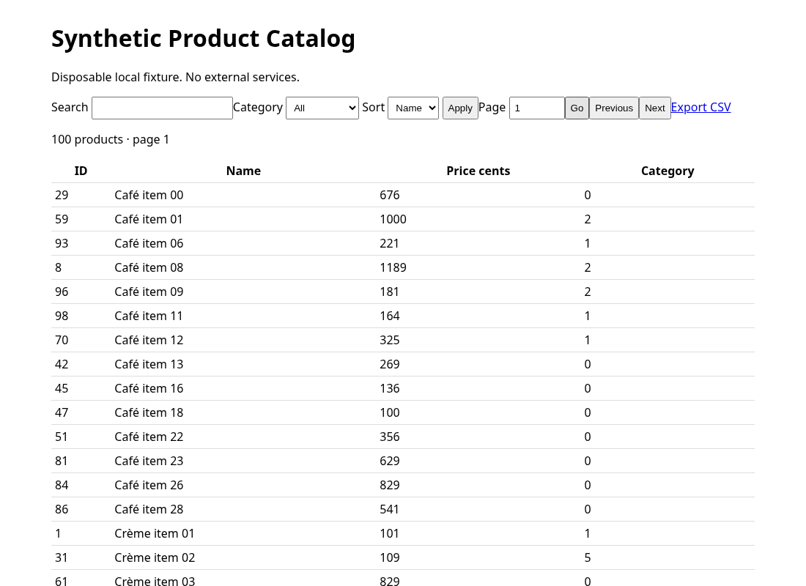
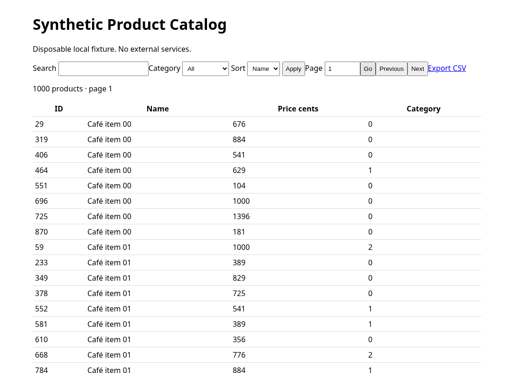
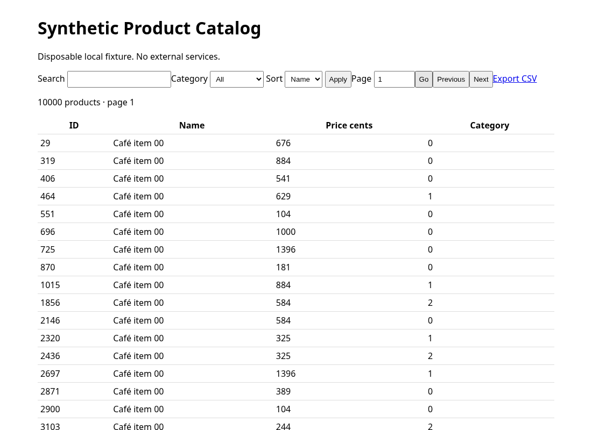

# Synthetic catalog volume test

Status: completed. Execution: technical HTTP runner, not Hermes agent E2E.

Environment: {'python': '3.12.14', 'platform': 'Linux-6.18.55-x86_64-with-glibc2.41', 'sqlite': '3.53.1', 'commit': '102dee9ef7a4a8bfbf6b6e0e7a2ed25dfc8d8b56', 'started_utc': '2026-10-30T14:51:01.058904+00:00', 'ended_utc': '2026-10-30T14:51:22.442383+00:00'}
Configuration: {'run': 'volume-70d70858d8f547b4abeeb7e148a27ec8', 'seed': 42, 'volumes': [100, 1000, 10000], 'samples': 10, 'timeout_seconds': 3, 'duration_seconds': 120, 'max_records': 10000, 'max_errors': 50, 'concurrency': 1, 'page_size': 50, 'batch_size': 250, 'counted_entity': 'products', 'cleanup': 'Delete only products/categories with this exact run; verify unrelated sentinel', 'dataset': {'fields': ['id', 'name', 'price', 'category'], 'relationships': '8 run-owned categories; enforced product category foreign key', 'distribution': 'Repeated Unicode names and prices; skewed categories; seed/index-stable prefix'}, 'operations': [{'name': 'listing', 'endpoint': '/products', 'parameters': {'page': 1}}, {'name': 'search', 'endpoint': '/products', 'parameters': {'q': 'Café', 'page': 1}}, {'name': 'category', 'endpoint': '/products', 'parameters': {'category': '0', 'page': 1}}, {'name': 'price-sort', 'endpoint': '/products', 'parameters': {'sort': 'price', 'page': 1}}, {'name': 'last-page', 'endpoint': '/products', 'parameters': {'page': 1}}, {'name': 'export', 'endpoint': '/export', 'parameters': {}}, {'name': 'filtered-export', 'endpoint': '/export', 'parameters': {'category': '0'}}], 'criteria': 'Exact independently generated ordered content, totals, complete pagination/export, no orphans; zero residuals and intact sentinel', 'cache_policy': 'First request follows preparation/page verification; no OS/SQLite cache flush; 1 warmup + 10 warm samples', 'performance_sla': None, 'target_url': 'http://127.0.0.1:45265', 'application_repository': 'tests/skills/fixtures/volume_test_app'}

Preparation, page-walk verification and measurement are separate. Concurrency: one sequential client; page size: 50; one warmup and ten warmed samples per operation.
The separately labeled first request is after preparation/verification; neither OS nor SQLite caches were flushed. No cold-cache claim. HTTP body download timing excludes oracle comparison and UI rendering.
No performance SLA was supplied. Ratios are observations, not bugs or infrastructure diagnoses. No sleeps manufacture latency; no percentiles are reported from these small samples.

## Confirmed volumes
| Target products | Actual products | Categories | Orphans |
| --- | --- | --- | --- |
| 100 | 100 | 8 | 0 |
| 1000 | 1000 | 8 | 0 |
| 10000 | 10000 | 8 | 0 |

## Warmed HTTP measurements
| Operation | Products | n | Median ms | Min ms | Max ms | Errors | Timeouts | Incorrect | Ratio to baseline |
| --- | --- | --- | --- | --- | --- | --- | --- | --- | --- |
| listing | 100 | 10 | 1.220 | 0.963 | 3.134 | 0 | 0 | 0 | 1.000 |
| search | 100 | 10 | 0.970 | 0.650 | 4.231 | 0 | 0 | 0 | 1.000 |
| category | 100 | 10 | 0.809 | 0.710 | 1.731 | 0 | 0 | 0 | 1.000 |
| price-sort | 100 | 10 | 0.818 | 0.687 | 0.956 | 0 | 0 | 0 | 1.000 |
| last-page | 100 | 10 | 0.752 | 0.683 | 0.871 | 0 | 0 | 0 | 1.000 |
| export | 100 | 10 | 0.935 | 0.827 | 1.514 | 0 | 0 | 0 | 1.000 |
| filtered-export | 100 | 10 | 1.047 | 0.767 | 1.157 | 0 | 0 | 0 | 1.000 |
| listing | 1000 | 10 | 0.913 | 0.881 | 0.956 | 0 | 0 | 0 | 0.749 |
| search | 1000 | 10 | 0.897 | 0.880 | 1.039 | 0 | 0 | 0 | 0.925 |
| category | 1000 | 10 | 0.952 | 0.891 | 1.047 | 0 | 0 | 0 | 1.177 |
| price-sort | 1000 | 10 | 0.969 | 0.876 | 1.297 | 0 | 0 | 0 | 1.185 |
| last-page | 1000 | 10 | 1.318 | 1.216 | 1.413 | 0 | 0 | 0 | 1.754 |
| export | 1000 | 10 | 2.936 | 2.886 | 3.304 | 0 | 0 | 0 | 3.141 |
| filtered-export | 1000 | 10 | 2.067 | 2.028 | 2.210 | 0 | 0 | 0 | 1.974 |
| listing | 10000 | 10 | 2.647 | 2.616 | 2.754 | 0 | 0 | 0 | 2.170 |
| search | 10000 | 10 | 2.670 | 2.646 | 2.801 | 0 | 0 | 0 | 2.752 |
| category | 10000 | 10 | 2.804 | 2.761 | 3.047 | 0 | 0 | 0 | 3.467 |
| price-sort | 10000 | 10 | 2.651 | 2.600 | 2.873 | 0 | 0 | 0 | 3.243 |
| last-page | 10000 | 10 | 7.276 | 7.199 | 8.188 | 0 | 0 | 0 | 9.679 |
| export | 10000 | 10 | 25.419 | 24.735 | 26.114 | 0 | 0 | 0 | 27.195 |
| filtered-export | 10000 | 10 | 15.509 | 15.315 | 15.775 | 0 | 0 | 0 | 14.807 |

## Correctness and evidence
Incorrect/error samples: 0. See raw samples.json and result.json for expected/actual counts, missing/unexpected rows, stage page walks and errors.
All page walks use an independent Python filter/sort reference, including final and empty pages, ties and full identifier coverage.
Controlled fault enabled: False. Any truncated export in that scenario is deliberately injected, not a spontaneous finding.

## Technical UI measurements
Browser: {'version': '154.0.8037.57', 'viewport': {'width': 1100, 'height': 800}, 'errors': [], 'screenshots': ['ui-100.png', 'ui-1000.png', 'ui-10000.png']}. DOM rows, displayed totals and request completion are checked against the independent reference. UI timing includes interaction and waiting for correct rendered content, not just navigation.
| Operation | Products | Warm n | Median UI ms | Errors | Timeouts |
| --- | --- | --- | --- | --- | --- |
| listing | 100 | 10 | 62.55696350126527 | 0 | 0 |
| search | 100 | 10 | 66.07819799683057 | 0 | 0 |
| category | 100 | 10 | 64.33039500552695 | 0 | 0 |
| price-sort | 100 | 10 | 63.00483600352891 | 0 | 0 |
| last-page | 100 | 10 | 65.41774750803597 | 0 | 0 |

| listing | 1000 | 10 | 61.11332000000402 | 0 | 0 |
| search | 1000 | 10 | 63.40820950572379 | 0 | 0 |
| category | 1000 | 10 | 62.41260949173011 | 0 | 0 |
| price-sort | 1000 | 10 | 63.54153099528048 | 0 | 0 |
| last-page | 1000 | 10 | 62.941191499703564 | 0 | 0 |

| listing | 10000 | 10 | 63.09260051057208 | 0 | 0 |
| search | 10000 | 10 | 60.42070550029166 | 0 | 0 |
| category | 10000 | 10 | 59.548620018176734 | 0 | 0 |
| price-sort | 10000 | 10 | 59.646579989930615 | 0 | 0 |
| last-page | 10000 | 10 | 60.81138600711711 | 0 | 0 |

## Coverage and limitations
HTTP listing, pagination, search, category filtering, stable name/price sorting, totals and full CSV content are covered only where stage entries/samples exist.
Real Hermes agent skill invocation, CPU/memory attribution and other platforms are unrun in this technical execution. UI timings/screenshots and console/network capture are covered only when ui_samples/browser evidence is present; otherwise unrun. Local results do not establish production capacity or arbitrary-app support.
Interruption/blocker: none.

## Cleanup
{'products': 0, 'categories': 0, 'orphaned': 0, 'sentinel_intact': True, 'residuals': {'products': 0, 'categories': 0, 'orphaned': 0, 'sentinel_intact': True}, 'verified': True}
