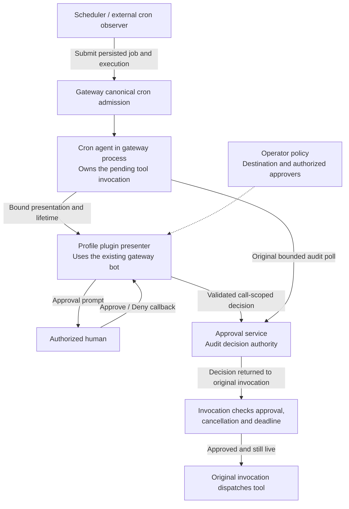

# Cron approval presentation



Agent cron jobs execute inside the gateway's canonical session owner. An external
scheduler worker submits and observes that admission; it does not run the agent.
A gateway plugin can present the pending invocation through an existing platform
connection using `ctx.cron_approvals`. This API carries presentation and lifetime
information only. It cannot return an approval decision or dispatch a tool.

Selecting a profile selects configuration and available transports. It does not make
the cron session a Telegram sender. `_CronRunScope` still clears `HERMES_SESSION_*`;
job `origin` and result-delivery targets must never become approval authority.

## Plugin contract

This API is for trusted **in-process** plugins. Isolated plugin hosts cannot use it.
The approval plugin must already be loaded for the runtime profile in the gateway
when execution starts. A job in a profile's cron store does not load its gateway
plugins. Secondary profiles need their own served transports or an explicit shared
transport mapping. The API never borrows another profile's presenter or starts a
second bot connection. Register a gateway presenter during plugin registration:

```python
from contextlib import contextmanager

def register(ctx):
    @contextmanager
    def present(request, lifetime):
        # Select transport and approvers from protected operator policy.
        # Each callback must check lifetime before and after decision I/O.
        lifetime.check()
        prompt = open_presentation(request, lifetime)
        try:
            yield
        finally:
            retire_presentation(prompt)

    handle = ctx.cron_approvals.register_presenter(present)
```

The callback receives a frozen `ApprovalRequest`: `profile_home`, `job_id`,
`execution_id`, `session_id`, `external_session_id`, `call_id`, `invocation_id`, and
`deadline` (absolute monotonic time on this host). Presentation is capped at 600
seconds without extending the original deadline. `ApprovalLifetime` provides
`check()`, `remaining_seconds`, `request(operation)`, and an `ended` event. Its
terminal reason is latched. A replacement registration or plugin unload invalidates
old presentations; an abandoned loader cannot register one. Callbacks run on a
background thread under the presenter's captured profile context.

In the original invocation, keep the existing bounded audit poll inside:

```python
with ctx.cron_approvals.pending(
    session_id=current_session_id,
    external_session_id=audit_session_id,
    call_id=pending_call_id,
    deadline=invocation.deadline,
    check=invocation.check,
):
    decision = poll_original_audit(invocation)
invocation.check()
# Only the original invocation's existing guard may decide to dispatch here.
```

`ctx.cron_approvals.available` indicates this plugin is running in its live canonical
cron execution context. It does not guarantee that a prompt can be sent. Missing
presenters and presentation failures retain the original bounded external audit
wait; they never imply approval. `check` must be a thread-safe, nonblocking check of
the original invocation's cancellation/deadline, and must raise when it is no longer
live. It also runs on the presentation monitor under the invocation's copied context.

Choose a cron-specific integration path using `ctx.current_cron_execution()`, not
`available`. Availability becomes false during cancellation or gateway drain; that
must not send the same cron invocation through an interactive-session fallback.

## Ownership and isolation

The canonical owner binds a fresh in-memory presentation scope around `run_job`.
The scheduler binds the actual agent object after construction. Requests must match
that object's current session, the bound job/execution, the profile home, and the
owner process. Compression may rotate the bound agent's session ID; request
arguments cannot rebind it. Nested jobs and delegated children cannot borrow an
outer invocation's scope. A forked child fails the process check; ordinary tool
subprocesses and external scheduler observers have no presentation context.

There is no new worker/gateway socket or administrative credential. Writable job
files, the execution ledger, job origin, and matching UID grant no presentation
authority. Installed gateway/plugin code and process debugging permissions remain
inside the trusted host boundary; this is not a sandbox for injected Python.

At most 16 presentations and 1,024 distinct calls are admitted per execution.
Duplicate call fences remain until execution ends, including after failed or
ambiguous sends. Plugin reload does not give an old execution a new presenter.

## Lifecycle and fallback

| Event | Presentation | Original execution |
|---|---|---|
| Authorized button | Plugin records a call-scoped audit decision | Original poll and final cancellation check decide whether to proceed |
| Invocation cancellation, deadline, or execution end | Retired; late callbacks fail lifetime checks | Existing cancellation/deadline policy applies |
| Gateway drain, authority retirement, or plugin unload | Retired; no prompt recovery or replay | Existing canonical execution policy applies |
| Ambiguous send | No automatic retry; call fence remains | External audit wait remains available |
| No presenter for the runtime profile | No prompt | External audit wait remains available |

Lifetime is checked before presentation and every 0.5 seconds while pending.
Callbacks must check lifetime themselves, including after network I/O. A decision
racing cancellation may still be recorded in the audit, but cannot bypass the
original invocation's final cancellation check.

Gateway restart does not reconstruct presentation authority from disk. Ordinary
cron result delivery keeps its separate durable queue. A plugin must retire
**presentation only** on lifetime loss, not convert a still-pending external audit
into a denial. Destination, actor, bot, topic, message, and call validation remain
the approval plugin's responsibility.

Session injection was not reused: it starts another agent turn rather than resuming
the blocked invocation. No model tool, Telegram poller, behavior env var, or remote
presentation RPC is added.
