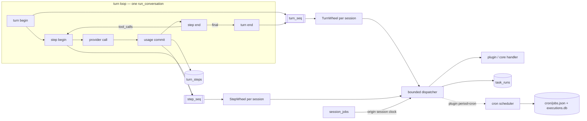

# Scheduled Tasks: Turn, Step, and Time

**Status: P0–P4 implemented; P5 pending.** Implemented: the `turn_steps` ledger and
`turn_seq`/`step_seq` clocks (P0); the engine, timing wheels, bounded dispatch and built-ins
(P1); `ctx.schedule` with `task_state` cadence reset and `task_runs` (P2); `cronjob_manage`
turn/step schedules backed by `session_jobs` (P3); the `plugin_task` cron payload kind (P4).
Still design-only: `hermes scheduler list/runs` and dashboard surfacing (P5).

This page specifies how Hermes exposes scheduled work at three cadences — **turn**, **step**, and
**wall-clock (cron)** — to plugins and to the agent's own `cronjob_manage` tool, and how every
step is recorded in `state.db` with full usage accounting.

Counter semantics are defined in [Turn and Step Counters](./turn-and-step-counters.md); read that
first. This document builds on it and does not redefine `api_call_count`, `turn_id`, or the
delta-queue accounting.

## Goals

- Plugins can register periodic tasks on the turn clock and the step clock, and wall-clock tasks
  on the existing cron scheduler.
- Turn/step tasks use a hierarchical timing wheel over a **logical** clock. Registration is
  idempotent; a period change resets the cycle.
- Every provider call writes one row to `turn_steps` with role, session, turn, profile/agent,
  token buckets (including cache read/write), cost, and timings.
- Turn/step task history is durable in `state.db`.
- `cronjob_manage` can schedule turn/step work, with a response contract that tells the truth
  about lifetime (session-bound, not gateway-dependent).

## Non-goals

- No new wall-clock scheduler. Cron keeps owning timezones, DST, catch-up windows, quota holds,
  claims, delivery, and its `executions.db` ledger.
- Turn/step tasks are **observers**. They never mutate messages, the system prompt, the toolset, or
  the model. That invariant is what keeps per-conversation prompt caching intact.
- No turn/step task runs `run_conversation` in the originating session. Agent jobs fired from a
  turn/step clock start a fresh session (see [Agent-scheduled jobs](#agent-scheduled-turnstep-jobs)).

## The three clocks

| Clock | Owner | Advances | Persisted | Fires |
|---|---|---|---|---|
| Turn | `AIAgent` + scheduler engine | once per completed turn | `sessions.turn_seq` (new) | before/after a turn boundary |
| Step | `AIAgent` + scheduler engine | once per provider call that returns a response | `sessions.step_seq` (new) | before a request reaches the provider / after its usage is committed |
| Time | `cron/` scheduler | wall clock | `jobs.json` + `cron/executions.db` | existing ticker |

`turn_id` is an opaque identity (Relay/lease key), never an ordinal. There is **no** persisted turn
total in the current schema; `turn_seq` is a new durable counter, seeded for legacy sessions from
the existing `role == 'user'` rehydration in `agent/turn_context.py`.

`api_call_count` is **not** a step ordinal: it is refunded on preflight compactions, empty-response
rerolls, and provider-switch hops (`agent/turn_context_compaction.py:103`,
`agent/turn_preflight.py`, `agent/turn_iteration_prep.py`, `agent/turn_empty_response.py`), so a
turn can emit step indexes 1,2,1,2,3. Step identity is `step_seq`.

## Architecture



One `SchedulingEngine` per process (CLI, gateway, TUI each have one), one wheel pair per active
session, lazily created. A session is owned by one process at a time (`session_turn_leases`), so no
cross-process wheel coordination exists or is needed.

## Timing wheel

- **Hierarchical, sparse.** Three levels × 256 slots; each slot is a `dict[int, list[Node]]`, so
  memory scales with scheduled nodes, not with sessions × 768.
- Placement: `next_due % 256` in L0; `next_due // 256 % 256` in L1 for strides ≥ 256; L2 beyond
  65 536. Each tick drains one slot; crossing a 256 / 65 536 boundary cascades the parent slot down.
  Insert is O(1); advance is amortized O(1); tick cost is bounded.
- Deterministic order: FIFO inside a slot, reinsertion after firing preserves registration order.
- **Logical time only.** No wall-clock jitter; `next_due = committed_seq + every`. A refunded
  iteration never commits, so it neither advances the clock nor fires a task.
- **Crash-safe without persisting the wheel.** `next_due` is recomputable from
  `sessions.step_seq` / `sessions.turn_seq` and the stride. A session resumed after a restart
  re-derives its schedule; no missed-fire catch-up exists because logical time only advances when
  real turns happen.
- **Pre-phase placement.** Pre handlers fire after `run_preflight_gate` returns a non-`continue`
  verdict and before `announce_api_call`, i.e. only for requests that will reach the provider.
  Pre handlers must be idempotent and side-effect-light: a crash between pre-fire and commit
  re-runs the same logical step.

Why a wheel at all: pure `every=N` could be a modulo scan over a task list. The wheel buys a
bounded tick, one-shot delays ("fire at step 500"), and stable FIFO firing order for roughly 150
lines. Do not grow it into a general job queue.

## Step ledger

### Emission chokepoints

Every path that spends tokens must produce exactly one `turn_steps` row. There are five today:

| Producer | Notes |
|---|---|
| Main loop `record_response_usage` | via `queue_token_counts`; a usage-less response queues no counter delta, so its zero-token row is `usage_status='missing'` |
| Codex app-server `_record_codex_app_server_usage` | per turn, `api_calls=1`; a usage-less turn still queues `api_call_count=1`, so its zero-token row is `usage_status='ok'` |
| Auxiliary `record_aux_usage` → `record_auxiliary_usage` | one row per response, `role='aux'`, `task` set |
| `background_review` | one write for N fork calls → **aggregated** row |
| `agent_run` (named agents) | one write for N calls → **aggregated** row |
| Managed worker | `_worker_usage` RPC applies the same payload; the payload allowlist must accept a `step` field |

The single aggregate chokepoint is `_update_token_counts_in_transaction` /
`_record_model_usage` (`hermes_state_usage.py`); `record_auxiliary_usage` reaches the same helper
inside its own transaction. Step rows travel **with** that write, but are built by the producer,
never derived from it.

### Identity and idempotency

| Column | Contract |
|---|---|
| `step_seq` | committed logical step, dense and monotonic per session; `UNIQUE(session_id, step_seq)`; the **only** dedupe key |
| `iteration_uid` | minted in `begin_iteration` (`turn_id:it:<12 hex>`), indexed **not unique**; correlates pre/post hooks, aux context, and logs |
| `step_index` | `agent._api_call_count` at response time; diagnostic only, may repeat and skip |
| `request_id` | `_current_api_request_id`; diagnostic only, collides by construction after refunds |

An iteration that yields more than one response produces more than one step row with the same
`iteration_uid` and distinct `step_seq`. Nothing may upsert on `(turn_id, step_index)`.

### Aggregation contract

Writes that summarize N calls do not expand into N rows — the per-call detail does not exist
(forks have `_session_db=None`; `agent_run` keeps only totals). They carry:

- `usage_status='aggregated'`
- `api_calls=N`
- `step_kind='aux'`, `turn_id IS NULL`, `step_seq IS NULL` — they never tick the step clock.

`usage_status` is one of `ok`, `missing`, `aggregated`.

### Schema

```sql
ALTER TABLE sessions ADD COLUMN turn_seq INTEGER NOT NULL DEFAULT 0;
ALTER TABLE sessions ADD COLUMN step_seq INTEGER NOT NULL DEFAULT 0;

CREATE TABLE IF NOT EXISTS turn_steps (
    id INTEGER PRIMARY KEY AUTOINCREMENT,
    session_id TEXT NOT NULL REFERENCES sessions(id) ON DELETE CASCADE,
    turn_id TEXT,
    step_seq INTEGER,
    turn_seq INTEGER,
    step_index INTEGER,
    parent_step_id INTEGER REFERENCES turn_steps(id),
    role TEXT NOT NULL CHECK (role IN ('assistant','tool','aux')),
    step_kind TEXT NOT NULL CHECK (step_kind IN ('llm','tool','aux')),
    agent_name TEXT NOT NULL DEFAULT '',
    profile_name TEXT NOT NULL DEFAULT '',
    model TEXT NOT NULL DEFAULT '',
    provider TEXT NOT NULL DEFAULT '',
    billing_provider TEXT NOT NULL DEFAULT '',
    billing_base_url TEXT NOT NULL DEFAULT '',
    billing_mode TEXT NOT NULL DEFAULT '',
    task TEXT NOT NULL DEFAULT '',
    usage_status TEXT NOT NULL DEFAULT 'ok'
        CHECK (usage_status IN ('ok','missing','aggregated')),
    api_calls INTEGER NOT NULL DEFAULT 1,
    tool_call_count INTEGER NOT NULL DEFAULT 0,
    tool_names TEXT,
    input_tokens INTEGER NOT NULL DEFAULT 0,
    output_tokens INTEGER NOT NULL DEFAULT 0,
    cache_read_tokens INTEGER NOT NULL DEFAULT 0,
    cache_write_tokens INTEGER NOT NULL DEFAULT 0,
    reasoning_tokens INTEGER NOT NULL DEFAULT 0,
    total_tokens INTEGER NOT NULL DEFAULT 0,
    estimated_cost_usd REAL NOT NULL DEFAULT 0,
    actual_cost_usd REAL NOT NULL DEFAULT 0,
    cost_status TEXT,
    cost_source TEXT,
    pricing_version TEXT,
    started_at REAL NOT NULL,
    ended_at REAL NOT NULL,
    duration_ms INTEGER NOT NULL DEFAULT 0,
    status TEXT NOT NULL DEFAULT 'ok'
        CHECK (status IN ('ok','error','timeout','interrupted')),
    finish_reason TEXT,
    request_id TEXT,
    iteration_uid TEXT,
    error TEXT,
    UNIQUE (session_id, step_seq)
);

CREATE INDEX IF NOT EXISTS idx_turn_steps_session ON turn_steps(session_id, step_seq DESC);
CREATE INDEX IF NOT EXISTS idx_turn_steps_turn ON turn_steps(turn_id);
CREATE INDEX IF NOT EXISTS idx_turn_steps_time ON turn_steps(profile_name, started_at DESC);
```

SQLite permits multiple NULL `step_seq` values, so aux and aggregated rows coexist with the unique
constraint.

### Write path

Token deltas are queued to a single writer thread (`hermes_state_usage.py`). The queue entry gains
a step payload:

```text
TokenDelta(kwargs)                # coalescable, unchanged
TokenDelta(kwargs, step)          # never coalesced; inserts one row in the same transaction
StepOnly(step)                    # no usage write (usage-less main-loop response)
```

- The coalescer only inspects token fields; it structurally cannot see step entries.
- The writer applies a whole batch in **one** `_execute_write` transaction: session counter update,
  `_record_model_usage` upsert, `turn_steps` insert, and `sessions.step_seq = MAX(step_seq, ?)`.
- Aux writes are their own synchronous transaction; insert the row inside the same `_write(conn)`.
- `absolute=True` writes (gateway counter overwrite) carry no step: they have no per-call
  attribution, and `session_model_usage` already skips them.

### Reconciliation invariants

1. Tokens/cost reconcile exactly, because both rows come from the same payload in the same
   transaction: for every `(session, model, billing_provider, billing_base_url, billing_mode, task)`,
   `sum(turn_steps.*_tokens|cost) == session_model_usage`.
2. `sum(turn_steps.api_calls WHERE step_kind='llm') == sessions.api_call_count + count(usage_status='missing')`.
   `missing` is reserved for chat-completions usage-less responses, which never queue a counter
   delta. A codex usage-less turn **does** increment `sessions.api_call_count`, so its row must be
   `usage_status='ok'`; marking it `missing` double-counts in this invariant.
3. `sum(turn_steps.api_calls WHERE step_kind='aux') == sum(session_model_usage.api_call_count WHERE task != '')`.
   This is the only reconciliation outlet for `background_review` and `agent_run` aggregates.
4. `step_seq` is dense and unique among `step_kind='llm' AND turn_id IS NOT NULL` rows; aux and
   aggregated rows are NULL and outside the clock.

### Retention

`scheduler.steps.max_rows_per_session` (default 2000, keep newest plus every non-`ok` row) and
`scheduler.steps.retention_days` (default 30). Pruning touches only `turn_steps`; aggregates are
never rewritten. Sessions delete their rows via `ON DELETE CASCADE`.

## Turn/step task engine

### Registration

```python
handle = ctx.schedule(
    name="acme.cache-audit",     # plugin-id prefix enforced
    period="step",               # "step" | "turn" | "cron"
    every=10,                    # step/turn stride; cron uses cron="*/5 * * * *"
    phase="post",                # "pre" | "post"
    handler=fn,                  # (TaskContext) -> None | Awaitable[None]
    timeout_ms=50,
)
```

Validation at registration: unique namespaced name, `every >= 1`, at most 32 tasks per plugin,
callable handler, parseable cron expression. `PluginRegistration` teardown removes wheel nodes and
pauses a backing cron job (`paused_reason="plugin unloaded"`).

`TaskContext` is frozen and deliberately narrow: `session_id`, `profile_name`, `agent_name`,
`turn_id`, `turn_seq`, `step_seq`, `step_index`, `phase`, `now`, `step: StepView | None`,
`result_status`. No agent handle, no message list.

### Dispatch: bounded, never inline

Sync handlers are **not** run on the turn thread inline. The engine reuses the contract already
proven for hot-path hooks (`hermes_cli/plugins_dispatch.py`): run the callback on a daemon worker,
wait with a wall-clock cap, and **abandon without joining** on timeout; suppress the same callback
for a window; cap abandoned workers per callback. Extract that primitive into a shared
`BoundedCallbackRunner` and give the engine its own instance.

- Gate key: `(task_name, session_id, step_seq|turn_seq)`. A still-running fire skips only that
  session's next boundary, never another session's.
- Sync: daemon worker + `done.wait(timeout)`. Timeout and abandonment are recorded; the turn
  continues.
- Async: `asyncio.wait_for` on the engine's own loop thread (cancelled, not abandoned), matching
  `ainvoke_hook`.
- Cap: `max_abandoned_workers = 3` per `(task, session)`; at the cap the task keeps being skipped
  and `task_runs` says so.
- Every outcome writes a `task_runs` row: `ok`, `error`, `timeout`, `skipped`
  (`suppressed`/`still_running`/`abandoned_cap`/`backpressure`), `disabled`, `rescheduled`.

Zero registrations short-circuits before any lock, allocation, or DB call: a single `_active` flag
check on the step path.

### Period change detection and reset

Detection happens on **every** `register(ctx)` — process boot, hot reload, and version upgrades use
the same path — and compares against `task_state` in the database, not against the previous
in-memory spec.

```sql
CREATE TABLE IF NOT EXISTS task_state (
    plugin_id TEXT NOT NULL,
    task_name TEXT NOT NULL,
    period TEXT NOT NULL,
    every INTEGER NOT NULL,
    phase TEXT NOT NULL DEFAULT 'post',
    spec_hash TEXT NOT NULL,
    enabled INTEGER NOT NULL DEFAULT 1,
    disabled_by TEXT,
    error_streak INTEGER NOT NULL DEFAULT 0,
    run_count INTEGER NOT NULL DEFAULT 0,
    error_count INTEGER NOT NULL DEFAULT 0,
    next_due_hint INTEGER,
    last_fired_at REAL,
    last_status TEXT,
    updated_at REAL NOT NULL,
    PRIMARY KEY (plugin_id, task_name)
);

CREATE TABLE IF NOT EXISTS task_runs (
    id INTEGER PRIMARY KEY AUTOINCREMENT,
    plugin_id TEXT NOT NULL DEFAULT 'core',
    task_name TEXT NOT NULL,
    period TEXT NOT NULL CHECK (period IN ('turn','step')),
    phase TEXT NOT NULL CHECK (phase IN ('pre','post')),
    owner_pid TEXT NOT NULL DEFAULT '',
    session_id TEXT, turn_id TEXT, turn_seq INTEGER, step_seq INTEGER, step_index INTEGER,
    profile_name TEXT NOT NULL DEFAULT '',
    agent_name TEXT NOT NULL DEFAULT '',
    started_at REAL NOT NULL,
    ended_at REAL NOT NULL,
    duration_ms INTEGER NOT NULL DEFAULT 0,
    status TEXT NOT NULL
        CHECK (status IN ('ok','error','timeout','skipped','disabled','rescheduled')),
    error TEXT
);
CREATE INDEX IF NOT EXISTS idx_task_runs_task ON task_runs(task_name, started_at DESC);
CREATE INDEX IF NOT EXISTS idx_task_runs_session ON task_runs(session_id, started_at DESC);
```

Algorithm:

1. No row → insert, `next_due_hint = committed_clock + every`.
2. Row exists and `spec_hash` matches → **no reset**: swap the handler reference atomically, keep
   `error_streak` and breaker state. Hot reload does not disturb cadence.
3. `spec_hash` differs → **reset**: update spec columns, re-base `next_due_hint`, clear
   `error_streak`, clear `disabled_by='breaker'` (keep `'admin'`), write one
   `task_runs(status='rescheduled', error='every 10→3; phase post→pre')` audit row, then replace
   the wheel nodes under the session lock.

Because the spec lives in the database, changing a built-in's `every` in code resets it on the next
boot without a data migration, and an admin-disabled task stays disabled across the change.
Cron-backed registrations compare the expression and route through `cron.jobs.update_job`, which
already re-anchors `next_run_at`.

`task_runs` mirrors `worker_executions` conventions (owner pid, terminal status, per-fire rows) but
does not reuse that table: `worker_executions` is an ownership/claim ledger with epochs, adoption
digests, and receipts; scheduled observers have no claim and no receipt.

### Built-in tasks

Registered through the same API with `plugin_id="core"`, each with a named consumer:

| Task | Period | Purpose |
|---|---|---|
| `core.steps.prune` | turn, every 50, post | trim `turn_steps` past the per-session cap |
| `core.cache.audit` | step, every 10, post | cache hit ratio over the last 10 steps; warn on regression |
| `core.usage.rollup` | step, every 32, post | force-drain the accounting queue during long turns |

No hook or task is registered without a concrete consumer; speculative surface is rejected.

## Agent-scheduled turn/step jobs

`cronjob_manage` gains turn/step schedules, but they do **not** live in `jobs.json`. Every cron job
invariant is wall-clock based (timezone pinning, catch-up windows, `pending_slot`, quota holds,
occurrences, detached worker sessions), so a logical-schedule job would bypass or corrupt them.

### Grammar

| Input | Parsed |
|---|---|
| `every 3 turns` / `every 2 steps` | `{"kind":"turn"|"step","every":3}`, repeat forever |
| `each turn` / `every step` | `every=1` |
| `in 2 turns` / `in 5 steps` | same plus `once=true`, repeat 1 |

Parsing happens before duration parsing so `"every 3 turns"` does not fall into `parse_duration`.

### Storage

```sql
CREATE TABLE IF NOT EXISTS session_jobs (
    id TEXT PRIMARY KEY,                    -- 'tj_' + uuid8, never collides with cron ids
    origin_session_id TEXT NOT NULL REFERENCES sessions(id) ON DELETE CASCADE,
    profile_name TEXT NOT NULL DEFAULT '',
    name TEXT,
    kind TEXT NOT NULL CHECK (kind IN ('turn','step')),
    every INTEGER NOT NULL CHECK (every >= 1),
    remaining INTEGER,                      -- NULL = forever
    next_due_seq INTEGER NOT NULL,
    prompt TEXT NOT NULL,
    skills TEXT,
    deliver TEXT, failure_deliver TEXT,
    enabled INTEGER NOT NULL DEFAULT 1,
    paused_reason TEXT,
    origin_depth INTEGER NOT NULL DEFAULT 0,
    created_at REAL NOT NULL, updated_at REAL NOT NULL,
    last_fired_at REAL, last_status TEXT
);
CREATE INDEX IF NOT EXISTS idx_session_jobs_session
    ON session_jobs(origin_session_id, next_due_seq);

CREATE TABLE IF NOT EXISTS session_job_runs (
    id INTEGER PRIMARY KEY AUTOINCREMENT,
    job_id TEXT NOT NULL,
    origin_session_id TEXT,
    fired_at_seq INTEGER NOT NULL,
    run_session_id TEXT,
    parent_job_id TEXT,
    started_at REAL NOT NULL, ended_at REAL, status TEXT NOT NULL, error TEXT
);
```

The engine loads a session's jobs at session start and keeps a small `next_due_seq` min-heap;
create/update/remove write the table and refresh the heap. Sessions with no jobs pay one empty-heap
check per step. When the origin session ends, its jobs are paused with
`paused_reason='origin session ended'` and remain visible in `cronjob_manage(action='list')`.

### Tool response contract

Turn/step jobs are session-bound; cron jobs are not. The tool must say so explicitly, or the model
will promise the user a task that dies with the chat.

| Field | cron / interval / once | turn / step |
|---|---|---|
| next fire | `next_run_at` | `next_due_turn` / `next_due_step` |
| activation | `_gateway_liveness_notice()` | `activation: "this session (in-process; no gateway)"` — liveness notice suppressed |
| lifetime | independent of the chat | `lifetime: "ends with this session; pauses when it ends"` |
| binding | none | `origin_session_id`; create without one is rejected |
| delivery | `deliver` resolution + `_local_delivery_notice` | same (delivery semantics are unchanged) |

`schema.description` carries the same constraint so the model sees it before calling.

### Firing

After a step/turn commits, take due jobs for that session and claim each with a compare-and-set:

```sql
UPDATE session_jobs
   SET next_due_seq = next_due_seq + every,
       remaining = CASE WHEN remaining IS NULL THEN NULL ELSE remaining - 1 END,
       last_fired_at = ?
 WHERE id = ? AND next_due_seq = ? AND enabled = 1
```

A lost CAS means another process/turn already fired it. A successful claim dispatches through the
existing background-run path, and the job executes in a **fresh session** with the usual cron
prompt contract; the origin session's clock is therefore never advanced by its own job and no
self-trigger loop exists.

**Chain depth:** a job's run may itself create a session job. The new job records
`origin_depth = parent + 1`; at depth ≥ 3, creation fails with `"scheduled job chain depth
exceeded"`. `session_job_runs.parent_job_id` keeps the lineage visible.

`action='run'` fires immediately without moving `next_due_seq`. `action='update'` to a turn/step
schedule re-bases `next_due_seq = current session seq + every`.

## Plugin wall-clock tasks

`ctx.schedule(period="cron", cron="…")` does not duplicate time handling. It creates a cron job of
a new, mutually exclusive payload kind `plugin_task` (alongside `prompt` and `script`) so all
schedule invariants stay intact. The scheduler thread dispatches the registered handler in-process;
a pre-run script would still be a subprocess. If the plugin is missing or disabled at fire time the
run fails visibly with a reason (no silent skip, no retry storm), and uninstalling pauses the job
with `paused_reason="plugin unloaded"`. History stays in `cron/executions.db`.

This is the only `cron/jobs.py` change in the design, and it is gated behind its own phase.

## Persistence and migrations

- New tables are added to `SCHEMA_SQL` with `CREATE TABLE IF NOT EXISTS`; no `SCHEMA_VERSION` bump,
  because this repository reserves the version for data migrations only.
- `sessions.turn_seq` / `sessions.step_seq` are added with
  `hermes_cli.sqlite_util.add_column_if_missing`.
- `turn_steps`, `task_runs`, `task_state`, `session_jobs`, `session_job_runs` all live in the
  per-profile `state.db`; `cron/executions.db` is untouched.
- Writers use WAL plus the existing single-writer batching. Step/task persistence failures are
  logged and counted in `state_meta`; they never raise into a turn.

## Configuration

Behaviour belongs in `config.yaml`, never in new environment variables:

```yaml
scheduler:
  wheel:
    buckets: 256
    levels: 3
  turn_step:
    handler_timeout_ms: 50
    max_abandoned_workers: 3
    max_tasks_per_plugin: 32
  steps:
    retention_days: 30
    max_rows_per_session: 2000
```

## Testing

Behaviour contracts, run under `scripts/run_tests.sh` with a temp `HERMES_HOME`:

1. Wheel: strides 1/3/256/65536, one-shot delay, FIFO order inside a slot, cascade, reinsertion,
   sparse memory.
2. Refund semantics: a preflight-refunded iteration fires no pre task, advances nothing, and leaves
   no row; a later iteration reuses the same provisional number.
3. Identity: two responses in one iteration produce two rows, one `iteration_uid`, distinct
   `step_seq`; no dedupe ever keys on `step_index`.
4. Emission coverage: main loop, codex (with and without usage), auxiliary, `background_review`
   (N=7 aggregate), `agent_run`, and the managed-worker RPC each produce the expected rows.
5. Reconciliation: invariants 1–3 hold for a normal turn, a tool-heavy turn, a retried turn, a
   compression turn, a subagent turn, and a turn with auxiliary calls.
6. Dispatch: a slow sync handler times out, is abandoned, and suppresses only its own session; the
   abandoned-worker cap holds; an async handler is cancelled on timeout; backpressure is recorded.
7. Registration: identical spec reload does not reset; a changed `every`/`phase` resets once and
   writes the audit row; admin-disabled survives a spec change; breaker-disabled is cleared.
8. `session_jobs`: CAS fires exactly once, `remaining` reaches zero, session deletion cascades, the
   depth cap rejects the fourth job, and a session job never appears in `jobs.json`.
9. Reporting: turn/step create responses carry no `next_run_at`, no gateway-liveness text, and the
   session lifetime line.
10. Hot path: with no registrations and no session jobs, a step performs no DB or wheel work.

## Phasing

| Phase | Scope | Value |
|---|---|---|
| P0 | `turn_steps` ledger + counters + reconciliation tests | per-step attribution, no scheduler |
| P1 | engine, wheels, bounded dispatch, built-ins | turn/step core |
| P2 | `ctx.schedule`, period-change reset, `task_runs` | plugin surface |
| P3 | `cronjob_manage` turn/step branch + `session_jobs` | agent-facing scheduling |
| P4 | `plugin_task` cron kind | plugin wall-clock tasks |
| P5 | `hermes scheduler list/runs`, dashboard surfacing | operability |

P0 ships independently: the ledger is useful even if the scheduler is never built.

## Risks and tradeoffs

- **A wheel is not free.** For a handful of pure `every=N` tasks a modulo scan is simpler. The
  wheel is justified by one-shot delays, bounded tick cost, and deterministic ordering.
- **Per-step persistence.** Batched into the accounting transaction; a crash can lose the tail of
  the current turn's steps while aggregates remain correct. A dropped-step counter in `state_meta`
  keeps the loss visible.
- **Sync handlers still cost a thread hop and up to `timeout_ms`.** That is the price of not letting
  a plugin wedge the turn; the same contract already governs hot-path hooks.
- **Aggregated rows lose per-call detail.** That detail does not exist upstream; `usage_status` and
  `api_calls` make the limitation explicit instead of silently splitting invented rows.
- **`turn_steps` is the largest new table.** Per-session caps plus age retention plus the existing
  VACUUM policy bound it; caps must stay configurable.
- **Session-bound agent jobs look like cron jobs.** The response contract, schema text, pause
  reason, and list labelling all exist to prevent that confusion; changing any of them re-opens it.
