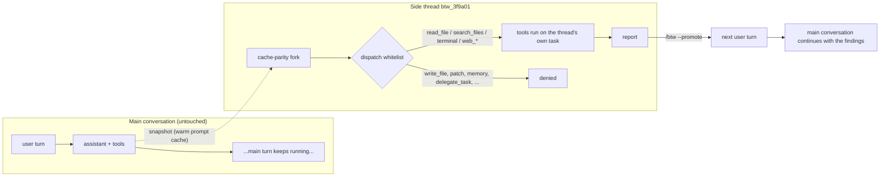
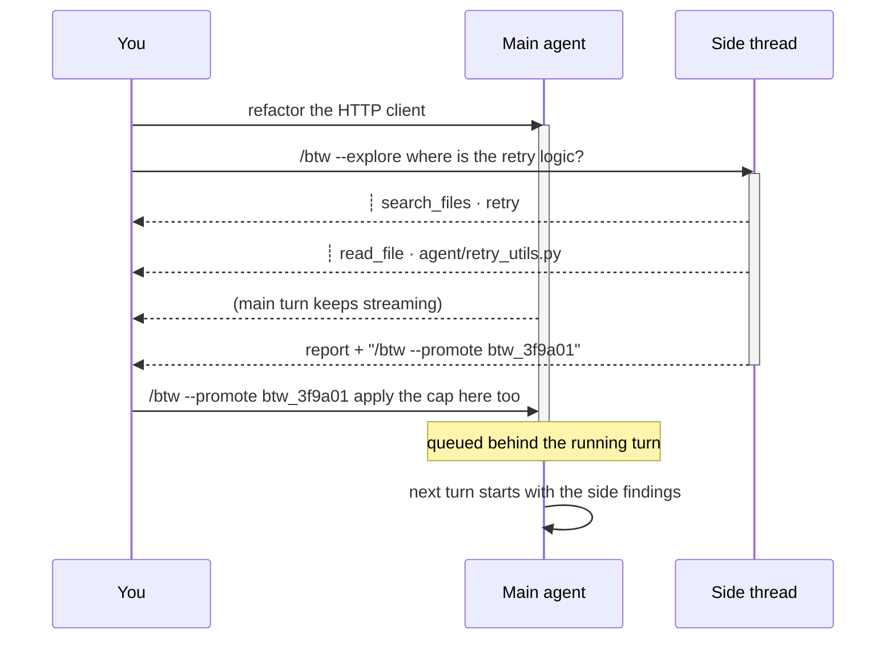

# Side Threads (`/btw --explore`)

`/btw` asks a quick side question about the conversation without interrupting it. Sometimes the
side question needs real digging — *"where is the retry/backoff logic, and does it cap the delay?"* —
and answering from the transcript alone is not enough. `/btw --explore` forks a **side thread** that
can search files, read code and run read-only commands while the main agent keeps working. When it
reports, you decide whether its findings belong in the main conversation.


The side thread's steps (`┊ 🔭 btw_abf247 …`) interleave with the main turn's own tool calls. When it
finishes, its report lands in its own panel, with a footer naming what it ran; `/btw --threads`
lists the conversation's threads:


`/btw --promote` then sends that report as your next message, and the main agent picks it up:


## Commands

| Command | What it does |
|---|---|
| `/btw <question>` | Unchanged: a quick, tool-less answer from a snapshot of the conversation. |
| `/btw --explore <task>` (`-e`) | Start a side thread that investigates `<task>` with tools. Its steps stream as they happen; its report arrives when it finishes. |
| `/btw --threads` (`--list`) | List this conversation's side threads with status, elapsed time, tool count and (while running) the latest step. |
| `/btw --promote [id] [note]` (`-p`) | Bring a finished thread's report into the main conversation as your next message. Without an id, the most recent finished thread. The optional note is appended as your instruction. |
| `/btw --stop <id>` | Stop a running thread. |
| `/btw -- <text>` | Ask a classic question that starts with `--`. |

Thread ids accept the full id (`btw_3f9a01`), the id without `btw_`, or a unique prefix of at least
four characters.

## How it works



A side thread is the `/btw` fork with tools switched on:

- **Same context, warm cache.** The thread is a detached fork of the live agent. It replays the
  conversation snapshot byte-for-byte, so its first request reads the provider's prompt cache the
  main conversation already warmed. The system prompt and the advertised tool list are identical to
  the main agent's.
- **Tools are limited at dispatch.** Only the tools in
  `auxiliary.side_question.explore_tools` that the main agent already has may run; any other call is
  refused and the model is told which tools it may use. Dangerous-command approvals are answered
  **deny** automatically (nobody can approve a prompt from a side thread while the main turn owns the
  screen), and skill secret prompts are skipped.
- **Its own sandbox.** Tools run under the thread's own task id, so it gets its own terminal
  environment and process table, released when the thread ends. The main session's terminal (its
  working directory, background processes) is never touched.
- **Nothing is written until you promote.** The thread never adds messages to the main transcript,
  never touches the session database, and never changes the system prompt. Its usage is recorded on
  the parent session as `side_exploration`.
- **Promotion is a normal turn.** `/btw --promote` sends the report as your next message, clearly
  marked as findings from a side thread. If the agent is busy, it is queued behind the running turn
  like any queued prompt. That keeps the main conversation's prompt cache and role alternation
  intact: history only ever grows by real turns.



Because the fork replays the conversation verbatim, its first request repeats what the main
conversation already sent — the part a provider's prompt cache can serve. A `/bg` task on the same
question starts a fresh session with its own system prompt, so none of it matches:


## Where it works

| Surface | Progress | Report | Promotion |
|---|---|---|---|
| Classic CLI | dim `┊ 🔭 <id>` lines | side-result panel (with bell) | queued as the next turn |
| TUI (Ink) | `[btw <id>] ┊ <step>` lines | `[btw "<task>"]` line | sent now, or queued while busy |
| Desktop | one live `[btw <id>]` row per thread | system row | sent now, or queued while busy (the `/goal` kickoff path) |
| Messaging (Telegram, Discord, Slack, …) | `/btw --threads` shows each thread's latest step | sent to the chat | pushed onto the chat's queue as the next turn |

A side thread needs a live agent to fork. On a messaging platform, send a normal message first if
the chat's agent was evicted for being idle. Side threads are unavailable with providers that run
their own tools (agent-as-provider runtimes) and with mixture-of-agents models, because their tool
calls cannot be held to a dispatch whitelist. At most three threads run per conversation at once,
and the eight most recent finished ones are kept for listing and promotion.

## Configuration

Side threads read the same `auxiliary.side_question` block as `/btw`:

```yaml
auxiliary:
  side_question:
    # Tools a side thread may run. Replaces the default list; [] makes it tool-less.
    # Default: [read_file, search_files, terminal, web_search, web_extract]
    explore_tools: [read_file, search_files, terminal]
    # Model calls a thread may make (1-30). Default 12.
    explore_max_iterations: 12
    # Optional: route /btw (questions and threads) to another model. A routed fork replays a
    # compact digest instead of the full conversation, so it cannot read the main prompt cache.
    # provider: openrouter
    # model: google/gemini-3-flash
```

Drop `terminal` from `explore_tools` for a strictly read-only thread. A tool listed here still runs
only if the main agent has it enabled.

## Side threads vs `/btw`, `/bg` and `/branch`

| | Context | Tools | Runs beside the main turn | Reaches the main conversation |
|---|---|---|---|---|
| `/btw <question>` | conversation snapshot | none | yes | never |
| `/btw --explore <task>` | conversation snapshot | exploration whitelist | yes | only when you `/btw --promote` |
| `/bg <prompt>` | fresh session | all enabled tools | yes | its result is shown, never added |
| `/branch` | full copy of the session | all enabled tools | no — you switch to it | it *is* a new session |
| `delegate_task` | the goal the agent writes | child's toolsets | inside the agent's turn | the child's summary, as a tool result |
