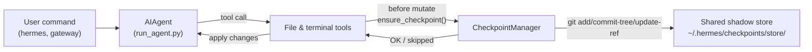

# チェックポイントと `/rollback`

Hermes Agent は、**破壊的操作** の前にプロジェクトを自動的にスナップショットし、1つのコマンドで復元できます。チェックポイントは v2 以降 **オプトイン** です。ほとんどのユーザーは `/rollback` を使わず、シャドウストアのストレージは時間が経つと無視できない量になるため、デフォルトはオフです。

セッションごとに `--checkpoints` でチェックポイントを有効にします。

```bash
hermes chat --checkpoints
```

または、`~/.hermes/config.yaml` でグローバルに有効にします。

```yaml
checkpoints:
  enabled: true
```

この安全策は、`~/.hermes/checkpoints/store/` の下に単一の共有シャドウ git リポジトリを保持する内部の **チェックポイントマネージャー** によって駆動されます。実際のプロジェクトの `.git` は決して触れられません。エージェントが作業するすべてのプロジェクトが同じストアを共有するため、git のコンテンツアドレス指定可能なオブジェクト DB が、プロジェクト間およびターン間で重複を排除します。

## チェックポイントをトリガーするもの

チェックポイントは、次の前に自動的に取得されます。

- **ファイルツール** — `write_file` と `patch`
- **破壊的なターミナルコマンド** — `rm`、`rmdir`、`cp`、`install`、`mv`、`sed -i`、`truncate`、`dd`、`shred`、出力リダイレクト（`>`）、`git reset`/`clean`/`checkout`

エージェントは **ディレクトリごと、ターンごとに最大1つのチェックポイント** を作成するため、長時間実行されるセッションでもスナップショットが乱発されることはありません。

## クイックリファレンス

セッション内のスラッシュコマンド:

| コマンド | 説明 |
|---------|-------------|
| `/rollback` | 変更統計とともにすべてのチェックポイントを一覧表示 |
| `/rollback <N>` | 手動での編集を保持したまま、チェックポイント N に復元（直前のチャットターンも取り消し） |
| `/rollback <N> --all` | 完全な復元 — 手動での編集も上書き |
| `/rollback diff <N>` | チェックポイント N と現在の状態との差分をプレビュー |
| `/rollback <N> <file>` | チェックポイント N から単一ファイルを復元 |

セッション外でストアを検査・管理するための CLI:

| コマンド | 説明 |
|---------|-------------|
| `hermes checkpoints` | 合計サイズ、プロジェクト数、プロジェクトごとの内訳を表示 |
| `hermes checkpoints status` | 素の `checkpoints` と同じ |
| `hermes checkpoints list` | `status` のエイリアス |
| `hermes checkpoints prune` | 強制スイープ: 孤立／古いものを削除、GC、サイズ上限を強制 |
| `hermes checkpoints clear` | チェックポイントベース全体を消去（最初に確認） |
| `hermes checkpoints clear-legacy` | v1 移行からの `legacy-*` アーカイブのみを削除 |

## チェックポイントの仕組み

大まかには:

- Hermes は、ツールが作業ツリー内の **ファイルを変更しようとしている** ことを検出します。
- 会話のターンごとに1回（ディレクトリごとに）、次のことを行います。
  - ファイルに対する妥当なプロジェクトルートを解決します。
  - `~/.hermes/checkpoints/store/` にある **単一の共有シャドウストア** を初期化または再利用します。
  - プロジェクトごとのインデックスにステージし、ツリーを構築し、プロジェクトごとの ref（`refs/hermes/<project-hash>`）にコミットします。
- これらのプロジェクトごとの ref が、`/rollback` で検査・復元できるチェックポイント履歴を形成します。



## 設定

`~/.hermes/config.yaml` で設定します。

```yaml
checkpoints:
  enabled: false              # master switch (default: false — opt-in)
  max_snapshots: 20           # max checkpoints per project (enforced via ref rewrite + gc)
  max_total_size_mb: 500      # hard cap on total store size; oldest commits dropped
  max_file_size_mb: 10        # skip any single file larger than this

  # Auto-maintenance (on by default): sweep ~/.hermes/checkpoints/ in the
  # background — the CLI on a helper thread right after launch, the gateway
  # on its housekeeping tick — and delete project entries whose last_touch is
  # older than retention_days. Runs at most once per min_interval_hours,
  # tracked via a .last_prune marker. It never blocks the prompt or gateway
  # startup: the `git gc` that reclaims space can take tens of seconds on a
  # large store. This sweep never deletes "orphan" entries (working directory
  # not found) — a missing workdir is ambiguous (deleted project vs. an
  # unmounted external volume / network share / VPN not yet up), so orphan
  # cleanup is only ever done via the explicit `hermes checkpoints prune`
  # command below, with a confirmation prompt.
  auto_prune: true
  retention_days: 7
  min_interval_hours: 24
```

すべてを無効にするには:

```yaml
checkpoints:
  enabled: false
  auto_prune: false
```

`enabled: false` のとき、チェックポイントマネージャーは何もせず、git 操作を試みることはありません。`auto_prune: false` のとき、ストアは `hermes checkpoints prune` を手動で実行するまで増え続けます。

## チェックポイントを一覧表示する

CLI セッションから:

```
/rollback
```

Hermes は、変更統計を示す整形されたリストで応答します。

```text
📸 Checkpoints for /path/to/project:

  1. 4270a8c  2026-03-16 04:36  before patch  (1 file, +1/-0)
  2. eaf4c1f  2026-03-16 04:35  before write_file
  3. b3f9d2e  2026-03-16 04:34  before terminal: sed -i s/old/new/ config.py  (1 file, +1/-1)

  /rollback <N>             restore to checkpoint N (keeps your hand-edits)
  /rollback <N> --all       full restore, overwriting your hand-edits too
  /rollback diff <N>        preview changes since checkpoint N
  /rollback <N> <file>      restore a single file from checkpoint N
```

## シェルからストアを検査する

```bash
hermes checkpoints
```

サンプル出力:

```text
Checkpoint base: /home/you/.hermes/checkpoints
Total size:      142.3 MB
  store/         138.1 MB
  legacy-*       4.2 MB
Projects:        12

  WORKDIR                                                       COMMITS    LAST TOUCH  STATE
  /home/you/code/hermes-agent                                        20       2h ago  live
  /home/you/code/experiments/rl-runner                                8       1d ago  live
  /home/you/code/old-prototype                                        3       9d ago  orphan
  ...

Legacy archives (1):
  legacy-20260506-050616                           4.2 MB

Clear with: hermes checkpoints clear-legacy
```

完全なスイープを強制します（24h のべき等性マーカーを無視）:

```bash
hermes checkpoints prune --retention-days 3 --max-size-mb 200
```

## `/rollback diff` で変更をプレビューする

復元を確定する前に、チェックポイント以降に何が変わったかをプレビューします。

```
/rollback diff 1
```

これは git diff の統計サマリーに続いて実際の差分を表示します。

## `/rollback` で復元する

```
/rollback 1
```

裏側で、Hermes は次のことを行います。

1. 対象のコミットがシャドウストアに存在することを検証します。
2. 後で「取り消しの取り消し」ができるように、現在の状態の **ロールバック前スナップショット** を取得します。
3. 作業ディレクトリ内の追跡対象ファイルを復元します — **手動での編集は保持されます**（下記参照）。
4. エージェントのコンテキストが復元されたファイルシステムの状態と一致するように、**直前の会話ターンを取り消します**。

### ユーザーの手動編集はデフォルトで保持される

`/rollback <N>` は、Hermes 自身が変更したファイルだけを復元します。成功した
`write_file` / `patch` はそれぞれ、ファイルのコンテンツハッシュを **エージェント書き込み
台帳** に記録します。復元時、現在の内容が Hermes の最後の書き込みと一致しなくなったファイル
（その後にあなたが編集した、または Hermes が一度も触れていない）は、上書きされる代わりに
**スキップ** され、出力に一覧表示されます:

```
✅ Restored to checkpoint a1b2c3d4: before write_file
↷ Kept your hand-edits: src/config.py, notes.md
Use /rollback <N> --all to restore those too.
```

あなた自身の編集も含めてすべてを元に戻す、従来の完全な復元を強制するには、
`--all` を追加します:

```
/rollback 1 --all
```

台帳が空の場合（この機能以前に作成されたストアである、または Hermes がまだプロジェクト内で
ファイルを書き込んでいない）、`/rollback` は自動的に完全な復元にフォールバックします。

## `/undo` は取り消したターンが変更したファイルを一覧表示する

`/undo` は会話を巻き戻すだけで、ファイルには一切触れません。チェックポイントが
オンで、取り消したターンがプロジェクト内のファイルを変更していた場合、`/undo` はそれらの
ファイル名を挙げて `/rollback` を案内する 1 行を追加します:

```
/undo
↶ Files changed in the undone turns: app.js, notes.md. Run /rollback to see checkpoints and restore them.
```

この行はチェックポイントを名指ししません: `/rollback` を実行して一覧を表示し、復元するものを
（番号またはハッシュで）選んでください。ファイルの一覧はベストエフォートです: 取り消した
ターンが始まった頃に取得されたチェックポイントとプロジェクトを比較するもので、何が変わったかを
示すだけで、復元によって何が戻るかを示すものではありません。この行自体は何も書き込みません。
また、チェックポイントがオフの場合や、取り消したターンがいずれもチェックポイントを取得して
いない場合、`/undo` は従来とまったく同じ内容を出力します。エディター（ACP）とゲートウェイの
チャットクライアントは `/rollback` を実行しないため、この行は出力されません。

ツリー全体の `/rollback` は、残っている最新のチャットターンも取り消します（上記のステップ 4）が、
それはそのターンがチェックポイントを作成したか、その後に来た場合に限ります。`/undo` の後、
保持したターンはチェックポイントの前に終わっているため、残ります。各チェックポイントは正確な
時刻を記録します。古いバージョンで作成されたチェックポイントでは秒単位しか分からないため、
その同じ秒内にある保持されたターンも残ります。

## 単一ファイルの復元

ディレクトリの残りに影響を与えずに、チェックポイントから1つのファイルだけを復元します。

```
/rollback 1 src/broken_file.py
```

## 安全性とパフォーマンスのガード

### ネストされた Git リポジトリ

親ディレクトリのチェックポイントは、ネストされたリポジトリを、そのファイルのコピーではなく Git の
**gitlink**（コミットへの参照）として保存することがあります。ネストされたリポジトリの再帰的な
取得はサポートされていません: そのコミットされていない編集や追跡されていないファイルは、親の
チェックポイントからは復元できません。このバージョン以降で取得されたチェックポイントは
`/rollback` の一覧でラベル付けされます。例:
`before write_file: app.py [nested git repos not captured: tool]`。

選択したチェックポイントに gitlink が含まれている場合、完全なロールバック（`--all` を含む）は、
ファイルを変更したりロールバック前スナップショットを作成したりする前に拒否されます。
ネストされたリポジトリ、その配下のファイル、またはそれにマッチする Git パススペックを選択した場合も、
取得されていないファイルについて成功を報告するのではなく、復元が拒否されます。
関係のない取得済みファイルは引き続き復元できます。例:
`/rollback 1 notes.txt`。ネストされたリポジトリ自身の作業ディレクトリから直接取得した
別のバックアップやチェックポイントを保持してください。

### コンテナバックエンド

コンテナのターミナルバックエンド（`docker`、`modal`、`daytona`、`vercel_sandbox`、または `singularity` などのコンテナプラグイン）では、ファイルパスはホストではなくサンドボックスに属します。そのため Hermes はそれらのパスについてチェックポイントを取得せず、エージェント書き込み台帳も記録しません。`/rollback` はこの制限を説明します: 既存のホストのチェックポイントは引き続き一覧表示しますが、CLI でもメッセージングゲートウェイのチャットでも、diff と復元は拒否します。`/diff session` も同じ理由で応答します。TUI と Desktop も同様に動作します: `/rollback list` は引き続き機能しますが、`/rollback diff` と `/rollback <N>` はその理由とともに拒否されます。ローカルと SSH のバックエンドは影響を受けません。`terminal.cwd` をマウントされたディレクトリのコンテナ側のビューに向けるには、[`terminal.docker_mount_cwd_to_workspace`](./configuration.md) を参照してください。

- **git の可用性** — `git` が `PATH` に見つからない場合、チェックポイントは透過的に無効化されます。
- **ディレクトリのスコープ** — Hermes は過度に広いディレクトリをスキップします: ルート `/`、ホーム `$HOME`、そしてホームを含むすべてのディレクトリ（`/home` や `/Users` など）です。また、プロジェクトが `~/.hermes` 自体であっても、自身のチェックポイントストアをスナップショットすることはありません。
- **リポジトリのサイズ** — 50,000を超えるファイルを含むディレクトリはスキップされます。除外ディレクトリ（`node_modules/`、`.venv/`、`build/`、Hermes 自身のブラウザプロファイル、その他の除外リスト）はカウントされないため、大きな `node_modules` を持つ小さなプロジェクトも引き続きチェックポイントされます。
- **ファイルごとのサイズ上限** — `max_file_size_mb`（デフォルト 10 MB）より大きいファイルはスナップショットから除外されます。データセット、モデルの重み、生成メディアを誤って取り込むことを防ぎます。
- **ストア合計サイズの上限** — ストアが `max_total_size_mb`（デフォルト 500 MB）を超えると、プロジェクトごとの最も古いコミットがラウンドロビンで破棄されます。各破棄は、次の破棄が必要かどうかを判断する前に回収されます。すべてのプロジェクトは少なくとも 1 つのスナップショットを保持します。Git 操作が失敗するとプルーニングは停止し、報告されます。メンテナンスが回収の失敗を補うためにさらに履歴を破棄することはありません。
- **ホットパスから外れた実際のプルーニング** — `max_snapshots` とサイズ上限は、チェックポイント時にプロジェクトごとの ref を書き換えることで強制されます（低コスト）。その後ストアに `.gc-pending` の印が付けられ、定期的なプルーニングが `git gc --prune=now` を 1 回実行するため、ルーズオブジェクトが蓄積せず、ツール呼び出しが完全な repack を待つこともありません。
- **並行操作** — スナップショット、復元、diff、メンテナンスは、プロセス間で共有される 1 つのストアロックを使用します。操作は、別のプロセスの未公開オブジェクトに対して GC を実行するのではなく、ストアがビジーであることを報告します。復元は、安全用スナップショットの履歴をプルーニングする前に、選択したツリーを適用します。
- **変更なしのスナップショット** — 前回のスナップショット以降に変更がない場合、チェックポイントはスキップされます。
- **致命的でないエラー** — スナップショットの失敗がツールをブロックすることはありません。プルーニングの失敗は警告としてログに記録されます。明示的なメンテナンスはエラー数を報告します。

## チェックポイントの保存場所

```text
~/.hermes/checkpoints/
  ├── store/                 # single shared bare git repo
  │   ├── HEAD, objects/     # git internals (shared across projects)
  │   ├── refs/hermes/<hash> # per-project branch tip
  │   ├── indexes/<hash>     # per-project git index
  │   ├── projects/<hash>.json  # workdir + created_at + last_touch
  │   ├── .gc-pending        # refs rewritten since the last gc; cleared by the next prune
  │   └── info/exclude
  ├── .last_prune            # auto-prune idempotency marker
  └── legacy-<ts>/           # archived pre-v2 per-project shadow repos
```

各 `<hash>` は、作業ディレクトリの絶対パスから導出されます。通常、これらを手動で触る必要はありません。代わりに `hermes checkpoints status` / `prune` / `clear` を使用してください。

隣にある `.checkpoints.lock` はプロセス間の調整を行い、ストアをクリアしても残ります。Hermes の実行中は削除しないでください。

### v1 からの移行

v2 への書き換え以前は、各作業ディレクトリが `~/.hermes/checkpoints/<hash>/` の直下に独自の完全なシャドウ git リポジトリを持っていました。そのレイアウトはプロジェクト間でオブジェクトを重複排除できず、文書化された通り何もしないプルーナーを持っていたため、ストアは際限なく増え続けていました。

最初の v2 実行時に、v2 以前のシャドウリポジトリは `~/.hermes/checkpoints/legacy-<timestamp>/` に移動され、新しい単一ストアレイアウトがクリーンに開始されます。古い `/rollback` 履歴は、レガシーアーカイブを `git` で手動検査することで引き続き到達可能です。不要だと確信できたら、次を実行して

```bash
hermes checkpoints clear-legacy
```

スペースを回収してください。レガシーアーカイブも `retention_days` 後に `auto_prune` によってスイープされます。

## ベストプラクティス

- **必要なときだけチェックポイントを有効にする** — `hermes chat --checkpoints` またはプロファイルごとの `enabled: true`。
- **復元前に `/rollback diff` を使う** — 何が変わるかをプレビューして、適切なチェックポイントを選びます。
- エージェント駆動の変更のみを取り消したいときは、**`git reset` の代わりに `/rollback` を使う**。
- チェックポイントを定期的に使うなら、**ときどき `hermes checkpoints status` を確認する** — どのプロジェクトがアクティブで、ストアがどれだけのコストになっているかを示します。
- 最大限の安全のために **Git worktree と組み合わせる** — 各 Hermes セッションを独自の worktree／ブランチに保ち、チェックポイントを追加のレイヤーとします。

同じリポジトリで複数のエージェントを並行実行する方法については、[Git worktree](./git-worktrees.md) のガイドを参照してください。
