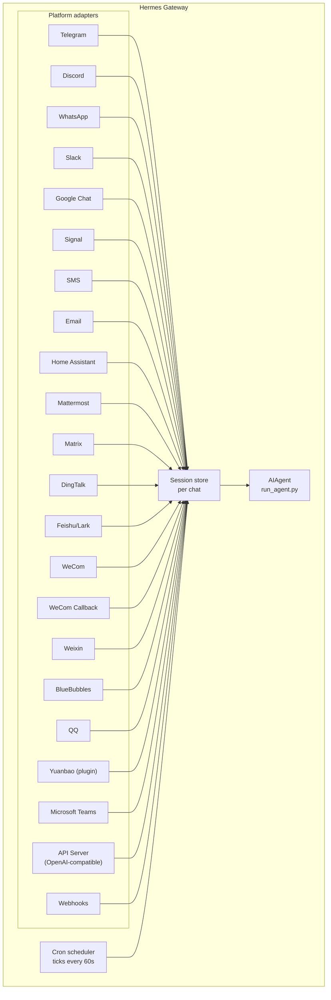

# メッセージングゲートウェイ

Telegram、Discord、Slack、WhatsApp、Signal、SMS、Email、Home Assistant、Mattermost、Matrix、DingTalk、Feishu/Lark、WeCom、Weixin、BlueBubbles（iMessage）、QQ、Yuanbao、Microsoft Teams、LINE、ntfy、またはブラウザからHermesとチャットできます。ゲートウェイは、設定したすべてのプラットフォームに接続し、セッションを処理し、cronジョブを実行し、ボイスメッセージを配信する単一のバックグラウンドプロセスです。

CLIのマイクモード、メッセージングでの音声返信、Discordのボイスチャンネルでの会話を含む、すべての音声機能セットについては、[ボイスモード](../features/voice-mode.md)と[Hermesでボイスモードを使う](../../guides/use-voice-mode-with-hermes.md)を参照してください。

:::tip
ボットにはモデルプロバイダーとツールプロバイダー（TTS、Web）の両方が必要です。[Nous Portal](/docs/integrations/nous-portal)のサブスクリプションには、それらすべてがバンドルされています。
:::

## Desktopとダッシュボードでのメッセージングステータス

メッセージングステータスは、選択したマシン上の選択したプロファイルに属します。`hermes gateway setup` で保存された認証情報は、`config.yaml` に `platforms` エントリがなくても認証情報ベースのプラットフォームを有効にできます。ただし、明示的な `platforms.<name>.enabled: false` があれば引き続き無効になります。別のプロファイルがサーバープロセスの認証情報を継承することはありません。必須の認証情報フィールドを持たないプラットフォームは、そのリストが空であるという理由だけで有効になることはありません。

サーバー自身のプロファイルを明示的に指定した場合（例えば、デフォルトプロファイルのサーバーで `profile=default`）、スコープなしのリクエストと同じステータスが返されます。**Saved** は認証情報が保存されていることを意味し、メッセージングゲートウェイが実行中であることやプラットフォームが接続済みであることを意味するものではありません。有効なプラットフォームが正しく **Messaging gateway stopped** と表示されることもあります。

## プラットフォーム比較

| プラットフォーム | 音声 | 画像 | ファイル | スレッド | リアクション | 入力中 | ストリーミング |
|----------|:-----:|:------:|:-----:|:-------:|:---------:|:------:|:---------:|
| Telegram | ✅ | ✅ | ✅ | ✅ | — | ✅ | ✅ |
| Discord | ✅ | ✅ | ✅ | ✅ | ✅ | ✅ | ✅ |
| Slack | ✅ | ✅ | ✅ | ✅ | ✅ | ✅ | ✅ |
| Google Chat | — | ✅ | ✅ | ✅ | — | ✅ | — |
| WhatsApp | — | ✅ | ✅ | — | — | ✅ | ✅ |
| WhatsApp Cloud API | ✅ | ✅ | ✅ | — | — | ✅ | — |
| Signal | — | ✅ | ✅ | — | — | ✅ | — |
| SMS | — | — | — | — | — | — | — |
| Email | — | ✅ | ✅ | ✅ | — | — | — |
| Home Assistant（プラグイン） | — | — | — | — | — | — | — |
| Mattermost | ✅ | ✅ | ✅ | ✅ | — | ✅ | ✅ |
| Matrix | ✅ | ✅ | ✅ | ✅ | ✅ | ✅ | ✅ |
| DingTalk | — | ✅ | ✅ | — | ✅ | — | ✅ |
| Feishu/Lark | ✅ | ✅ | ✅ | ✅ | ✅ | ✅ | ✅ |
| WeCom | ✅ | ✅ | ✅ | — | — | — | — |
| WeCom Callback | — | — | — | — | — | — | — |
| Weixin | ✅ | ✅ | ✅ | — | — | ✅ | — |
| BlueBubbles | — | ✅ | ✅ | — | ✅ | ✅ | — |
| Photon（iMessage） | ✅ | ✅ | ✅ | — | ✅ | ✅ | — |
| QQ | ✅ | ✅ | ✅ | — | — | ✅ | — |
| Yuanbao（Labsプラグイン） | ✅ | ✅ | ✅ | — | — | ✅ | ✅ |
| Microsoft Teams | — | ✅ | — | ✅ | — | ✅ | — |
| LINE | — | ✅ | ✅ | — | — | ✅ | — |
| ntfy | — | — | — | — | — | — | — |
| Raft | — | — | — | — | — | — | — |
| IRC | — | — | — | — | — | — | — |
| Buzz | — | ✅ | — | ✅ | — | — | — |
| SimpleX | ✅ | ✅ | ✅ | — | — | ✅ | — |

**音声** = TTS音声返信および/または音声メッセージの文字起こし。**画像** = 画像の送受信。**ファイル** = ファイル添付の送受信。**スレッド** = スレッド化された会話。**リアクション** = メッセージへの絵文字リアクション。**入力中** = 処理中の入力中インジケーター。**ストリーミング** = 編集による段階的なメッセージ更新。

:::note Hermes Relay
[Hermes Relay](/docs/user-guide/messaging/relay)（実験的）はそれ自体がチャットプラットフォームではありません。プラットフォームの認証情報を保持する外部コネクターを通じて、Discord、Telegram、Slack、WhatsAppなどのプラットフォームを仲介するコネクターシステムです。機能（メディア、ネイティブの承認/clarifyプロンプト、リアクション、スレッド、入力中、ストリーミング）は上の表で固定されているのではなく、ハンドシェイク時にコネクターごとにネゴシエートされます。
:::

## アーキテクチャ



各プラットフォームアダプターはメッセージを受信し、チャットごとのセッションストアを経由してルーティングし、処理のためにAIAgentにディスパッチします。ゲートウェイはcronスケジューラも実行し、60秒ごとにティックして期限が来たジョブを実行します。

## 意図的な沈黙トークン {#intentional-silence-tokens}

グループチャット、フック、自動化フローのために、Hermesは明示的な沈黙トークンをサポートしています。エージェントの最終応答がサポートされているトークンのいずれかと完全に一致する場合、ゲートウェイは送信を抑制し、チャットには何も送りません。

サポートされているトークン:

- `[SILENT]`
- `SILENT`
- `NO_REPLY`
- `NO REPLY`
- `[静默]` / `静默` および `[沉默]` / `沉默` — モデルがセンチネルをそのまま出力せずに翻訳してしまった場合に生成される中国語表記

空白と大文字小文字は正規化されますが、最終応答全体がトークンでなければなりません。「何も変わっていないときは `[SILENT]` を使ってください」のような文は通常どおり配信されます。

沈黙は配信上の判断にすぎません。Hermesはアシスタントの沈黙ターンをセッションのトランスクリプトに保持するため、会話は引き続き通常どおり交互に進みます。

```text
user: side-channel chatter
assistant: [SILENT]   # stored, not delivered
user: next message
```

失敗したターンは引き続きエラーとして表示されます。テキストが沈黙トークンに似ているという理由だけで、Hermesが失敗を隠すことはありません。

人間からのメッセージに対しては、返信が必要なメッセージが消えてしまってはならないため、沈黙トークンのみの応答は短い通知に置き換えられます。バックグラウンドプロセス通知などの内部ウェイクは沈黙したままでも構いません。また、プラットフォームアダプターがボット宛てではないと報告したメッセージも同様です。Slackは、他の誰かへの@メンションで始まるメッセージと、自由応答チャンネルで新しいスレッドを開始するメンションなしのトップレベルメッセージについてこれを報告します。Telegramは[ボット宛てではないグループメッセージ](telegram.md#letting-the-bot-stay-silent-in-a-group)についてこれを報告します。その他のプラットフォームでは常に通知が送られます。

## クイックセットアップ

メッセージングプラットフォームを設定する最も簡単な方法は、対話型ウィザードです。

```bash
hermes gateway setup        # Interactive setup for all messaging platforms
```

これは、矢印キーによる選択で各プラットフォームの設定を順を追って案内し、すでに設定済みのプラットフォームを表示し、完了時にゲートウェイの起動/再起動を提案します。

## ゲートウェイコマンド

```bash
hermes gateway              # Run in foreground
hermes gateway setup        # Configure messaging platforms interactively
hermes gateway install      # Install as a user service (Linux) / launchd service (macOS)
sudo hermes gateway install --system   # Linux only: install a boot-time system service
hermes gateway start        # Start the default service
hermes gateway stop         # Stop the default service
hermes gateway status       # Check default service status
hermes gateway status --system         # Linux only: inspect the system service explicitly
```

### オンデマンドのスタックダンプ（`SIGUSR2`）

LinuxとmacOSでは、`kill -USR2 <gateway pid>` を実行すると、すべてのスレッドのスタックのダンプが `~/.hermes/logs/gateway_faulthandler.log` に追記され、ゲートウェイはそのまま実行を続けます。停止したり異常な動作をしたりしているゲートウェイが何をしているかを、再起動せずに確認するために使用してください。

### 組み込みのイベントループ生存監視ウォッチドッグ

すべてのプラットフォームで、ゲートウェイはasyncioループを監視するループ外のウォッチドッグスレッドを実行します（`gateway.loop_watchdog_probe_interval_s`、デフォルト30秒）。ループが `gateway.loop_watchdog_max_strikes` 回連続のプローブ（デフォルト3回）でディスパッチを停止した場合、ハウスキーピング、cronスケジューラ、組み込みのkanbanディスパッチャーもすべて一緒にフリーズしているため、ウォッチドッグはすべてのスレッドのスタックをログにダンプし、`gateway_state.json` に `gateway_state: degraded` と `exit_reason: loop_liveness_watchdog` を記録して、サービススーパーバイザーがプロセスを再起動するようコード `75` で終了します。`hermes gateway status` は、新しいゲートウェイプロセスが上書きするまで、その記録を `⚠ Gateway exited degraded: event loop stopped dispatching …` として表示し、ダッシュボードのゲートウェイバッジも同じ理由とともに **Degraded** と表示します。ウォッチドッグを無効にするには、`config.yaml` で `gateway.loop_watchdog: false` を設定してください。

ハウスキーピングは毎ティック（60秒）`gateway_state.json` の `updated_at` も再記録するため、ハートビートとしても機能します。プロセスはまだ生きているのにそのスタンプが120秒より古い場合、`hermes gateway status` は `⚠ Gateway heartbeat stale: housekeeping has not refreshed gateway_state.json
for N s …` と表示し、ダッシュボードのバッジは **Heartbeat stale** となります。これは「実行中に見えるが何もスケジュールされていない」ケースです。ゲートウェイを再起動してください。

### オプションのLinuxイベントループウォッチドッグ

systemdで管理されるゲートウェイは、Pythonのasyncioイベントループがスケジューリング時間を受け取れなくなったときのプロセス復旧をオプトインできます。これは、プラットフォーム固有の生存監視タスクの実行も妨げる、プロセス全体の停止をカバーします。

```yaml title="~/.hermes/config.yaml"
gateway:
  systemd_watchdog_seconds: 120
```

この設定を変更した後は、サービスユニットを再生成してください。

```bash
hermes gateway install --force
```

正の値を指定すると、生成されるユニットは `Type=notify`、`NotifyAccess=main`、および対応する `WatchdogSec` を使用します。Hermesはイベントループが適時に進行している間のみハートビートを送信し、ハートビートが止まるとsystemdがプロセスを再起動します。デフォルトの `0` は既存の `Type=simple` の動作を維持します。この設定はLinux/systemd専用であり、通常のプラットフォームのネットワーク切断をイベントループの障害として扱うことはありません。

`Type=notify` の下では、ゲートウェイは提供するすべてのプロファイルのアダプターが1プロファイルずつ接続した後にのみ準備完了を報告します。各セカンダリプロファイルの接続前に、その接続の予算にマージンを加えた値でsystemdに `EXTEND_TIMEOUT_USEC` を送信します。そのため、大規模なマルチプロファイルの起動はsystemdのデフォルトの90秒の起動タイムアウトを超えて実行できますが、進行が止まった起動は引き続き強制終了されます。

## チャットコマンド（メッセージング内）

| コマンド | 説明 |
|---------|-------------|
| `/new` または `/reset` | 新しい会話を開始します |
| `/model [provider:model]` | モデルを表示または変更します（`provider:model` 構文をサポート） |
| `/personality [name]` | パーソナリティを設定します（リセットするには `none`） |
| `/retry` | 最後のメッセージを再試行します |
| `/undo` | 最後のやり取りを削除します |
| `/status` | セッション情報を表示します |
| `/whoami` | このスコープでのスラッシュコマンドのアクセス権を表示します（admin / user / unrestricted） |
| `/stop` | 実行中のエージェントを停止します |
| `/approve` | 保留中の危険なコマンドを承認します |
| `/deny` | 保留中の危険なコマンドを拒否します |
| `/sethome` | このチャットをホームチャンネルとして設定します |
| `/compress` | 会話コンテキストを手動で圧縮します |
| `/title [name]` | セッションタイトルを設定または表示します |
| `/resume [name]` | 以前に名前を付けたセッションを再開します |
| `/sessions [all] [search <query>]` | 以前のセッションを一覧表示します。`search <query>` でタイトルまたはIDで絞り込みます |
| `/usage` | このセッションのトークン使用量を表示します（`/usage reset [--force]` は保留中のCodexの制限リセットを使用します） |
| `/insights [days]` | 使用状況のインサイトと分析を表示します |
| `/reasoning [level\|show\|hide]` | 推論の労力を変更するか、推論の表示を切り替えます |
| `/voice [on\|off\|tts\|join\|leave\|status]` | メッセージングの音声返信とDiscordのボイスチャンネルの動作を制御します |
| `/rollback [number]` | ファイルシステムのチェックポイントを一覧表示または復元します |
| `/bg <prompt>` | 別のバックグラウンドセッションでプロンプトを実行します |
| `/btw <question>` | 現在の会話を中断せずに、その会話についての補足的な質問をします |
| `/reload-mcp` | 設定からMCPサーバーを再読み込みします |
| `/update` | Hermes Agentを最新バージョンに更新します |
| `/help` | 利用可能なコマンドを表示します |
| `/<skill-name>` | インストール済みの任意のスキルを呼び出します |

## セッション管理

### セッションの永続化

セッションはリセットされるまでメッセージをまたいで永続化されます。エージェントはあなたの会話コンテキストを記憶します。

### 過去のセッションを探す（`/sessions`）

`/sessions` は、現在のチャットの以前のセッションを一覧表示します（現在のセッションも `(current)` の印付きで含まれます）。`/sessions <name>` でそのうちの1つを再開します（`/resume` の短縮形）。リストが長くなった場合は、`/sessions search <query>`（エイリアス `find`）でタイトルまたはセッションIDの一致で絞り込めます。結果は最近アクティブだった順に並びます。`/sessions all` によるオリジンをまたいだ一覧表示は管理者専用です。一般ユーザーにはリストがチャットスコープのままであることを説明する通知が表示され、自分のチャットオリジンのセッションのみが表示されます。

### 永続的な `/model` オーバーライド

ゲートウェイチャットでの `/model` の切り替えはそのセッションに適用され、現在は**ゲートウェイの再起動後も維持されます**。モデル/プロバイダーの選択はセッションストアに永続化され、再起動後の最初の使用時に復元されます（認証情報は読み込み時に再解決され、ディスクに書き込まれることはありません）。`/model reset` は会話を保持したままオーバーライドをクリアし、`/new`（または `/reset`）は新しい会話とともにクリアし、`/model <name> --global` は代わりに `config.yaml` へ書き込みます。`/model <name> --once` は1ターンのみに適用されます。

### 配信の信頼性

エージェントの最終応答は、各プラットフォームへの送信の前後で永続的な**配信台帳**（`state.db`）に記録されます。応答の生成からプラットフォームによる受信確認までの間にゲートウェイがクラッシュまたは再起動した場合、次回の起動時に、応答を失ったりターン全体を再実行したりする代わりに、保存された応答が再配信されます。台帳はゲートウェイが起動されたホームに置かれます。多重化されたゲートウェイも、提供するすべてのプロファイルの返信をそこに保持します。

セマンティクスは正直な at-least-once です。

- 送信が**一度も開始されなかった**応答は、そのまま再配信されます。
- ゲートウェイが停止した時点で**送信途中**だった応答（プラットフォームが受信したかどうかは不明）は、以前の起動でまだ送信中だった再配信も含め、目に見える「♻️ Recovered reply — … may be a duplicate」という接頭辞付きで再配信されます。曖昧さには必ずラベルが付けられ、黙って再送されることはありません。
- **フラッド制御**（Telegramのレート制限など）によって拒否された最終送信は、記録されたペナルティの期限が切れた後、再接続や再起動を必要とせずに自動的に再試行されます。ペナルティ期間中に再起動した場合は、再試行回数を消費したりエージェントを再実行したりせずに、保存された返信を引き継ぎます。再試行では元のボットプロファイル、チャット、スレッドが保持されます。レート制限からの復旧の接頭辞は、以前のチャンクがすでに届いている可能性があることを警告します。台帳はメッセージの長さから部分的な配信を推測することはできません。
- その他の理由で拒否された最終送信（プラットフォームの5xx、分類されないエラー）も、増加するバックオフ（30秒、次に2分）の後に同様に再試行されます。予算内の最後の試行は次回のゲートウェイ起動まで残されるため、タイマーより長く続く障害によって返信が取り残されることはありません。恒久的に到達できないチャット（ブロックされたボット、削除されたグループ）は再試行されません。
- 再配信には上限があります。3回の試行、24時間の鮮度を過ぎると、その行は破棄されます。配信済みの行は7日後に削除されます。

無効にするには、`config.yaml` で `gateway.delivery_ledger: false` を設定します（クラッシュ時に送信中の応答が失われる以前の動作に戻ります）。

### セッションの継続性

ゲートウェイの会話は、無活動の後や日付の境界でリセットされることはありません。明示的に新しい会話を始めるには `/new` または `/reset` を使用してください。コンテキストの圧縮は引き続き自動で行われます。コアは、レガシーな `session_reset` 設定、リセットポリシーのオーバーライド、リセットタイマーの環境変数を無視します。設定でまだ `session_reset.mode` を `idle`、`daily`、`both` のいずれかに設定している場合、ゲートウェイの起動時と `hermes doctor` で警告が出ます。時間ベースのリセットを維持するには、同じブロックをそのまま読み取るカタログプラグインをインストールしてください: `hermes plugins install hermes-session-reset-policy`。キャッシュされたエージェントは、永続的な会話を置き換えることなく、リソースを回収するために解放される場合があります。再起動復旧の鮮度は自動的な継続を制限するものであり、メッセージを送信したときに読み込まれる履歴を制限するものではありません。


## チャンネルごとのモデルとシステムプロンプトのオーバーライド

**単一のゲートウェイ**から、チャンネルごとに異なるモデルとペルソナを実行できます。例えば、`#daily` では安価で高速なモデルを、`#dev` では専門家向けプロンプトを持つフロンティアモデルを使う、といった具合です。`~/.hermes/config.yaml` のプラットフォームの下に `channel_overrides` を設定します。

```yaml
platforms:
  discord:
    enabled: true
    channel_overrides:
      "123456789012345678":        # channel/thread id
        model: anthropic/claude-sonnet-4.6
        provider: anthropic
        system_prompt: "You are the #dev channel code-review specialist."
      "987654321098765432":
        model: openai/gpt-5-mini
```

詳細:

- `model`、`provider`、`system_prompt` はオプションです。設定されていないフィールドはグローバルのデフォルトにフォールバックします。ルームでは `allow_silence` によって意図的な沈黙を設定することもでき、これはプラットフォーム自体の `allow_silence`（後述）をオーバーライドします。
- 検索順序は、まず完全一致のチャンネル/スレッドID、次に**親**のチャンネル/フォーラムIDです。そのため、Discordのスレッドは親チャンネルのオーバーライドを自動的に継承します。
- モデルの解決優先順位は、セッションの `/model` オーバーライド → `channel_overrides` → グローバル設定 です。チャット内で `/model` を実行したユーザーの指定は、引き続きチャンネルのデフォルトより優先されます。
- `system_prompt` のオーバーライドは、そのチャンネルのグローバルなゲートウェイプロンプトを置き換えます（これは一時的なもので、ターンごとに注入され、履歴には保存されません）。

## プラットフォームごと・ルームごとの意図的な沈黙 {#per-platform-and-per-room-intentional-silence}

共有チャットでは、メッセージが自分宛てでない場合に、モデルが `NO_REPLY` や `[SILENT]` のような明示的な沈黙マーカーでターンを終えることを選ぶ場合があります。Hermesがメンションされた場合、直接話しかけられた場合、またはアダプターが判断できない場合（例えば、Slackスレッドでのメンションなしのフォローアップや、WhatsAppのグループでの雑談）でも、成功したマーカーのみのターンを沈黙のままにするには、提供するプロファイルの `config.yaml` で、プラットフォーム全体または1つのルームに対して `allow_silence` を有効にします。

```yaml
platforms:
  slack:
    allow_silence: true            # every Slack chat this profile serves
    channel_overrides:
      "C0123456789":
        allow_silence: false       # except this channel: keep the visible notice
  whatsapp:
    allow_silence: true            # every WhatsApp group and DM
  matrix:
    channel_overrides:
      "!exampleTeamRoom:example.org":
        allow_silence: true        # only this room
```

トップレベルの `slack:` / `whatsapp:` ブロック形式も同じように機能します。リレー経由のチャットは、その `channel_overrides` と同様に、基盤となるプラットフォームのブロック（リレー経由のSlackなら `platforms.slack`）を使用します。

デフォルトは既存の返信ポリシーです。省略、`null`、または `false` の場合、人間のメッセージに返信が必要なとき（またはアダプターが判断できないとき）に目に見える警告が維持されます。内部通知、スケジュールされたハートビート、宛先がないことがわかっているメッセージは、`allow_silence: false` であっても既存の沈黙の例外を維持します。

ルームの `allow_silence` はプラットフォームの設定をオーバーライドします。Hermesは他のチャンネルオーバーライドと同様に、チャットID → スレッドID → 親IDの順でルームを検索し、最初に一致したエントリ（明示的な `false` を含む）がそのルームの設定になります。他のキーのみを設定したエントリ（例えば `model:` だけを持つスレッド）も最初に一致するため、親チャンネルの値ではなくプラットフォームの値を取ります。親のルームのオプトインを維持するには、そこにも `allow_silence` を繰り返し記述してください。引用符付きの `"false"` は `false` として扱われます。オプトインには実際の `true` が必要です。どこにも何も設定されていない場合は、デフォルトの返信ポリシーが適用されます。ルームIDはチャットIDと完全に一致する必要があります。WhatsAppのグループは `<id>@g.us` ですが、ダイレクトチャットは `<number>@s.whatsapp.net` または `<id>@lid` として届く場合があります。

チャットのプラットフォームで `display.suppress_warning_notifications` が有効になっている場合、グループチャット、チャンネル、スレッド、Webhookソースでは通知自体が非表示になるため、`allow_silence` が設定されていない場所でも、正常なマーカーのみのターンは沈黙したままになります（[警告とエラーの通知](#warning-and-error-notifications-opt-in-suppression)を参照）。ルームまたはプラットフォームで明示的に `allow_silence: false` を設定すると、そこでは引き続き通知が維持されます。抑制によってダイレクトメッセージが沈黙することはありません。DMでは通知が質問に対する唯一の返答となるため、DMが沈黙するのは、そのDMまたはそのプラットフォームに `allow_silence: true` が設定されている場合のみです。

プラットフォームの設定はダイレクトメッセージにも適用されます。DMでは、モデルがマーカーのみで答えた質問にはまったく返信が届かないため、常に回答が必要なDMやチャンネルには `allow_silence: false` を設定してください。

設定を編集した後は、すべての提供プロファイルが更新された設定を使用するよう、ゲートウェイを再起動してください。この設定は最終的な配信にのみ影響します。ツールのアクションを取り消したり、すでに送信された進捗を撤回したり、モデルに沈黙を選ぶよう指示したりすることはありません。空の結果、失敗した結果、部分的な結果、中断された結果が消えてもよいという許可を得ることはありません。通常の返信と会話履歴は変わりません。モデルがハウスキーピング専用のツール呼び出し（メモリ、TODOリスト、スキル管理、セッション検索）と並べて返信を書き、その後完了したターンを裸のマーカーで終えた場合、その返信はオプトインしたプラットフォームやルームでも最終回答として配信されます。クラッシュからの復旧では、その最終返信に対する抑制の判断が保存された後でのみ、その判断が尊重されます。それより前にクラッシュした場合は、人間のターンに対するセーフガードが維持されます。

## セキュリティ

**デフォルトでは、ゲートウェイは許可リストに含まれていない、またはDMでペアリングされていないすべてのユーザーを拒否します。** これはターミナルアクセスを持つボットにとって安全なデフォルトです。

```bash
# Restrict to specific users (recommended):
TELEGRAM_ALLOWED_USERS=123456789,987654321
DISCORD_ALLOWED_USERS=123456789012345678
SIGNAL_ALLOWED_USERS=+155****4567,+155****6543
SMS_ALLOWED_USERS=+155****4567,+155****6543
EMAIL_ALLOWED_USERS=trusted@example.com,colleague@work.com
MATTERMOST_ALLOWED_USERS=3uo8dkh1p7g1mfk49ear5fzs5c
MATRIX_ALLOWED_USERS=@alice:matrix.org
DINGTALK_ALLOWED_USERS=user-id-1
FEISHU_ALLOWED_USERS=ou_xxxxxxxx,ou_yyyyyyyy
WECOM_ALLOWED_USERS=user-id-1,user-id-2
WECOM_CALLBACK_ALLOWED_USERS=user-id-1,user-id-2
TEAMS_ALLOWED_USERS=aad-object-id-1,aad-object-id-2

# Or allow
GATEWAY_ALLOWED_USERS=123456789,987654321

# Or explicitly allow all users (NOT recommended for bots with terminal access):
GATEWAY_ALLOW_ALL_USERS=true
```

### DMペアリング（許可リストの代替） {#dm-pairing-alternative-to-allowlists}

ユーザーIDを手動で設定する代わりに、未知のユーザーがボットにDMを送ると、一度限りのペアリングコードを受け取ります。Emailは例外で、Emailのペアリングを明示的に有効にしない限り、未知のEmail送信者は無視されます。

```bash
# The user sees: "Pairing code: XKGH5N7P"
# You approve them with:
hermes pairing approve telegram XKGH5N7P

# Other pairing commands:
hermes pairing list          # View pending + approved users
hermes pairing revoke telegram 123456789  # Remove access
```

ペアリングコードは1時間後に期限切れになり、レート制限があり、暗号学的なランダム性を使用します。

### チャット内の他のボット

Hermesは、プラットフォームが送信者をボットだと示した場合（Discord、Slack、Telegram、Feishu、QQギルド、Mattermostのボットアカウント）、その送信者をボットとして扱います。イベントにボットフラグが含まれないプラットフォーム（Matrix、Signal、IRC、Mattermostのパーソナルアクセストークンのボットなど）では、`config.yaml` のそのプラットフォームの `bot_users` に相手のユーザーIDを列挙してください。

```yaml
mattermost:
  bot_users: ["peer_bot_user_id"]
```

ボットの送信者は、そのプラットフォームの `*_ALLOW_BOTS` 設定を通じてのみ受け入れられます。Hermesはボットにランタイム通知（ビジーおよび中断の確認、進捗、「処理されませんでした」や再試行のヒント、モデルのフォールバックや無活動の警告、委任失敗の通知）を送ることはなく、モデルの返信のみを送ります。また、ボットから話しかけられた場合でも沈黙で応答することがあります。`gateway.bot_loop_guard` がやり取りを終了させます。あなたの最後のメッセージの後に `max_hops`（デフォルト4）件のボットメッセージ、繰り返されたメッセージは1回としてカウントされ、`bot_replies_expect_reply: true` でない限り、Hermesが配信した返信に答えるボットには返答しません。`enabled: false` でこれらのルールを無効にします。

### 管理者と一般ユーザー

許可リストは「この人はそもそもボットにアクセスできるか？」に答えます。**管理者 / 一般ユーザーの区分**は「アクセスできるようになった後、何をすることが許可されているか？」に答えます。

許可されたすべてのユーザーは、スコープ（DM対グループ/チャンネル）ごとに2つの階層のいずれかに分類されます。

- **管理者** — フルアクセス。登録されたすべてのスラッシュコマンド（組み込み + プラグイン）を実行でき、ゲートされたすべての機能を使用できます。
- **一般ユーザー** — 制限付きアクセス。エージェントと通常どおりチャットできますが、明示的に有効にしたスラッシュコマンドのみを実行できます。常に許可される最低限のものは `/help` と `/whoami` です。

階層はプラットフォームごと、スコープごとに設定されます。DMの管理者ステータスは、グループ/チャンネルの管理者ステータスを意味しません。各スコープには独自の管理者リストがあります。

**現在階層によってゲートされるもの:** スラッシュコマンド。この区分はライブのコマンドレジストリを通じて機能するため、機能ごとの配線なしに組み込みおよびプラグイン登録のコマンドをカバーします。通常のチャットには影響しません。非管理者も引き続きエージェントと話すことができます。

**将来ゲートされる可能性があるもの:** 今後追加される、より多くの機能領域（ツールへのアクセス、モデルの切り替え、高コストな操作）も、同じ管理者 / 一般ユーザーの区別に基づいて扱われる予定です。今のうちに区分を設定しておけば、誰が管理者かを再設計することなく、そうした将来の制限がスムーズに適用されます。

#### 設定

```yaml
gateway:
  platforms:
    discord:
      extra:
        allow_from: ["111", "222", "333"]
        allow_admin_from: ["111"]                    # admins → all slash commands
        user_allowed_commands: [status, model]       # what non-admins may run
        # Optional: separate group/channel scope
        group_allow_admin_from: ["111"]
        group_user_allowed_commands: [status]
```

**後方互換性:** あるスコープで `allow_admin_from` が設定されていない場合、そのスコープでは階層の区分が無効になり、許可されたすべてのユーザーがフルアクセスを持ちます。既存のインストールは変更なしで動作し続けます。区別が必要になったときにオプトインしてください。

**プロンプトへの応答はコマンドの実行とみなされます。** 危険なコマンドの承認に応答することは `/approve` または `/deny` であり、スラッシュコマンドの確認（`/reset`、`/reload-mcp` など）に応答することはそのコマンドを実行することです。そのため、ゲートされたスコープでは、非管理者はそれ以外の方法でも応答できません。裸の `yes` / `always` の入力、入力による確認の返信、ネイティブボタンのタップ（Telegram、Discord、Slack、Matrix、Feishu、Teams、WhatsApp Cloud、QQ Bot、relay）のいずれでも、同じ *⛔ /approve is admin-only here* という注記が表示され、プロンプトは管理者のために保留されたままになります。`user_allowed_commands` に `approve`（または `deny`、あるいは確認対象のコマンド）を追加すると、メンバーがそれを入力できるのとまったく同じように、応答できるようになります。clarifyの質問はコマンドではないため影響を受けません。絞り込まれた [`approvals.approvers`](../security.md#who-can-answer-an-approval-in-a-shared-chat-approvalsapprovers) はこれより優先されます。その場合は、リクエスト者、列挙されたID、および管理者が応答できます。

#### アクセス権の確認

任意のプラットフォームから `/whoami` を使用すると、アクティブなスコープ、あなたの階層（admin / user / unrestricted）、および実行できるスラッシュコマンドを確認できます。管理者リストが設定されている場合、`/help` と `/commands` は非管理者に実際に実行できるコマンド（`/help`、`/whoami`、および `user_allowed_commands`）のみを表示します。管理者には完全なカタログが表示されます。プラットフォーム固有の例については、[Telegram](./telegram.md#slash-command-access-control)と[Discord](./discord.md#slash-command-access-control)のページを参照してください。

## エージェントの方向修正

エージェントが作業中にメッセージを送信すると、アクティブなターンを修正できます。

- **モデルの生成はコンテキストを保持したまま再開されます** — すでに表示された推論と目に見える部分的なテキストは、通常のアシスタントのチェックポイントとして保持されます
- **完了した作業は引き続き利用できます** — それまでのツール呼び出しと結果はターン内に残ります
- **実行中のツールは安全に終了します** — 修正はツールを強制終了するのではなく、次のツール結果の境界で適用されます
- **`/stop` は引き続きハードストップです** — アクティブなターンとフォアグラウンドの作業をキャンセルするために使用します

### キュー対中断対ステア（busy-inputモード）

デフォルトでは、ビジー状態のエージェントにメッセージを送ると、そのアクティブなターンの方向が修正されます（実行中のフォアグラウンドのターミナルコマンドは強制終了されるのではなくバックグラウンドに移されるため、メッセージは即座に読み取られます）。他に2つのモードが利用できます。

- `queue` — フォローアップメッセージは待機し、現在のタスクが終了した後に次のターンとして実行されます。各フォローアップ（テキスト、ボイスノート、動画、ドキュメント）は到着順にそれぞれ独自のターンを持ちます。短時間に連続して送られた写真のみが1つのアルバムターンに統合されます。
- `steer` — フォローアップメッセージは `/steer` を介して現在の実行に注入され、次のツール呼び出しの後にエージェントに到達します。中断もなく、新しいターンもありません。エージェントがまだ開始していない場合は `queue` の動作にフォールバックします。

ステアはテキストのみを運ぶため、添付ファイル付きのメッセージ（写真、ファイル、動画。`/steer ...` というキャプション付きのものを含む）は、代わりに添付ファイルとともに次のターンとしてキューに入れられます。エージェントが実行されていない場合、添付ファイルのキャプションとしての `/queue` または `/steer`（単独、またはテキスト付き）は、添付ファイルを通常のメッセージとして送信します。

小さなテキストファイルは通常、メッセージにインライン展開されます。キャプションがスラッシュコマンド（`/goal summarize this`）の場合は、コマンドが引き続き実行されるよう、テキストをインライン展開せずにファイルが添付され、エージェントには保存されたファイルを読むよう指示されます。

ゲートウェイのステア（明示的な `/steer` を含む）とアクティブターンの方向修正は、リクエスト元のイベントで利用可能なプラットフォーム、チャット、スレッド、送信者、メッセージ、プロファイル、スコープの識別子を、メッセージごとのJSONコンテキストとして運びます。`privacy.redact_pii: true` の場合、このモデルから見えるコンテキスト内の識別子は、サポートされているプラットフォームでハッシュ化されます（代替識別子と親識別子を含む）。元のイベント識別子はルーティングのために内部に保持されます。それ以外の場合、識別子はそのまま保持されます。どちらのモードも、セッションのシステムプロンプトを変更したり、フォールバックの返信先を選択したりすることはありません。このコンテキストはルーティングデータであり、認可や自動配信の保証ではありません。

```yaml
display:
  busy_input_mode: steer   # or queue, or interrupt (default)
  busy_ack_enabled: true   # set to false to suppress the ⚡/⏳/⏩ chat reply entirely
  busy_text_debounce_seconds: 0.35   # quiet window before merged busy text is delivered
  busy_text_hard_cap_seconds: 1.0    # never hold merged busy text longer than this
```

4つのキーはすべて各プロファイル自身の `config.yaml` から読み取られるため、多重化されたプロファイルはそれぞれ独立したビジーポリシーを保持します。プロセス環境変数によるオーバーライドはありません。

任意のプラットフォームでビジー状態のエージェントに初めてメッセージを送ると、Hermesはこのノブを説明する1行のリマインダー（`"💡 First-time tip — …"`）をbusy-ackに追加します。このリマインダーはインストールごとに1回発火します。`onboarding.seen.busy_input_prompt` の下のフラグがそれをラッチします。そのキーを削除すると、再びヒントが表示されます。

ビジー時の確認応答がうるさいと感じる場合は、`display.busy_ack_enabled: false` を設定してください。入力の処理は変わりません。確認メッセージのみが非表示になります。

## clarifyの質問（複数選択）

エージェントが `clarify` ツールを使って質問すると、ゲートウェイは選択肢を番号付きのプロンプト（またはサポートしているプラットフォームではネイティブボタン）として表示します。clarifyは**複数選択**の質問もサポートしており、エージェントは複数の選択肢を一度に選ばせることができます。

- **メッセージングプラットフォーム** — プロンプトに「Multiple selections allowed」と表示されます。カンマまたはスペースで区切った番号（例: `1, 3`）、選択肢のテキスト、または独自の自由形式の回答で返信してください。
- **クラシックCLI / TUI** — 複数選択はチェックボックスとして表示されます。**Space** で選択肢を切り替え、**Enter** で選択を送信します。

単一選択のプロンプトは従来どおり動作します。番号、ボタン、テキストで1つの選択肢を選ぶか、「Other」から独自の回答を入力してください。

## ツール進捗通知

`~/.hermes/config.yaml` で、どれだけのツールアクティビティを表示するかを制御します。

```yaml
display:
  tool_progress: all    # off | new | all | verbose | log
  tool_progress_command: false  # set to true to enable /verbose in messaging
  # How progress is grouped on platforms that support message editing:
  #   accumulate (default) — edit one bubble in place as tools run
  #   separate             — send one message per tool (pre-v0.9 style; noisier)
  # Only applies where tool_progress is already enabled.
  tool_progress_grouping: accumulate   # accumulate | separate
```

認識されない `tool_progress` の値（タイプミスや、他のツールからコピーしたモード）は、より多くの出力の要求としては解釈されません。ゲートウェイはそれを1回ログに記録してプラットフォーム自体のデフォルトを維持するため、階層が `off` のTelegramチャットは静かなままです。

### `log` モード — チャットメッセージの代わりに監査ファイル

`display.tool_progress: log` を設定すると、チャットには進捗バブルが**一切**送信されません。代わりに、各ツール呼び出しが `~/.hermes/logs/tool_calls.log` に1行ずつ追記されます。これはローテーションする監査ファイル（5 MB × 3バックアップ）で、通常のログと同じシークレットを伏せ字にするフォーマッターを通るため、認証情報がディスクに残ることはありません。チャットを騒がしくせずにツール呼び出しの完全な記録が必要な場合に使用してください。

### 設定可能なステータスフレーズ

長時間実行中のゲートウェイのステータス行（「still working…」のようなハートビート）は、フレーズカタログから選ばれます。組み込みのデフォルトは `gateway/assets/status_phrases.yaml` に同梱されています。`HERMES_HOME` の下にプロファイル間で持ち運べるファイルを置いて、独自のフレーズを追加できます。

- `~/.hermes/status_phrases.yaml` または `~/.hermes/status_phrases/` 内の任意の `*.yaml`（慣例的なパスで、自動的に読み込まれます）、または
- 設定で相対パスを指定します:

```yaml
display:
  status_phrases:
    path: status_phrases/whatsapp.yaml  # relative to HERMES_HOME
    mode: append                        # append (default) or replace
```

フレーズファイルは、サーフェス（`status`、`generic`）を文字列のリストにマッピングします（サーフェスごとに最大80フレーズ、各160文字）。設定がプロファイル間で持ち運べるよう、絶対パスと `..` によるエスケープは無視されます。使用されるのは設定したフレーズ文字列のみで、生のツール引数、コマンド、推論テキストがステータスフレーズに埋め込まれることはありません。

### モデルコンテキスト内のメッセージタイムスタンプ

デフォルトではオフです。有効にすると、Hermesは*モデルのコンテキスト内の*各**ユーザー**メッセージの先頭に、人間が読めるタイムスタンプ（例: `[Tue 2026-04-28 13:40:53 CEST]`）を付加し、エージェントがメッセージの送信時刻を把握できるようにします。時間に関する推論（「今朝あなたが尋ねた…」、長い間隔に気づくなど）に役立ちます。アシスタントのメッセージやシステムプロンプトには**追加されません**。

```yaml
gateway:
  message_timestamps:
    enabled: false   # set true to show send-times to the model
```

永続化されたトランスクリプトは常にクリーンなままです。タイムスタンプはこのトグルに関係なくメッセージのメタデータとして保存されるため、後で有効にすると過去のメッセージの送信時刻も表示され、リプレイで接頭辞が重複して蓄積されることもありません。

有効にすると、ボットは作業中にステータスメッセージを送信します。

```text
💻 `ls -la`...
🔍 web_search...
📄 web_extract...
🐍 execute_code...
```

## バックグラウンドセッション {#background-sessions}

別のバックグラウンドセッションでプロンプトを実行し、メインチャットの応答性を保ちながら、エージェントがそれを独立して処理するようにします。

```
/bg Check all servers in the cluster and report any that are down
```

Hermesは即座に確認します。

```
🔄 Background task started: "Check all servers in the cluster..."
   Task ID: bg_143022_a1b2c3
```

### 仕組み

各 `/bg` プロンプトは、非同期で実行される**別個のエージェントインスタンス**を生成します。

- **分離されたセッション** — バックグラウンドエージェントは独自の会話履歴を持つ独自のセッションを持ちます。現在のチャットコンテキストを認識せず、提供したプロンプトのみを受け取ります。
- **同じ設定** — 現在のゲートウェイ設定から、モデル、プロバイダー、ツールセット、推論設定、プロバイダールーティングを継承します。
- **ノンブロッキング** — メインチャットは完全に対話可能なままです。作業中にメッセージを送信したり、他のコマンドを実行したり、さらにバックグラウンドタスクを開始したりできます。
- **結果の配信** — タスクが終了すると、結果はコマンドを発行した**同じチャットまたはチャンネル**に「✅ Background task complete」を前置きして返送されます。失敗した場合は、エラーとともに「❌ Background task failed」が表示されます。

### バックグラウンドプロセス通知

バックグラウンドセッションを実行しているエージェントが `terminal(background=true)` を使用して長時間実行されるプロセス（サーバー、ビルドなど）を開始すると、ゲートウェイはステータス更新をチャットにプッシュできます。これは `~/.hermes/config.yaml` の `display.background_process_notifications` で制御します。

```yaml
display:
  background_process_notifications: concise    # concise | all | result | error | off
```

| モード | 受け取る内容 |
|------|-----------------|
| `concise` | 完了時に1行のステータスメッセージ。失敗時は短い出力の末尾が追加されます（デフォルト） |
| `all` | 実行中の出力の更新**および**出力の末尾付きの最終ステータスメッセージ |
| `result` | 出力の末尾付きの最終ステータスメッセージのみ（終了コードに関係なく） |
| `error` | 終了コードがゼロ以外の場合の、出力の末尾付きの最終ステータスメッセージのみ |
| `off` | プロセスウォッチャーのメッセージは一切なし。CLI、TUI、Desktopでも尊重されます。バックグラウンドプロセスの完了とハートビートによってエージェントがウェイクすることはなくなります（サブエージェントの結果は引き続きウェイクします） |

これは環境変数でも設定できます。

```bash
HERMES_BACKGROUND_NOTIFICATIONS=result
```

`terminal(background=true, notify_on_complete=true)` を使用すると、終了したプロセスが新しいエージェントのターンを開始し、エージェント自身が結果を報告するため、別のステータス行は送信されません。例外は、プロセスを起動したターンがまだ実行中にプロセスが終了した場合です。その場合、完了はエージェントの次のターンとしてキューに入れられ、そのターンが終わるまで沈黙する代わりに、1行の `concise` ステータスがすぐに届きます（モードが `off` の場合、または `error` で終了コードがゼロの場合を除く）。

### ユースケース

- **サーバー監視** — "/bg Check the health of all services and alert me if anything is down"
- **長時間のビルド** — "/bg Build and deploy the staging environment" とチャットを続けながら
- **リサーチタスク** — "/bg Research competitor pricing and summarize in a table"
- **ファイル操作** — "/bg Organize the photos in ~/Downloads by date into folders"

:::tip
メッセージングプラットフォームでのバックグラウンドタスクは「撃ちっぱなし（fire-and-forget）」です。待つ必要も確認する必要もありません。タスクが終了すると、結果が同じチャットに自動的に届きます。
:::

## サービス管理

### Linux（systemd）

```bash
hermes gateway install               # Install as user service
hermes gateway start                 # Start the service
hermes gateway stop                  # Stop the service
hermes gateway status                # Check status
journalctl --user -u hermes-gateway -f  # View logs

# Enable lingering (keeps running after logout)
sudo loginctl enable-linger $USER

# Or install a boot-time system service that still runs as your user
sudo hermes gateway install --system
sudo hermes gateway start --system
sudo hermes gateway status --system
journalctl -u hermes-gateway -f
```

ラップトップや開発マシンではユーザーサービスを使用してください。systemdのlingerに依存せずブート時に復帰すべきVPSやヘッドレスホストでは、システムサービスを使用してください。

:::danger カスタムの `ExecStopPost` kill ドロップインを追加しないでください
Hermesがインストールするユニットは、すでに `KillMode=mixed` + `KillSignal=SIGTERM` でゲートウェイをクリーンにシャットダウンし、`Restart=always` と `RestartForceExitStatus` を使用して、更新や `/restart` で正しく再起動されるようになっています。`ExecStopPost=/bin/kill -9 $MAINPID` のようなsystemdドロップインは追加**しないでください**。`ExecStopPost` はクリーンな再起動を含む*すべての*停止で発火するため、新しく起動したインスタンスが安定する前に `SIGKILL` し、`Restart=always` がすぐにそれを再起動します。その結果、無限の再起動ループ（Telegramでは再起動メッセージの洪水）が発生します。そのようなドロップインを追加してしまった場合は削除してください: `systemctl --user edit hermes-gateway`（システムサービスの場合は `sudo systemctl edit hermes-gateway`）で `ExecStopPost` の行を削除し、その後 `systemctl --user daemon-reload` を実行します。
:::

### 直接の `systemctl restart` / `stop` はクリーンに終了します

インストールされたユニットは `ExecStop=` を宣言しており、`SIGTERM` が配信される前に `$MAINPID` の計画停止マーカーを記録します。そのため、サービスを直接停止または再起動しても意図的なものとして分類されます。ゲートウェイはドレインし、`gateway_state=stopped` を永続化して `0` で終了します。ジャーナルには `Failed with result exit-code` の行のない、クリーンな停止/起動が表示されます。

```bash
systemctl --user restart hermes-gateway   # or: sudo systemctl restart hermes-gateway
```

実行中のエージェントのターンが重要な場合は、`hermes gateway restart` を優先してください。これはゲートウェイにまずドレインするよう要求し（`SIGUSR1`、再起動の待機予算を尊重）、置き換えのプロセスを待ちます。一方、素の `systemctl restart` はsystemdのスケジュールで現在のプロセスを停止します。Hermesを更新した後は、`ExecStop=` 行を含む再生成されたユニットを実行中のサービスが取り込めるよう、一度 `hermes gateway restart` を実行してください（インストールされたユニットが古い間は `hermes gateway status` が警告します）。

インストールされたユニットは、`systemctl reload hermes-gateway` も `SIGUSR1` にマッピングしています。そのため、Hermesにおける `reload` は、グレースフルなドレイン、プロセスの終了、スーパーバイザーによる再起動を意味します。プロセス内での設定の再読み込みでは**ありません**。CLIに置き換えのプロセスを待って検証させたい場合は、`hermes gateway restart` を使用してください。

:::tip ヘッドレスVM: ユーザーサービス + linger でrootのプロンプトを回避
システムサービスは、`hermes update` の最後に行われる自動的なゲートウェイの再起動を含め、すべての再起動でrootを必要とします。`hermes update` が非rootユーザーとして実行されると、パスワードなしの `sudo systemctl` を試みます。それが利用できない場合は再起動をスキップし、手動の `sudo systemctl restart hermes-gateway` コマンドを表示します（対話的なパスワードプロンプトでブロックすることはありません）。

一度もログインしないヘッドレスVMでは、lingeringを有効にした**ユーザー**サービスで、rootをまったく介さずに同じブート時起動の動作が得られます。

```bash
hermes gateway install          # user service
sudo loginctl enable-linger $USER   # one-time: start at boot, survive logout
```

その後は、`hermes update` が権限なしでゲートウェイを再起動できます。システムサービスを維持したい場合は、`sudo hermes update` で更新を実行するか、サービスアカウントにsystemctl用のパスワードなしsudoを付与してください。例えば `sudo visudo -f /etc/sudoers.d/hermes-gateway` で次のようにします。

```
hermes ALL=(root) NOPASSWD: /usr/bin/systemctl --no-ask-password reset-failed hermes-gateway*, /usr/bin/systemctl --no-ask-password start hermes-gateway*, /usr/bin/systemctl --no-ask-password restart hermes-gateway*
```
:::

本当に意図する場合を除き、ユーザーとシステムの両方のゲートウェイユニットを同時にインストールしておくのは避けてください。start/stop/statusの動作が曖昧になるため、Hermesは両方を検出すると警告します。

インストールされたユニット（またはlaunchdのplist）は、それが固定している `HERMES_HOME` に属します。別のホーム（たまたま同じサービス名に解決されるテスト用やスクラッチ用のホームなど）から起動されたゲートウェイがそれを書き換えることはありません。`gateway run`、`start`、`restart`、`install --force` は両方のホームを示すメッセージとともに拒否し、ファイルには手を付けません。既存のサービスを意図的に現在のホームに向けるには、`hermes gateway install --force-unit-path` を実行してください。

:::note コンテナ内ではシステムスコープのみが提供されます
Hermesがコンテナ内で実行されていることを検出すると、`hermes gateway install`（および `hermes gateway setup` ウィザード）は**ユーザー**サービスのインストールを拒否します。ユーザーユニットは `~/.config/systemd/user` に配置されますが、そのホームがホストからバインドマウントされている場合（podman/distrobox）、ホスト自身の `systemd --user` が同じユニットを有効化して起動してしまい、同じボットトークンをポーリングする2つ目のゲートウェイができてしまいます。ゲートウェイをコンテナのメインプロセスとして実行する（`hermes gateway run`、コンテナの再起動ポリシー付き）か、systemdコンテナ（systemdがPID 1）では分離されたシステムスコープをインストールしてください: `sudo hermes gateway install --system --run-as-user <user>`。
:::

:::info 複数のインストール
同じマシンで複数のHermesインストール（異なる `HERMES_HOME` ディレクトリ）を実行する場合、それぞれが独自のsystemdサービス名を取得します。デフォルトの `~/.hermes` は `hermes-gateway` を使用し、他のインストールは `hermes-gateway-<hash>` を使用します。`hermes gateway` コマンドは、現在の `HERMES_HOME` に対応する正しいサービスを自動的に対象とします。
:::

### macOS（launchd） {#macos-launchd}

```bash
hermes gateway install               # Install as launchd agent
hermes gateway start                 # Start the service
hermes gateway stop                  # Stop the service
hermes gateway status                # Check status
tail -f ~/.hermes/logs/gateway.log   # View logs
```

生成されたplistは `~/Library/LaunchAgents/ai.hermes.gateway.plist` にあります。3つの環境変数が含まれます。

- **PATH** — インストール時の完全なシェルPATHに、venvの `bin/` と `node_modules/.bin` が先頭に追加されたもの。これにより、ユーザーがインストールしたツール（Node.js、ffmpegなど）が、WhatsAppブリッジのようなゲートウェイのサブプロセスで利用可能になります。
- **VIRTUAL_ENV** — ツールがパッケージを正しく解決できるよう、Pythonのvirtualenvを指します。
- **HERMES_HOME** — ゲートウェイをあなたのHermesインストールにスコープします。

:::tip インストール後のPATH変更
launchdのplistは静的です。ゲートウェイをセットアップした後に新しいツール（例: nvm経由の新しいNode.jsバージョン、Homebrew経由のffmpeg）をインストールした場合は、`hermes gateway install` を再度実行して更新されたPATHを取り込んでください。ゲートウェイは古いplistを検出し、自動的に再読み込みします。
:::

:::info 起動せずにインストールする
plistは `RunAtLoad` を設定しているため、読み込むとゲートウェイが起動します。`hermes gateway install --no-start-now` は、`hermes gateway setup` で「Start the gateway now?」に No と答えた場合と同様に、plistを読み込まずに書き込みます。ゲートウェイは次回のログイン時、または `hermes gateway start` を実行したときに起動します。launchdがすでに実行しているゲートウェイは、停止されるのではなく新しいplistで再読み込みされます。
:::

:::info ローカルネットワークへのアクセス（LANデバイスが「No route to host」で失敗する）
macOSのローカルネットワークプライバシーは、ソケットをlaunchdがジョブのために起動した実行ファイルに帰属させます。素のvenvのPythonにはアプリケーションとしてのアイデンティティがないため、launchdで実行されたゲートウェイはLAN上のホスト（Home Assistant、ローカルのモデルサーバー）に到達できませんでした。同じURLがターミナルからは機能するのに、すべての接続が `errno 65 No route to host` で失敗し、許可を求めるプロンプトも一度も表示されませんでした。そのため、生成されるplistは `/usr/bin/osascript` を通じてゲートウェイを実行します。JXAの `system()` 呼び出しは対話的なイベントポーリングループなしでゲートウェイを起動し、macOSはその子プロセスをosascript自身のもの（チェックが免除されるAppleのプラットフォームバイナリ）として扱います。`ps` には `osascript → stderr_timestamp → gateway run` と表示されます。stop/restart/KeepAliveの動作は以前とまったく同じです。古いHermesがインストールしたplistは、`hermes gateway install` で（または次回の `hermes gateway start` 時に）更新されます。

インストールされたサービスがない場合、Hermesが代わりに起動するゲートウェイ（Hermes Desktop、チャットまたはTUIクライアント、あるいは `hermes update` 後の再起動）も同じ方法で、`com.nousresearch.hermes.runtime.<id>` というラベルの一回限りのlaunchdジョブとして実行されます。単なる子プロセスでは、それを起動したアプリが終了した時点でLANアクセスを失ってしまいます。macOSはその後ゲートウェイ自体を責任者とみなし、アクセスを拒否するためです。一回限りのジョブは `~/Library/LaunchAgents` にインストールされることはなく、ログイン時に起動することも、launchdによって再起動されることもありません。osascriptが責任のあるアプリとなるため、そのゲートウェイに対するmacOSのファイルアクセスのプロンプト（書類、ダウンロードなど）には、Hermesではなく **osascript** の名前が表示されます。
:::

:::tip `hermes auth add` / `hermes auth reset` 後に新しい認証情報を反映する
エージェントは1つのゲートウェイプロセス内のスレッドとして実行されます。子プロセスはツールのサブプロセス（ターミナルコマンド、ブラウザ）のみで、それらがプロバイダーの認証情報を保持することはありません。実行中のゲートウェイは、`auth.json` からシードした `openai-codex` のログインも、そのエントリが `exhausted` または `dead` になった後にプールがそれを次に選択したときに再読み込みします（`hermes auth add openai-codex` で追加されたエントリは独立したアカウントであり、再同期されません）。すべてのセッションを一度に新しいログインに切り替えたい場合はゲートウェイを再起動してください。ただし、素のkillよりもドレインを考慮した方法を優先してください。

- `hermes gateway restart` は、ゲートウェイに（SIGUSR1で）新しいターンを拒否するよう要求し、実行中のターンが終わるまで最大 `agent.restart_after_turn_timeout`（デフォルト1800秒）待ってから終了し、launchdの `KeepAlive` に再起動させます。新しいプロセスは `auth.json` を最初から読み込みます。
- `launchctl kickstart -k gui/$UID/ai.hermes.gateway` は代わりにSIGTERMを送信します。ゲートウェイは `agent.restart_drain_timeout`（デフォルト `0` — 即座。ユーザーにはその旨が伝えられ、次のメッセージでターンが再開されます）の後に実行中のチャットのターンを中断し、cronの実行とapi_server（`/v1`）の実行には `agent.cron_drain_timeout`（デフォルト30秒）を与え、ツールのサブプロセスを強制終了して終了し、その後launchdがそれを再起動します。古いプロセスからは何も残らないため、再起動後もセッションが `401` で失敗し続ける場合、それは別のゲートウェイプロセスと通信しています。`hermes gateway status`（および `launchctl list | grep hermes`）で2つ目のPID（手動で起動した `hermes gateway run` など）を確認し、それも停止してください。
:::

:::info 複数のインストール
Linuxのsystemdサービスと同様に、各 `HERMES_HOME` ディレクトリは独自のlaunchdラベルを取得します。デフォルトの `~/.hermes` は `ai.hermes.gateway` を使用し、他のインストールは `ai.hermes.gateway-<suffix>` を使用します。
:::

### Windows（タスクスケジューラ）

```powershell
hermes gateway install               # Register the Hermes_Gateway Scheduled Task (runs at logon)
hermes gateway start                 # Start the gateway hidden, without a console window
hermes gateway stop                  # Drain and stop the service
hermes gateway status                # Check status, including registration drift
```

スケジュールタスクは、`%USERPROFILE%\.hermes\gateway-service\` の下に生成された `.vbs` ランチャーで `wscript.exe` を実行します。ランチャーは非表示のウィンドウで `python.exe -m hermes_cli.main gateway run` を起動し、**すぐに終了します**。これは設計上のものです。`wscript.exe` にはコンソールがないため、ログオン時に `cmd.exe` でホストされたゲートウェイを強制終了する `CTRL_CLOSE_EVENT` を受け取ることがなく、ゲートウェイはすべてのサブプロセスがそれぞれ独自のコンソールを点滅させる代わりに、1つの非表示コンソールを継承します（`hermes_cli/gateway_windows.py::_build_gateway_vbs_script` を参照）。

:::warning RestartOnFailure がカバーするのはランチャーであり、ゲートウェイではありません
ランチャーはゲートウェイが起動されるとすぐに戻るため、タスクスケジューラが目にするのはランチャーの終了コードのみです。そのため、登録されたタスクの `<RestartOnFailure>` ポリシーが発火するのは `wscript.exe` 自体がゲートウェイの起動に失敗した場合のみで、後でクラッシュしたり強制終了されたりしたゲートウェイを再起動することは**ありません**。Windowsでのゲートウェイの自動再起動は、ゲートウェイ自身のプロセス内再起動の仕組み（`/restart`、更新、`hermes gateway restart` コマンド）に依存しています。外部から強制終了されたゲートウェイは、`hermes gateway start` または `schtasks /Run /TN <task>` を実行するまで停止したままです。
:::

`hermes gateway install` は現在のテンプレートからタスクを書き込みます。そうしないと、古いビルドで登録されたタスクは古い設定（`RestartOnFailure` なし、ログオンの `Delay` なし、古いランチャーのコマンドライン）を無期限に保持し続けます。`hermes gateway status` は登録されたタスクを現在のテンプレートと比較し、テンプレートより古い場合に警告します。

```
⚠ Scheduled Task registration predates the current template (missing: RestartOnFailure, LogonTrigger Delay; version 1.3 vs 1.4)
  Repair: hermes gateway start  (or: hermes gateway install)
```

`hermes gateway start` と `hermes update` も同じ比較を実行し、ずれたタスクを現在のテンプレートから自動的に再登録します（Linuxでのsystemdユニットの更新と同様）。昇格なしで `schtasks` が拒否した場合は、管理者の承認を要求できる `hermes gateway install` を再実行してください。タスクを照会できない場合、このチェックは何も表示しません。また、Hermesが所有するいくつかの設定（タスクのバージョン、`RestartOnFailure`、ログオントリガーの遅延、ランチャーの引数）のみを検査するため、タスクの他の部分への意図的なローカル編集が指摘されることはありません。

## プラットフォーム固有のツールセット

各プラットフォームには独自のツールセットがあります。

| プラットフォーム | ツールセット | 機能 |
|----------|---------|--------------|
| CLI | `hermes-cli` | フルアクセス |
| Telegram | `hermes-telegram` | terminalを含むフルツール |
| Discord | `hermes-discord` | terminalを含むフルツール |
| WhatsApp | `hermes-whatsapp` | terminalを含むフルツール |
| WhatsApp Cloud API | `hermes-whatsapp` | terminalを含むフルツール（Baileysブリッジとツールセットを共有） |
| Slack | `hermes-slack` | terminalを含むフルツール |
| Google Chat | `hermes-google_chat` | terminalを含むフルツール |
| Signal | `hermes-signal` | terminalを含むフルツール |
| SMS | `hermes-sms` | terminalを含むフルツール |
| Email | `hermes-email` | terminalを含むフルツール |
| Home Assistant（プラグイン） | `hermes-homeassistant` | フルツール + `homeassistant` カタログプラグインによるHAデバイス制御（ha_list_entities、ha_get_state、ha_call_service、ha_list_services） |
| Mattermost | `hermes-mattermost` | terminalを含むフルツール |
| Matrix | `hermes-matrix` | terminalを含むフルツール |
| DingTalk | `hermes-dingtalk` | terminalを含むフルツール |
| Feishu/Lark | `hermes-feishu` | terminalを含むフルツール |
| WeCom | `hermes-wecom` | terminalを含むフルツール |
| WeCom Callback | `hermes-wecom-callback` | terminalを含むフルツール |
| Weixin | `hermes-weixin` | terminalを含むフルツール |
| BlueBubbles | `hermes-bluebubbles` | terminalを含むフルツール |
| QQBot | `hermes-qqbot` | terminalを含むフルツール |
| Yuanbao（Labsプラグイン） | `hermes-yuanbao` | フルツール + `yuanbao` Hermes Labsプラグインによる `yb_*` グループ/DM/スタンプツール |
| Microsoft Teams | `hermes-teams` | terminalを含むフルツール |
| API Server | `hermes-api-server` | フルツール（`clarify`、`text_to_speech` を除く — プログラムによるアクセスには対話的なユーザーがいません） |
| Webhooks | `hermes-webhook` | terminalを含むフルツール |
| Raft | `hermes-raft` | ウェイク専用チャンネル。エージェントはメッセージの入出力にRaft CLIを使用します |

## マルチプラットフォームゲートウェイの運用

ゲートウェイは通常、複数のアダプター（Telegram + Discord + Slackなど）を同時に実行します。以下のセクションでは、すべてのプラットフォームにまたがる日常の運用について説明します。

### `/platform` コマンド

ゲートウェイの実行中は、接続された任意のCLIセッションまたはチャットから `/platform` スラッシュコマンドを使用して、ゲートウェイ全体を再起動せずに個々のアダプターを確認・操作できます。

```
/platform list                  # show all adapters and their state
/platform pause <name>          # stop dispatching new messages to one adapter
/platform resume <name>         # re-enable a paused adapter
```

`/platform list` は、各アダプターが `running`、`paused`（手動）、`paused-by-breaker`（後述）のいずれであるかを表示します。一時停止してもアダプターは読み込まれたままで、バックグラウンドループも動作し続けます。受信メッセージは破棄されますが、接続自体は開いたままなので、再開は即座に行われます。

より広範なステータス概要コマンド [`/platforms`](../../reference/slash-commands.md#info) も参照してください。

### 認証情報が `.env` に残っているプラットフォームを無効にする

`~/.hermes/config.yaml` の `platforms.<name>.enabled: false` が最優先されます。環境に残っているそのプラットフォームの認証情報（`TELEGRAM_BOT_TOKEN`、`WEIXIN_TOKEN`、`HASS_TOKEN`、`EMAIL_*`、`TWILIO_ACCOUNT_SID` など）は、送信専用のツールが引き続き機能するよう、プラットフォームの設定には引き続き組み込まれますが、アダプターを起動することはなくなります。

```yaml title="~/.hermes/config.yaml"
platforms:
  weixin:
    enabled: false   # wins over WEIXIN_TOKEN in .env
```

以前のリリースでは、そのキーに関係なく、認証情報が存在するだけで12のプラットフォーム（Weixin、WhatsApp Cloud、Home Assistant、Email、SMS、DingTalk、Feishu、WeCom、WeCom callback、BlueBubbles、QQ Bot、Yuanbao）が再び有効になっていました。その動作に依存していた場合でも、黙って停止したままにならないよう、ゲートウェイは起動時に影響を受けるプラットフォームごとに1つのWARNINGをログに記録するようになりました。

```
Platform 'weixin' is explicitly disabled by platforms.weixin.enabled: false in config.yaml,
so the credentials found in the environment (WEIXIN_TOKEN, WEIXIN_ACCOUNT_ID) will NOT start
its adapter. Environment credentials no longer override an explicit disable. Remove the key
or set platforms.weixin.enabled: true to turn it back on.
```

`enabled` キーを完全に省略すると、環境変数のみに基づく動作が維持されます。認証情報が存在すれば、アダプターが起動します。

### 継承されたプロキシを無視する（`gateway.trust_env`）

デフォルトでは、すべてのプラットフォームアダプターはゲートウェイの環境の `HTTP_PROXY` / `HTTPS_PROXY` / `NO_PROXY`（および `SSL_CERT_FILE`）を尊重し、macOSのシステムプロキシを自動検出します。Windowsのスケジュールタスクやサービスマネージャーによって起動されたゲートウェイは、対話シェルからは見えないプロキシ（まだ起動していないローカルのClash/V2Rayのリスナーなど）を継承し、ポーリングのたびに `Cannot connect to host 127.0.0.1:7890` をログに記録することがあります。継承されたプロキシをすべてのアダプターで一度にオフにするには、次のようにします。

```yaml title="~/.hermes/config.yaml"
gateway:
  trust_env: false
```

明示的なプラットフォームごとのプロキシ変数（`DISCORD_PROXY`、`TELEGRAM_PROXY`、`MATRIX_PROXY` など）は引き続き尊重されます。変更した後はゲートウェイを再起動してください。

### 自動サーキットブレーカー

各アダプターはサーキットブレーカーでラップされています。再試行可能な失敗（ネットワークの一時的な障害、レート制限の応答、上流の5xx応答、WebSocketの切断）が繰り返されると、ブレーカーがトリップします。アダプターは自動的に一時停止され、別の稼働中のプラットフォームのホームチャンネルが設定されていればそこにオペレーター通知が送信され、構造化されたログ行が出力されます。

ブレーカーは自動では再開**しません**。手動で `/platform resume <name>` を実行するまで開いたままです。これは意図的なものです。プラットフォームが長期的な障害に陥っている場合、ゲートウェイが再接続を繰り返して空回りするのは望ましくありません。

### プラットフォームが一時停止したときに確認する場所

アダプターが一時停止した場合は、次を確認してください。

1. **ゲートウェイのログ**（`~/.hermes/logs/gateway.log` またはsystemd / launchdのユニットログ）。プラットフォーム名と `circuit breaker`、`paused`、`disabled` で検索してください。トリップイベントには失敗回数と最後のエラーが含まれます。
2. **`/platform list`** の出力 — 現在の状態と最後の理由を表示します。
3. **プロバイダーのステータスページ**（Telegram Bot APIのステータス、Discordのステータスなど）。ブレーカーがトリップしたのはプラットフォームが不健全だったためです。復旧するまで再開しようとしないでください。

上流が健全になったら、`/platform resume <name>` でブレーカーがクリアされ、アダプターが再び有効になります。

### 再起動通知

ゲートウェイが再起動したとき（または実行中のセッションがある状態でシャットダウンされたとき）、各プラットフォームのホームチャンネルに「エージェントが戻りました」/「エージェントが中断されました」という一度限りのメッセージを送信できます。これは `config.yaml` のプラットフォームごとの `gateway_restart_notification` フラグで制御され、デフォルトは `true` です。

「シャットダウン中」と「オンライン」のホームチャンネル通知はペアで送られます。ゲートウェイが停止することをホームチャットに伝えた場合、何がそれを停止させたか（`/restart`、`hermes gateway restart`、または `systemctl restart` のようなサービスマネージャー）に関係なく、次回の起動時にオンラインに戻ったことが伝えられます。`--replace` による引き継ぎでは、置き換え側のゲートウェイがサービスを継続するため、どちらも送信されません。短時間に何度もゲートウェイが停止された場合（再起動ループ）、送信されるシャットダウン通知は最大 `gateway.restart_loop_guard.max_restarts` 件（デフォルト3件。間隔が `max_gap_seconds` 未満である限り連鎖します）までで、その後はゲートウェイが安定して稼働するまで沈黙します。同じ設定が、セッションの自動再開のための再起動ループブレーカーも制御します。

`platform` と `chat_id` の両方を含む `home_channel` オブジェクトで送信先を設定します。

```yaml
gateway:
  platforms:
    telegram:
      home_channel:
        platform: telegram
        chat_id: "123456789"
      gateway_restart_notification: false   # opt out for this platform
    discord:
      home_channel:
        platform: discord
        chat_id: "987654321"
      # gateway_restart_notification omitted → defaults to true
```

騒がしいプラットフォームや優先度の低いプラットフォームでは無効にし、メインのチャットでは有効のままにしておきましょう。通知は、実行中だったセッションの数に関係なく、再起動ごとに1回送信されます。

### 入力中インジケーター

エージェントがメッセージを処理している間、ゲートウェイはそれをサポートするプラットフォームでライブの入力中ステータスを表示します。Telegram/Discord/Signalでは「typing…」のバブル、Slackでは「is thinking…」のアシスタントステータスです。これは `config.yaml` のプラットフォームごとの `typing_indicator` フラグで制御され、デフォルトは `true` です。

```yaml
gateway:
  platforms:
    slack:
      typing_indicator: false   # don't show "is thinking…" on Slack
    telegram:
      # typing_indicator omitted → defaults to true
```

インジケーターが不要なプラットフォームでは `typing_indicator: false` を設定してください。Slackの「is thinking…」ステータスを騒がしいと感じるユーザーもいます（SlackのAssistant APIを使用するため、表示中は入力欄も一時的に無効になります）。無効にしてもインジケーターが抑制されるだけで、メッセージの配信やその他のすべては変わりません。このフラグは汎用的なものなので、同じキーがすべてのプラットフォームで機能します。

### ゲートウェイの再起動をまたいだセッションの再開

実行中のツール呼び出しや生成がある状態でゲートウェイがシャットダウンすると、影響を受けたセッションには `restart_interrupted` のフラグが立てられます。次回の起動時、ゲートウェイはそれぞれについて自動再開をスケジュールします。ユーザーにはチャットで短い事前通知（「Send any message after restart and I'll try to resume where you left off.」）が届き、ユーザーが返信すると、セッションは最後にコミットされたターンから再開されます。

再開されるのは実際に実行中だったターンのみで、それぞれ一度だけ再開されます。すでにターンが終わっていたチャットは、クラッシュの少し前にアクティブだったという理由だけで再び返答されることはありません。エージェントが返信を終えた後、送信される前にゲートウェイが強制終了された場合は、再生成されるのではなく、保存された返信が（「Recovered reply」の通知付きで）配信されます。

この動作はデフォルトで有効になっており、ゲートウェイの起動時にログに記録されます。

```
Scheduled auto-resume for N restart-interrupted session(s)
```

設定は不要です。事前通知が不要な場合は、そのプラットフォームで `gateway_restart_notification: false` を設定してください。

### モバイル向けの進捗のデフォルト

Telegramは通常モバイルの受信箱として使われるため、デフォルトはその用途に合わせて調整されています。

- **`tool_progress`** のデフォルトは **`off`** — ツールごとの経過表示でチャットが埋まることはありません。
- **`busy_ack_detail`** のデフォルトは **`off`** — ビジー状態の確認応答と長時間実行中のハートビートは簡潔なままです（`iteration 21/60` のようなデバッグの詳細はありません）。
- **`interim_assistant_messages`** は **on** のまま — ターン途中の実際のアシスタントのコメント（モデルがこれから何をするかを文字どおり伝えるもの）はノイズではなくシグナルです。
- **`long_running_notifications`** は **on** のまま — その場で編集される「⏳ Working — N min」のバブルが数分ごとに更新されるため、30分間 `typing…` を眺め続ける代わりにハートビートが得られます。

これらのプラットフォームごとのデフォルトは、同じキーが `display:` の直下で設定されていない間にのみ適用されます。グローバルな `display.tool_progress`、`display.show_reasoning`、`display.busy_ack_detail`、`display.interim_assistant_messages`、`display.long_running_notifications` はすべてのプラットフォームに適用され、そのデフォルトを置き換えます。古い `cli-config.yaml.example` からコピーした `config.yaml` はこの5つすべてをグローバルに設定しており、古い初回の `hermes setup` は `tool_progress: all` を書き込んでいました。プラットフォームごとのデフォルトに戻すには、それらの行を削除してください。

有効のままのデフォルトのいずれかをオプトアウトするか、プラットフォームごとに詳細な進捗に再びオプトインするには、次のようにします。

```yaml
display:
  platforms:
    telegram:
      # Re-enable the tool-progress stream
      tool_progress: new
      # Show "iteration N/M, running: tool" in heartbeats and busy acks
      busy_ack_detail: true
      # Or quiet them entirely
      interim_assistant_messages: false
      long_running_notifications: false
```

### 警告とエラーの通知（オプトインの抑制） {#warning-and-error-notifications-opt-in-suppression}

自動的な警告とエラーの通知はデフォルトで表示されます。これらの通知を抑制するには、`suppress_warning_notifications` をグローバルに、または個々のサーフェスに対して有効にします。

```yaml
display:
  suppress_warning_notifications: true
  platforms:
    telegram:
      suppress_warning_notifications: false
```

この例では、Telegramでは表示したまま、グローバルに通知を抑制します。通常の配信を維持するには、設定を省略するか `false` を使用してください。プラットフォームのオーバーライドが優先され、`null` は継承します。無効な値で抑制が有効になることはありません。

この設定は、エンジンの自動警告、再試行/フォールバックの診断、ウォッチドッグとデータベースの通知、cronの失敗通知、Kanbanの失敗通知、バックグラウンド/委任の診断、アダプターが生成するエラー通知を制御します。沈黙マーカーの通知（「The model returned only a silence marker...」）も対象です。チャットのプラットフォームで抑制が有効な場合、グループチャット、チャンネル、スレッドで裸の `[SILENT]`/`NO_REPLY` で終わった成功したターンは、そのルームまたはプラットフォームで `allow_silence: false` が設定されていない限り、[`allow_silence`](#per-platform-and-per-room-intentional-silence) が設定されているかのように沈黙したままになります。ダイレクトメッセージでは通知が維持されます。失敗した結果、部分的な結果、中断された結果、空の結果は従来どおり表示されます。これはメッセージングプラットフォーム、CLI/TUIの表示、APIの通知の表示に適用されます。分類は生成元が行います。ユーザーのリクエストや通常の結果に含まれる警告のようなテキストが、その文言によってフィルタリングされることはありません。

抑制は表示を変えるだけで、実行は変えません。既存のログ、保存された診断内容、再試行の判断、失敗の状態、スケジューラの記録、通知のカーソルは引き続き利用できます。診断のみの内部ウェイク（サブエージェントやクレジットの失敗、Kanbanのクラッシュ通知）は引き続きエージェントのターンを実行します。これにより、エージェントは失敗に対処でき、セッション履歴の一貫性も保たれます。そのターンは通常どおり課金され、その自発的なテキスト、メディア、ストリーミングの表示のみがミュートされます。構造化された承認とclarifyのコントロール、直接のコマンド/APIの結果、要求された結果が、成功に変換されたり破棄されたりすることはありません。APIの失敗フラグ、ステータスコード、使用量は、診断テキストが非表示の場合でも正確なままです。

cronの `failure_deliver` は引き続き送信先を選択します。送信先の警告ポリシーによって、自動的な失敗通知がそこで表示されるかどうかが決まります。抑制された配信は、送信成功を主張することなく処理済みになります。すでに受け付けられた配信は、その配信のアイデンティティと結果を保持します。

ポリシーは、所有するプロファイルと論理的な送信先に対して解決されます。エージェントのターンはそのターンのポリシーを使用し、独立した通知や遅延配信はそれぞれの配信の境界でポリシーを評価します。すでに配信されたメッセージが削除されることはありません。抑制によって根本的な失敗が修正されたり、別のログ出力先が追加されたりすることはありません。

### 進捗バブルのクリーンアップ（オプトイン）

ツール進捗のメッセージ、「still working…」のハートビート、ステータスコールバックのバブルは、最終応答が届いた後に自動削除することもできます。`display.platforms.<platform>.cleanup_progress` でプラットフォームごとに有効にします。

```yaml
display:
  platforms:
    telegram:
      cleanup_progress: true
    discord:
      cleanup_progress: true
```

デフォルトは `false` です。アダプターが `delete_message` を実装しているプラットフォーム（現在はTelegramとDiscord）のみがこの設定を尊重します。失敗した実行ではクリーンアップが**スキップ**されるため、バブルは経過記録として残ります。

## 次のステップ

- [Telegramのセットアップ](telegram.md)
- [Discordのセットアップ](discord.md)
- [Slackのセットアップ](slack.md)
- [Google Chatのセットアップ](google_chat.md)
- [WhatsAppのセットアップ](whatsapp.md)
- [WhatsApp Business Cloud APIのセットアップ](/docs/user-guide/messaging/whatsapp-cloud)
- [Signalのセットアップ](signal.md)
- [SMSのセットアップ（Twilio）](sms.md)
- [Emailのセットアップ](email.md)
- [Home Assistant連携](homeassistant.md)（プラグインカタログ）
- [Mattermostのセットアップ](mattermost.md)
- [Matrixのセットアップ](matrix.md)
- [DingTalkのセットアップ](dingtalk.md)
- [Feishu/Larkのセットアップ](feishu.md)
- [WeComのセットアップ](wecom.md)
- [WeCom Callbackのセットアップ](wecom-callback.md)
- [Weixinのセットアップ（WeChat）](weixin.md)
- [BlueBubblesのセットアップ（iMessage）](bluebubbles.md)
- [Photonのセットアップ（iMessage）](/docs/user-guide/messaging/photon)
- [QQBotのセットアップ](qqbot.md)
- [Yuanbao](yuanbao.md)（Hermes Labsプラグイン）
- [Microsoft Teamsのセットアップ](teams.md)
- [Teams会議パイプライン](teams-meetings.md)
- [Microsoft Graph Webhookリスナー](msgraph-webhook.md)
- [LINEのセットアップ](line.md)
- [ntfyのセットアップ](/docs/user-guide/messaging/ntfy)
- [SimpleX Chatのセットアップ](/docs/user-guide/messaging/simplex)
- [Open WebUI + APIサーバー](open-webui.md)
- [Raftのセットアップ](/docs/user-guide/messaging/raft)
- [IRCのセットアップ](/docs/user-guide/messaging/irc)
- [Buzzのセットアップ](/docs/user-guide/messaging/buzz)
- [A2A（Agent-to-Agent）のセットアップ](/docs/user-guide/messaging/a2a)
- [Webhook](webhooks.md)
